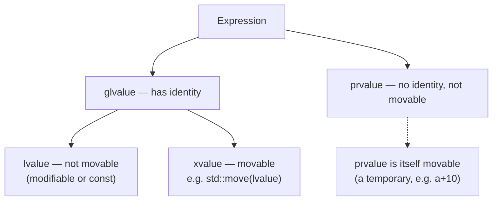

## Definition

Every C++ expression has a **value category** (*Wertkategorie*) that determines what can be done with it: whether it names a persistent memory location, whether that location can be modified, and whether its contents may be "stolen" rather than copied. The base distinction is between **L-values** (*L-Werte*) and **R-values** (*R-Werte*), refined by the **GL-value / PR-value / X-value** classification along two orthogonal properties: *identity* and *movability*.

## Problem it solves

C++ needs a way to tell the compiler "this temporary object is about to be discarded anyway, so you are allowed to cannibalize its internals instead of copying them." Overload resolution (e.g. choosing between a copy constructor and a move constructor, see [[concepts/move-semantics]]) is driven entirely by the value category of the argument expression, not by its static type.

## The basic distinction (§0.4.4.10)

- **L-value (L-Wert)**: an expression that refers to a *contiguous memory region* (*zusammenhängender Speicherbereich*), with or without a name — e.g. something created with `new`, or a dereferenced expression such as `*p[a+10]`. L-values may be modifiable or constant; a *constant* L-value cannot stand on the left of an assignment.
- **R-value (R-Wert)**: an expression that is **not** an L-value — e.g. a temporary such as `a+10`.

An L-value can be *turned into* an R-value reference explicitly via `std::move(lVar)`, which is identical to `static_cast<X&&>(lVar)` for an `lVar` of type `X` (see [[concepts/move-semantics]]).

## Identity and movability (§0.4.4.13)

- **Identity** (*Identität*): an object has identity if it can be named, pointed to, or referenced (a **GL-value**, generalized lvalue), so that two occurrences can be checked for equality, or one occurrence can be observed to change. A **PR-value** (pure R-value) has no identity.
- **Movability** (*Verschiebbarkeit*): a *movable* object (an R-value) possesses dynamic content that can be moved out of it, leaving the original in a valid-but-unspecified state, rather than being copied.

These two properties cross-classify into the full value-category matrix:

| | GL-value (has identity) | PR-value (no identity) |
|---|---|---|
| **R-value (movable)** | **X-value**: `std::move(L-value)` | pure R-value |
| **not movable** | **L-value**: modifiable or `const` | — |



> [!note] Terminology note
> glvalue and xvalue are both *rvalue* in the coarse L/R split used in §0.4.4.10: `rvalue = prvalue ∪ xvalue`. The notes group the finer classification by two axes (identity, movability) rather than drawing the standard three-leaf "glvalue/rvalue → lvalue/xvalue/prvalue" tree directly, so the diagram above renders the matrix from §0.4.4.13 as a tree to match that source.

## Minimal code example

```cpp
int a = 7;
int& lv = a;           // a is an lvalue
int&& xv = std::move(a); // std::move(a) is an xvalue: has identity (names a),
                          // but is movable
int   pv = a + 10;       // a+10 is a prvalue: a temporary, no identity
```

## Consequences / trade-offs

- Whether a copy constructor or move constructor is selected for a function argument depends purely on the argument expression's value category, not on its declared type — this is why `std::move(x)` is needed to make an otherwise-named (lvalue) object `x` bind to an R-value-reference parameter.
- A `const` L-value cannot appear on the left of an assignment, but it can still bind to `const T&` parameters.

## Misuse & anti-patterns

- Assuming `std::move` performs any action at runtime — it is purely a compile-time cast to an R-value reference; see [[concepts/move-semantics]] for the full consequence of that distinction.
- Confusing "temporary" (prvalue) with "has no name" — an xvalue also has no name at the call site (`std::move(a)`) yet does have identity, because it still denotes the storage of `a`.

## Related

- [[concepts/move-semantics]]
- [[concepts/assignment-operator]]
- [[concepts/copy-constructor]]
- [[concepts/pointers-and-references]]
- [[concepts/parameter-passing]]

## Sources

- [[sources/grigat-cpp-concepts-generic]] §0.4.4.10, §0.4.4.13
