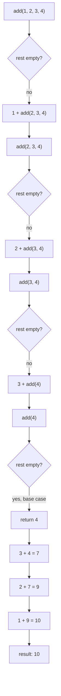

## Definition

A variadic template (*variadisches Template*) is a [[concepts/templates|template]]
that accepts a **variable number** of template parameters, collected into a
**parameter pack** (*Parameterpack*). A **template parameter pack**
(`template<typename ...T>`) holds the types of the variable template parameters;
a corresponding **function parameter pack** (`void g(Types ...args){}`) holds the
associated function parameters. `g()` can then be called with `n ≥ 0` arguments
of (possibly) different types.

## Problem it solves

Without variadic templates, a function that must accept an arbitrary number of
heterogeneous arguments (e.g. a generic sum, a `printf`-like formatter, or
`std::make_shared`'s forwarding constructor) would need to be overloaded by hand
for every argument count. Variadic templates let the compiler generate exactly
the overload needed for the arguments actually passed.

## Parameter packs (§0.5.2.10)

```cpp
template<typename ...Types>
void g(Types ...args){ /* Funktionsblock */ }
```

The trailing dots after the parameter-pack name in a call, `g(args...)`, are
expanded by the compiler into the list of call parameters, e.g.
`g(args1, args2, args3)`.

## Recursive unpacking (§0.5.2.11)

Recursive unpacking (*rekursives Entpacken*) of a variadic function requires
**two** overloads:

- a **base case** (*Basisfall*) without a parameter pack,
- a **general case** (*allgemeiner Fall*) with a parameter pack, which calls
  itself recursively with one fewer argument each time, until the base case is
  reached.

```cpp
template<typename T>                      // Basisfall
T add(const T& a){return a;}
template<typename T, typename ... Args>   // Rekursion
T add(const T& first, const Args& ...rest)
{return first + add(rest...);}
int main(){
    cout << add(1, 2, 3, 4) << endl; // 10
    string s1 ="Sonnen", s2 ="blumen", s3 ="kerne";
    cout << add(s1, s2, s3) << endl; // Sonnenblumenkerne
    return 0; }
// Beispiel: KP32_4_variadicTemplates
```

### Numbered pseudocode

```
1. function add(first, rest...):
2.     if rest is empty (base case, matches add(const T& a)):
3.         return first
4.     else (general case):
5.         return first + add(rest...)   // recursive call with one fewer argument
```

### Flowchart of the recursion peeling off parameters



Each recursive call strips off the first argument (`first`) and calls `add`
again with the remaining pack (`rest...`), which is one element shorter; this
continues until the single-argument base-case overload `add(const T& a)` is the
best match and the recursion terminates. This mechanism relies on the same
[[concepts/function-overloading]] resolution rules that govern ordinary
[[concepts/templates]] overloads (§0.5.2.8–9): the compiler picks the
single-argument non-pack overload over the pack overload once only one argument
remains, because it is the more specialized (and non-variadic) match.

## Consequences / trade-offs

- Enables type-safe, arbitrary-arity functions without `va_arg`/`...` C-style
  varargs, and without losing type information.
- The recursive-unpacking pattern generates one function instantiation per
  pack length actually used in the program — compile-time cost can grow with
  the number of distinct call-site arities.
- Requires careful overload design: omitting the base case causes infinite
  template recursion (a compile error once recursion depth limits are hit).

## Misuse & anti-patterns

- Forgetting the base-case overload (`add(const T& a)`), which makes the
  general case recurse until the pack is empty with no matching overload to
  stop on, yielding template instantiation-depth errors.
- Relying on parameter-pack argument order for side effects — expansion order
  of `args...` within a single expression is unspecified in older standards
  outside of certain contexts.

## Related

- [[concepts/templates]]
- [[concepts/template-specialization]]
- [[concepts/function-overloading]]
- [[concepts/standard-library]]

## Sources

[[sources/grigat-cpp-concepts-generic]] §0.5.2.10, §0.5.2.11
