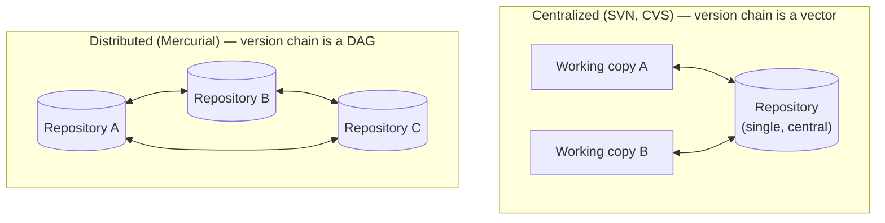
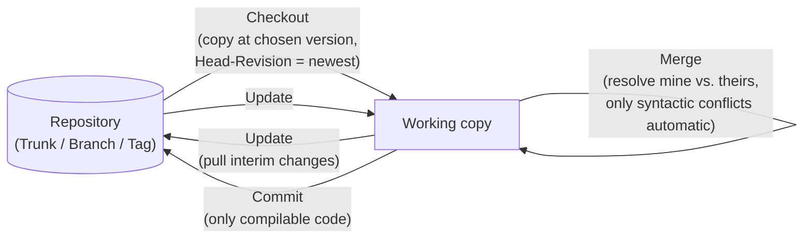

## Definition

**Version control** (*Versionsverwaltung*) is the logging (*Protokollierung*)
of changes to documents or files — especially source code, office
applications, and content-management systems — recorded with a timestamp,
user identification, and comment: who changed *what*, *when*, and *why*.

## Problem it solves

Without version control, nothing is ever truly undoable and parallel work by
multiple people on the same files is error-prone. Version control:

- Forgets nothing: it enables restoration of **all** stored versions, even
  ones a user has marked as deleted.
- Archives the development version (**Trunk**) and customer-delivered versions
  (**Branch**, **Tag**) in the archive (**Repository**); trunk and branches
  can then be developed independently.
- Provides **Merge**: combining versions as needed.
- Keeps transfer times short by only transmitting the differences (diffs) of
  documents, not whole copies.

## Centralized vs. distributed version control

- **Zentrale Versionsverwaltung** (centralized version control, e.g. SVN,
  CVS): runs on client-server systems; access to the server is via rights
  management, e.g. over a network; version history exists only in the
  repository. The version chain is a **vector**.
- **Verteilte Versionsverwaltung** (distributed version control, e.g.
  Mercurial): has no central repository. Each project member has their own
  repository and can synchronize it with any other repository. Version
  history is distributed, not central. The version chain is a **directed
  acyclic graph (DAG)**.

## Locking vs. merging models

- **Lock Modify Write** (pessimistic version control): locks a file for
  editing and releases it afterward. No merging of changes is required, but
  only one user at a time is allowed. Examples: Revision Control System,
  Visual SourceSafe. Typical for binary files.
- **Copy Modify Write** (optimistic version control): enables parallel editing
  by multiple users. Changes are merged afterward, automatically or manually
  (**Merge**).

### The checkout / commit / update cycle

## Apache Subversion (SVN)

SVN (*Apache Subversion*) is a centralized, successor to CVS, version control
system; it allows moving and copying documents without losing version
history, and revision numbers capture all changes of a commit command. On
Windows it has good support via **TortoiseSVN** (tortoisesvn.net) and
**TortoiseMerge**, with no separate SVN installation required. The working
copy is managed in the `.svn` folder — do not delete it, it holds copies of
file originals and all change steps. SVN locks the working copy while running
its commands:

- **Checkout**: create a local working copy of the document — a local
  directory into which the chosen repository directory is copied. Requires
  specifying both directories plus the version to copy. The newest version is
  the **Head-Revision**.
- **Add**: new files must be explicitly placed under SVN version control;
  they are only saved with **Commit** once known to the repository via
  **Add**.
- **Ignore**: explicitly exclude temporary files and intermediate versions
  from version control.
- **Copy, Rename, Delete, Move**: use SVN's own commands, not Explorer
  commands — otherwise SVN restores e.g. deleted files on Update. Changes are
  only saved with **Commit**. Directories should not be copied within the
  working copy (linear effort O(n)) but only on the server (constant effort
  O(1), since only a new reference is created — a *cheap copy*, *billige
  Kopie*).
- **Update**: refresh the local working copy with interim changes from the
  repository.
- **Merge**: during **Update**, conflicts can occur between local changes
  (*mine*) and repository changes (*theirs*); these must be resolved in the
  local copy. Only **syntactic** conflicts can be resolved automatically —
  not **semantic** conflicts.
- **Commit**: locally changed files are taken over into the repository as the
  current version. Every Commit should be immediately preceded by an
  **Update** and, if necessary, a **Merge**. Only compilable source code
  should be committed — no versions with compiler or linker errors.
- **Branch/Tag**: a new branch (*Zweig*) is created, e.g. for a
  customer-delivered version or a new development line. **Tag** marks a
  version.
- **Switch**: switching between versions (Trunk, Branches).
- **Check for modifications**: status query of the current changes in the
  local copy.
- **Cleanup**: SVN first writes operations into a log file
  (*Protokolldatei*) and executes them from there; Cleanup executes any
  remaining operations from that log (if still present after a crash or
  process termination) and then removes locks on the working copy.

## Mercurial

Mercurial is a platform-independent, **distributed** version control system
for software development. The user works on a local copy of the repository
and can execute all repository operations on that local copy. Synchronization
happens between copies of the repository, or with a server repository.
Graphical support for Windows is available, e.g. via **TortoiseHg**.

## Consequences / trade-offs

- Centralized systems have a single authoritative history (simpler mental
  model, needs network/server access) vs. distributed systems where every
  clone is a full repository (works offline, but history is a DAG rather than
  a simple chain, which can be harder to reason about).
- Lock-Modify-Write avoids merge conflicts entirely but serializes all editors
  of a file; Copy-Modify-Write allows parallelism at the cost of needing a
  merge step, some of which (semantic conflicts) can never be fully
  automated.

## Misuse & anti-patterns

- Copying, renaming, deleting, or moving files with Explorer instead of SVN's
  own commands — SVN will not see the change and may restore deleted files on
  the next Update.
- Committing code that does not compile — every Commit should leave the
  repository in a buildable state.
- Deleting the `.svn` working-copy metadata folder.

## Related

- [[concepts/uml-overview]]
- [[concepts/modularization-and-build-pipeline]]
- [[patterns/design-patterns-overview]]

## Open questions

- The notes do not elaborate on Mercurial's commands (equivalents of
  Checkout/Add/Commit/Merge) the way they do for SVN — only its general
  distributed, platform-independent properties and TortoiseHg are mentioned.

## Sources

[[sources/grigat-uml-patterns]] §0.7.7.1, §0.7.7.2, §0.7.7.3
