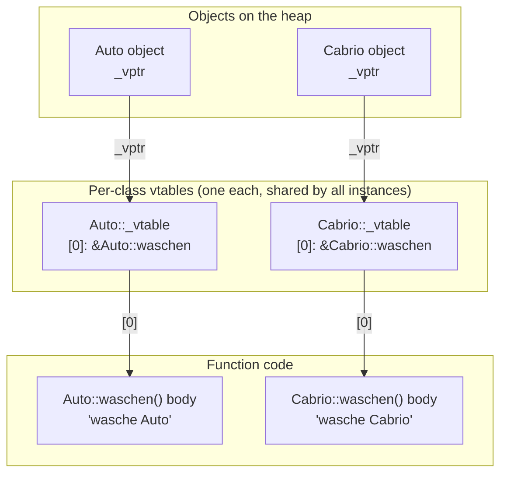

The vtable (virtual method table) is the hidden, per-class array of function
pointers that makes [[concepts/polymorphism]] work: every object of a
polymorphic class carries a hidden pointer (`_vptr`) to its class's vtable, so
the correct override can be found at runtime.

## Core idea

Only classes with at least one `virtual` function get a vtable at all. When
such a class is instantiated, the compiler stores an invisible pointer in
every instance pointing at the vtable belonging to the object's *actual*
class. A virtual call is then resolved by following that pointer and jumping
through the appropriate entry — this is precisely what lets a base-type
pointer invoke the derived-class override ("late binding").

## Memory layout: two derived classes sharing a base



Every instance only stores the 8-byte (on a 64-bit system) `_vptr`; the
`_vtable` array itself exists exactly once per *class*, not once per object.

## Illustrative pseudocode (NOT real C++)

The script explicitly marks the following as pseudocode to illustrate the
mechanism, not compilable C++:

Base class vtable:

```cpp
// auto.cpp
class Auto
{
public:
    virtual void waschen(){cout << "wasche Auto" << endl;}
    // Pseudocode - KEIN C++!
    // Initialisiere Zeiger d. Instanz auf vtable
    Auto():_vptr(&Auto::_vtable[0]){};
    FunctionPtr* _vptr;
    // Erzeuge eine Liste von FunctionPtr
    // der Länge 1 mit einem Zeiger auf
    // die Funktion Auto::waschen
    FunctionPtr _vtable[0] = {&Auto::waschen};
};
```

Derived class vtable:

```cpp
// cabrio.cpp
class Cabrio : public Auto
{
public:
    void waschen(){cout << "wasche Cabrio" << endl;}
    // Pseudocode - KEIN C++!
    // Initialisiere Zeiger d. Instanz auf vtable
    Cabrio():_vptr(&Cabrio::_vtable[0]){};
    FunctionPtr* _vptr;
    // Erzeuge eine Liste von FunctionPtr
    // der Länge 1 mit einem Zeiger auf
    // die Funktion Cabrio::waschen
    FunctionPtr _vtable[0] = {&Cabrio::waschen};
};
```

Each class gets its *own* vtable (one `FunctionPtr` array per class, here of
length 1, holding a pointer to that class's own `waschen`). Each *instance*
only stores the `_vptr` pointer to its class's vtable, not a copy of the
vtable itself.

## Invisible use at a call site

```cpp
int main()
{
    // _vptr wird auf die vtable von Auto gesetzt
    Auto* automobil = new Auto();
    // _vptr wird auf die vtable von Cabrio gesetzt
    Auto* cabrio = new Cabrio();
    // Wird übersetzt als automobil->_vptr[0], also Auto::waschen
    automobil->waschen();
    // Wird übersetzt als cabrio->_vptr[0], also Cabrio::waschen
    cabrio->waschen();
}
```

Output:

```
wasche Auto
wasche Cabrio
```

Both `automobil` and `cabrio` are held through the same static pointer type
`Auto*`, yet each call dispatches through that object's own `_vptr` to the
vtable of its *actual* class — the programmer never writes `_vptr` or
`_vtable` directly; the compiler generates and uses them invisibly.

### Procedure: the dispatch walk for `cabrio->waschen()`

1. Compiler sees `waschen` is `virtual` and the call is through a pointer — defer to runtime; it does **not** know at compile time which function body will run.
2. At runtime, load `cabrio`'s hidden `_vptr` field (set once, at construction, to `&Cabrio::_vtable[0]`).
3. Index into the vtable it points to: `waschen`'s slot is fixed at compile time (e.g. slot `0`), so look up `_vptr[0]`.
4. That slot holds `&Cabrio::waschen` — because `cabrio` was actually constructed as a `Cabrio`, even though the pointer's declared type is `Auto*`.
5. Call the function address found in step 4, passing `cabrio` as the implicit `this`.
6. `Cabrio::waschen` executes and prints `"wasche Cabrio"`.

Repeating the same five steps for `automobil->waschen()` instead loads
`automobil`'s `_vptr`, which points at `Auto::_vtable`, whose slot `0` holds
`&Auto::waschen` — hence `"wasche Auto"`. Same call-site code, different
runtime data, different function — the essence of late binding.

## Runtime / memory cost

- A vtable is created **only** for classes with at least one virtual
  function — non-polymorphic classes pay nothing for this mechanism.
- Every instance of a polymorphic class carries the extra hidden `_vptr`
  member, increasing object size.
- Every virtual call goes through an extra pointer indirection (instance →
  `_vptr` → vtable entry → function) compared to a direct (statically bound)
  call — this is the per-call runtime cost of late binding.
- This is also why non-virtual calls resolve purely by the pointer's static
  type at compile time and carry none of this cost — and why "overriding" a
  non-virtual function does not participate in this mechanism at all; see the
  pitfall in [[concepts/polymorphism]].
- [[concepts/templates]] sidestep this indirection entirely: a template
  instantiated for a concrete type calls that type's function directly, with
  no `_vptr`, no vtable, and (often) full inlining — the "zero-overhead"
  compile-time alternative to runtime dispatch, at the cost of needing the
  concrete type known at compile time and one code copy per instantiation.

## Related

- [[concepts/polymorphism]]
- [[concepts/overriding-vs-overloading]]
- [[concepts/abstract-class]]
- [[concepts/memory-model]]
- [[concepts/templates]]

## Sources

- [[sources/grigat-oop-teil1]] §0.3.7.9
- [[sources/grigat-oop-teil1]] §0.3.7.10
- [[sources/grigat-oop-teil1]] §0.3.7.11
