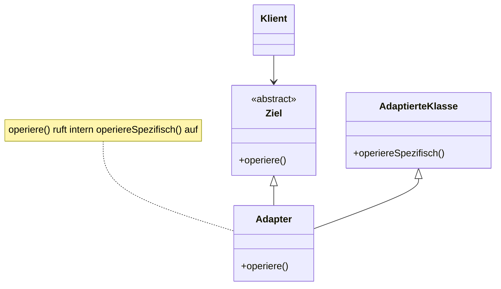
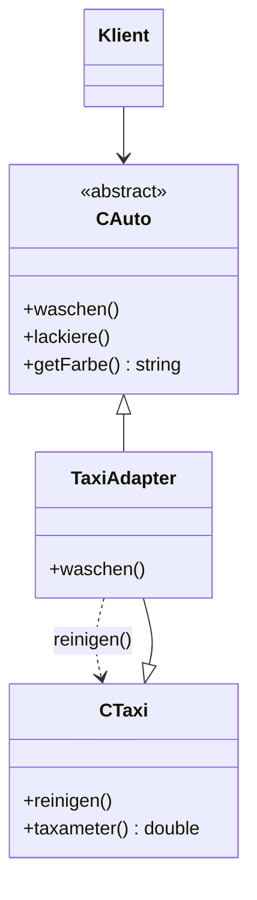

## Intent

The **Adapter** pattern (*Adapter*, häufig auch **Wrapper** genannt) is a
structural pattern (*Strukturmuster*) that enables the use of an interface
that does not match the one required (*Ermöglicht die Verwendung einer
Schnittstelle, die nicht der benötigten Schnittstelle entspricht*). `Adapter`
inherits from the interface used by the client (*Klient*) and from the
interface to be adapted (*zu adaptierenden Schnittstelle*). Calling an
operation on the `Adapter` causes a specific operation (*spezifische
Operation*) of the adapted class to be called.

## Structure



*Abbildung 41: UML-Klassendiagramm: Adapter.* `Ziel` is an abstract class
(italicized operation `operiere()` in the original figure — see
[[concepts/abstract-class]]). `Adapter` realizes `Ziel` and also inherits
from `AdaptierteKlasse`, i.e. multiple inheritance in the diagram. A note
attached to `Adapter` records the internal mapping: `operiere()` calls
`operiereSpezifisch()` internally.

## Participants

| Role | Responsibility |
|---|---|
| `Klient` (Client) | Uses objects through the `Ziel` interface. |
| `Ziel` (Target) | Abstract interface the client expects; declares `operiere()`. |
| `AdaptierteKlasse` (Adaptee) | The existing class with an incompatible interface, offering `operiereSpezifisch()`. |
| `Adapter` | Inherits from `Ziel` to satisfy the client's expected interface, and inherits from `AdaptierteKlasse` to reuse its implementation; translates a call to `operiere()` into a call to `operiereSpezifisch()`. |

## Collaboration

1. `Klient` calls `operiere()` on an object it believes implements `Ziel`.
2. If that object is actually an `Adapter`, its `operiere()` implementation
   runs.
3. `Adapter::operiere()` internally calls `operiereSpezifisch()`, which it
   inherited from `AdaptierteKlasse`.
4. The adapted class's behavior is thus made available through the
   interface the client expects, without modifying either `Klient` or
   `AdaptierteKlasse`.

## Example

§0.7.3.2 *Beispiel zu Adapter*. Setup: a purchased/third-party library
(*Zugekaufte Bibliothek*) contains the class `CTaxi`. `CTaxi` contains the
method `reinigen()` (to clean), which corresponds to method `waschen()`
(to wash) in class `CAuto`. The source code of `CTaxi` is not available and
its interface cannot be changed (*Quellcode von CTaxi ist nicht verfügbar,
Schnittstelle kann nicht verändert werden*).

```cpp
//ctaxi.hpp
class CTaxi
{
  public:
    CTaxi();
    ~CTaxi();
    void reinigen();
    double taxameter();
  private:
    double m_taxameter;
};
```



*Abbildung 42: UML-Klassendiagramm: Adapter-Beispiel.* The dashed arrow with
note `reinigen()` shows that `TaxiAdapter::waschen()` internally calls
`CTaxi::reinigen()`.

```cpp
//cauto.hpp
class CAuto
{
  public:
    CAuto();
    CAuto(std::string farbe);
    virtual ~CAuto();
    virtual std::string getFarbe();
    virtual void lackiere(std::string farbe);
    virtual void waschen() = 0;
  private:
    std::string m_farbe;
};
```

`CAuto` is an abstract class (*Abstrakte Klasse*, see
[[concepts/abstract-class]]); `waschen()` is a pure virtual function
(*rein virtuelle Funktion*).

```cpp
//ctaxiadapter.hpp
class CTaxiAdapter :
  public CAuto,
  private CTaxi
{
public:
  CTaxiAdapter();
  ~CTaxiAdapter();
  void waschen();
};
```

`CTaxiAdapter` inherits **publicly** from `CAuto` (so it satisfies the
client's expected interface) and **privately** (*private Vererbung*) from
`CTaxi` (so it can reuse `CTaxi`'s implementation without exposing it). Because
of private inheritance, methods of `CTaxi` are **not accessible** through
`CTaxiAdapter` from outside (*Methoden von CTaxi sind nicht über
CTaxiAdapter ansprechbar*). See [[concepts/inheritance]].

```cpp
//ctaxiadapter.cpp
CTaxiAdapter::CTaxiAdapter():
  CAuto("taxigelb")
{}
CTaxiAdapter::~CTaxiAdapter()
{}
void CTaxiAdapter::waschen()
{
  CTaxi::reinigen();
}
```

The constructor of `CAuto` is passed the color string `"taxigelb"`
(taxi-yellow). `waschen()` calls `reinigen()` from `CTaxi` — i.e. the
adapter translates the `waschen()` call into the adaptee's `reinigen()`
call.

```cpp
//main.cpp
CAuto *taxi = new CTaxiAdapter;   // Polymorphie ("Upcast")
taxi->waschen();
cout << taxi->getFarbe() << endl;
//cout << taxi->taxameter() << endl; // Compilerfehler
delete taxi;
```

## Consequences

Stated as a wrap-up (§0.7.3.2) of the worked example:

- `CAuto*` can hold a pointer to `CTaxiAdapter`, because `CAuto` is its base
  class — an instance of [[concepts/polymorphism]] ("Upcast").
- `waschen()` calls `reinigen()` via the adapter.
- `getFarbe()` calls the method inherited from `CAuto`.
- Calling `taxameter()` on the adapter pointer is **not allowed**:
  - `CAuto` is **not** a base class of `CTaxi`.
  - The inheritance from `CTaxi` to `CTaxiAdapter` is private.
- Don't forget `delete`! (*delete nicht vergessen!*)

## Misuse & anti-patterns

Not stated by the source.

## Related

- [[concepts/abstract-class]]
- [[concepts/inheritance]]
- [[concepts/polymorphism]]
- [[patterns/proxy]]
- [[patterns/strategy]]
- [[patterns/design-patterns-overview]]

## Sources

[[sources/grigat-uml-patterns]] §0.7.3, §0.7.3.1, §0.7.3.2

## Open questions

- The initial Adapter notes (uml-a, printed p. 192) describe the setup of
  the `CTaxi`/`CAuto` example but the code was only completed on the
  following pages (uml-b, printed pp. 193–195), transcribed here in full;
  no further Adapter content beyond this worked example and its wrap-up
  bullets is present in the source.
