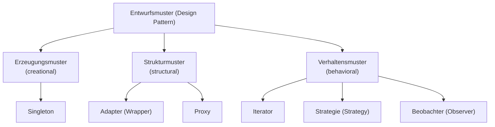

## Definition

A **design pattern** (*Entwurfsmuster*) is a "description of collaborating
objects and classes that are tailored to solve a general design problem in a
particular context" (*"Beschreibung zusammenarbeitender Objekte und Klassen,
die maßgeschneidert sind, um ein allgemeines Entwurfsproblem in einem
bestimmten Kontext zu lösen"*).

## Problem it solves

Facing a concrete programming task, a developer can fall back on an
already-known, named pattern instead of "reinventing the wheel"
(*"das Rad neu zu erfinden"*). Patterns describe a solution for a whole
**class** of problems, not a single instance, and give that solution a name
that lets designers discuss software design at a higher level of abstraction.

## The GoF book

The standard reference (*Standardwerk zu Softwaredesign*) is Erich Gamma,
Richard Helm, Ralph Johnson, John Vlissides, *"Design Patterns: Elements of
Reusable Object-Oriented Software"* (German: *"Entwurfsmuster: Elemente
wiederverwendbarer objektorientierter Software"*) — commonly called the
"Gang of Four" (GoF) book. It describes 23 design patterns, intended as a
**catalog** (*Katalog*) for finding and applying a suitable pattern to a
concrete task.

## The four-part structure

Each pattern in the GoF catalog consists of four elements:

1. **Mustername** (pattern name) — a standardized name that enables
   discussing software design at a higher level of abstraction.
2. **Problemabschnitt** (problem section) — describes when the pattern is to
   be applied.
3. **Lösungsabschnitt** (solution section) — an abstract description using
   classes and objects.
4. **Konsequenzenabschnitt** (consequences section) — contrasts the
   advantages and disadvantages (*Vor- und Nachteile*) of the pattern.

## Classification by task

The script groups patterns by task (*Einteilung nach Aufgabe*) into three
categories:

- **Erzeugungsmuster** (creational patterns) — describe how an object can be
  created, independent of concrete data types. Example named by the script:
  [[patterns/singleton|Singleton]] — allows at most one object of a class to
  exist.
- **Strukturmuster** (structural patterns) — describe how classes or objects
  can be linked with one another. Examples named by the script:
  [[patterns/adapter|Adapter (Wrapper)]] — adapts an interface to one expected
  by another object; [[patterns/proxy|Proxy]] — controls access to an object
  via a placeholder object placed in front of it (*vorgelagertes Objekt*).
- **Verhaltensmuster** (behavioral patterns) — encapsulate algorithms or deal
  with the interaction of objects. Examples named by the script: **Iterator**
  (see [[concepts/iterators]]) — sequentially accesses elements of a composite
  object; [[patterns/strategy|Strategie (Strategy)]] — defines a family of
  interchangeable, encapsulated algorithms; [[patterns/observer|Beobachter
  (Observer)]] — defines a 1-to-n dependency between objects so that, on
  change of one object, all dependent objects are notified and updated.

Only the five patterns covered in detail by this script are
[[patterns/singleton|Singleton]], [[patterns/adapter|Adapter]],
[[patterns/proxy|Proxy]], [[patterns/strategy|Strategy]] and
[[patterns/observer|Observer]]; **Iterator** is only named as a classification
example (see [[concepts/iterators]] for the C++ iterator concept itself, which
is not the same material as the GoF Iterator pattern).

## Consequences / trade-offs

The script does not give general consequences for patterns as a whole — the
four-part structure above states that the consequences section is specific to
*each* pattern (advantages vs. disadvantages per pattern), not a blanket
statement about patterns in general. See the consequences sections of the
individual pattern pages.

## Misuse & anti-patterns

Not stated by the source for this introductory section.

## Related

- [[patterns/singleton]]
- [[patterns/adapter]]
- [[patterns/proxy]]
- [[patterns/strategy]]
- [[patterns/observer]]
- [[concepts/iterators]]
- [[concepts/uml-class-diagram]]
- [[concepts/uml-overview]]

## Sources

[[sources/grigat-uml-patterns]] §0.7.1, §0.7.1.1, §0.7.1.2, §0.7.1.3, §0.7.1.4

## Open questions

- The script names **Iterator** only as a classification example; it is not
  worked out as a full pattern page in this source range.
- No general (pattern-independent) consequences/misuse guidance is given by
  the source beyond "each pattern has its own consequences section" — do not
  infer generic pattern-literature wisdom not stated here.
