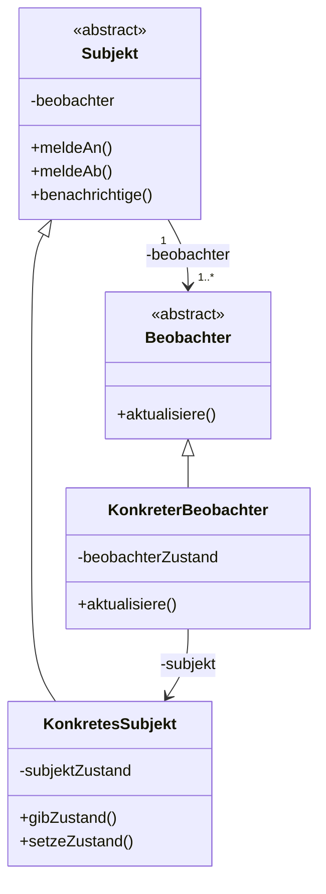
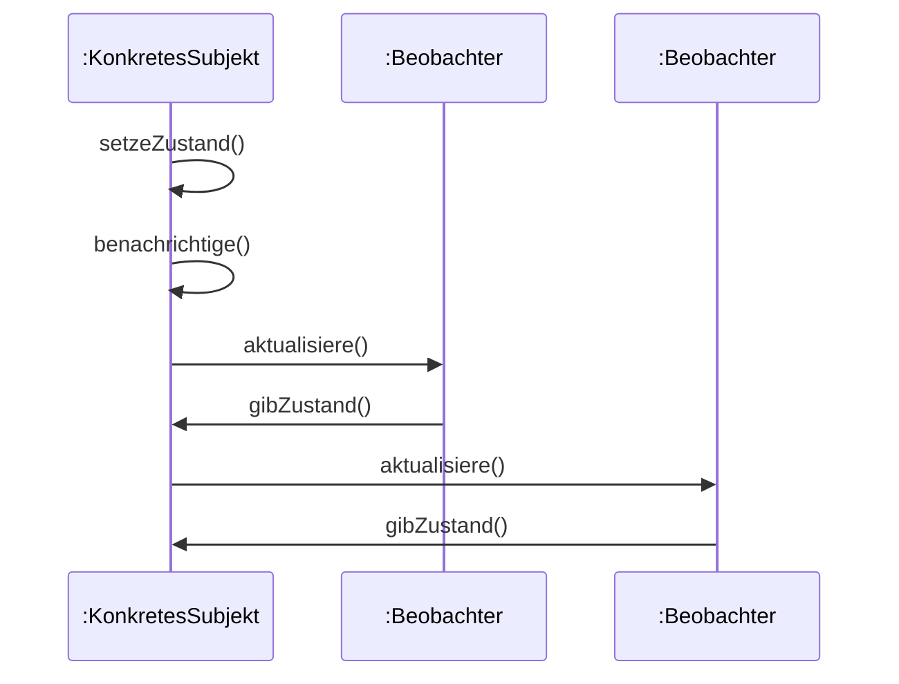
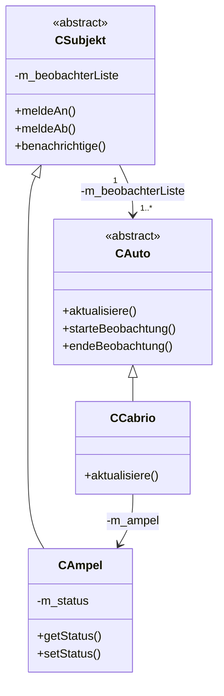

## Intent

The **Observer** pattern (*Beobachter*) is a behavioral pattern
(*Verhaltensmuster*) that defines a 1-to-n dependency between objects
(*1-zu-n-Abhängigkeit zwischen Objekten*): a change of state in one object
is communicated to all other participating objects (*Änderung des Zustands
eines Objektes wird allen anderen beteiligten Objekten mitgeteilt*).

## Structure



*Abbildung 47: UML-Klassendiagramm: Beobachter.* `Subjekt` and `Beobachter`
are abstract classes (see [[concepts/abstract-class]]). Notes attached to
methods in the original figure: `Subjekt::benachrichtige()` — "für alle b in
beobachter: b->aktualisiere()"; `KonkreterBeobachter::aktualisiere()` —
"beobachterZustand = subjekt->gibZustand()".

## Participants

| Role | Responsibility |
|---|---|
| `Subjekt` (Subject) | Knows its observers (*Kennt seine Beobachter*). Can be observed by arbitrarily many observers (*Wird von beliebig vielen Beobachtern beobachtet*). Offers an interface for registering and deregistering observers (*Bietet Schnittstelle zum An- und Abmelden von Beobachten*): `meldeAn()`, `meldeAb()`, `benachrichtige()`. |
| `Beobachter` (Observer) | Defines the update interface `aktualisiere()` for objects that are to be notified about changes of a subject. |
| `KonkretesSubjekt` (ConcreteSubject) | Stores the state relevant to `KonkreterBeobachter` as `subjektZustand`. Notifies observers when the state changes, via `benachrichtige()`. |
| `KonkreterBeobachter` (ConcreteObserver) | Maintains a reference to `KonkretesSubjekt`. Stores the state of the subject. Implements the update interface `aktualisiere()`. |

## Collaboration

Sequence diagram of the notify flow (Abbildung 48, §0.7.6.3):



`setzeZustand()` is called on `KonkretesSubjekt`, which internally calls
`benachrichtige()` (self-call); `benachrichtige()` in turn calls
`aktualisiere()` on each registered `Beobachter`; each `Beobachter` calls
back `gibZustand()` on the subject to pull its new state.

Numbered pseudocode of the collaboration (based on Abbildung 48/49 and the
example code below):

```
1. Client creates one or more concrete observers (e.g. CCabrio, CTaxiAdapter)
   and one concrete subject (CAmpel).
2. Each observer calls starteBeobachtung(subject), which stores the subject
   pointer and calls subject->meldeAn(this) to register itself in the
   subject's observer list.
3. Some external event causes subject->setStatus(newStatus) to be called.
4. setStatus() updates the subject's internal state and calls
   benachrichtige().
5. benachrichtige() iterates over the observer list and calls
   aktualisiere() on each registered observer.
6. Each observer's aktualisiere() calls back subject->getStatus() (or
   similar getter) to pull the new state and reacts accordingly.
7. When no longer interested, an observer calls endeBeobachtung(), which
   calls subject->meldeAb(this) to remove itself from the list and resets
   its subject pointer to nullptr.
```

## Example

§0.7.6.4 *Beispiel zu Beobachter*: "Autos beobachten Ampel" (cars observe a
traffic light).



*Abbildung 49: UML-Klassendiagramm: Beobachter-Beispiel.* Notes:
`CSubjekt::benachrichtige()` → "für alle b in beobachter: b->aktualisiere()";
`CAmpel::setStatus()` calls `benachrichtige()`; `CCabrio::aktualisiere()` →
"m_ampel->getStatus()".

```cpp
//cauto.hpp
class CAuto
{
  public:
    CAuto();
    virtual ~CAuto();
    virtual void aktualisiere() = 0; // rein virtuell
    virtual void starteBeobachtung(CAmpel* ampel); // benötigen CSubjekt
    virtual void endeBeobachtung();                // und CAmpel
  protected:  // besser wäre private: sowie getValue(), setValue() Methoden
    CAmpel* m_ampel;
};
```

`CAuto` is the abstract observer base class (*Abstrakte Klasse*); it offers
the interface `aktualisiere()` for updating observing objects, and
`m_ampel` is a pointer to the object being observed (`KonkretesSubjekt`,
resp. `CAmpel`).

```cpp
//cauto.cpp
CAuto::CAuto() :
m_ampel(nullptr)
{}
CAuto::~CAuto()
{}
void CAuto::starteBeobachtung(CAmpel* ampel)
{
  m_ampel = ampel;
  m_ampel -> meldeAn(this); // in beobachterListe eintragen
}
void CAuto::endeBeobachtung()
{
  m_ampel -> meldeAb(this); // aus beobachterListe löschen
  m_ampel = nullptr;
}
```

`meldeAn` adds a pointer to the current object (`this`) to
`beobachterListe` in `CSubjekt`; `m_ampel` is `nullptr` when no traffic
light is being observed.

```cpp
//csubjekt.hpp
class CAuto;// Ringförmige Abhängigkeit der Klassen in Beobachter-Muster,
            // daher hier zusätzliche Deklaration von CAuto nötig
class CSubjekt
{
  public:
    virtual ~CSubjekt();
    virtual void meldeAn(CAuto* beobachter); // benötigt CAuto, also
    virtual void meldeAb(CAuto* beobachter); // ringförmige Abhängigkeit
    virtual void benachrichtige();
  protected:
    CSubjekt();
  private:
    std::list<CAuto*> m_beobachterListe;
};
```

Because `CSubjekt` needs pointers to `CAuto` and `CAuto` needs a pointer to
`CAmpel` (derived from `CSubjekt`), there is a circular dependency
(*Ringförmige Abhängigkeit*) requiring the forward declaration
`class CAuto;`. `CSubjekt`'s constructor is `protected` (abstract base,
only derivable). Observing objects are stored in `m_beobachterListe`.

```cpp
// CSubjekt.cpp
CSubjekt::CSubjekt()
{}
CSubjekt::~CSubjekt()
{}
void CSubjekt::meldeAn(CAuto* beobachter)
{
  m_beobachterListe.push_back(beobachter);
}
void CSubjekt::meldeAb(CAuto* beobachter)
{
  m_beobachterListe.remove(beobachter);
}
void CSubjekt::benachrichtige()
{
  list<CAuto*>::iterator pos;
  for (pos = m_beobachterListe.begin(); pos!=m_beobachterListe.end(); ++pos)
  {
    (*pos)->aktualisiere();
  }
}
```

`meldeAn` adds an observer to the list; `meldeAb` removes an observer from
the list; `benachrichtige()` calls `aktualisiere()` for all observers
(using an [[concepts/iterators|iterator]] over `std::list`).

```cpp
enum AmpelStatus {ROT, GRUEN};
  //Aufzählungstyp: ROT = 0, GRUEN =1

class CAmpel: public CSubjekt
{
  public:
    CAmpel();
    virtual ~CAmpel();
    virtual AmpelStatus getStatus() const;
    virtual void setStatus(AmpelStatus);
  private:
    AmpelStatus m_status;
};
```

`CAmpel` inherits from `CSubjekt`. The state of `CAmpel` can be changed via
`setStatus`, which must call `benachrichtige()` from `CSubjekt` so that all
observers get updated.

```cpp
//campel.cpp
CAmpel::CAmpel():
  m_status(ROT)
{}
CAmpel::~CAmpel()
{}
AmpelStatus CAmpel::getStatus() const
{
  return m_status;
}
void CAmpel::setStatus(AmpelStatus status)
{
  m_status = status;
  benachrichtige();// bewirkt Aktualisierung aller Autos
                    // Definiert in CSubjekt (Basisklasse von CAmpel)
}
```

```cpp
class CCabrio : public CAuto
{
  public:
    CCabrio();
    virtual ~CCabrio();
    virtual void aktualisiere();
};

CCabrio::CCabrio()
{}
CCabrio::~CCabrio()
{}
void CCabrio::aktualisiere()
{
  cout << "Cabrio: neuer Ampelstatus: " ;
  cout <<  m_ampel->getStatus() << endl;
}
```

`aktualisiere` performs the necessary operations after a state change of the
`KonkretesSubjekt`; local storage of the new state can also happen here.

```cpp
//main.cpp
CCabrio cabrio;
CTaxiAdapter taxi;
  // Implementierung von aktualisiere() in CTaxiAdapter wie in CCabrio,
  // aus Platzgründen hier weggelassen
CAmpel ampelAmWeg;

cabrio.starteBeobachtung(&ampelAmWeg);// fügt cabrio und taxi
taxi.starteBeobachtung(&ampelAmWeg);  // der Liste der Beobachter
                                       // in CSubjekt hinzu

ampelAmWeg.setStatus(GRUEN);
//Ausgabe: Cabrio: neuer Ampelstatus: 1
//         Taxi: neuer Ampelstatus: 1

ampelAmWeg.setStatus(ROT);
//Ausgabe: Cabrio: neuer Ampelstatus: 0
//         Taxi: neuer Ampelstatus: 0

cabrio.endeBeobachtung(); // entfernt Cabrio aus der Liste
taxi.endeBeobachtung();   // der Beobachter in CSubjekt
```

## Consequences

- A subject can be observed by an arbitrary number of observers without the
  subject knowing their concrete types — only the abstract `CAuto`/
  `Beobachter` interface.
- Updating all observers is centralized in `benachrichtige()`, decoupling
  the triggering state change (`setStatus()`) from the reactions
  (`aktualisiere()`).
- The pattern introduces a **circular (ring) class dependency**
  (*Ringförmige Abhängigkeit*) between `CSubjekt` and `CAuto`, which must be
  resolved with a forward declaration.
- Observers must explicitly register (`starteBeobachtung`/`meldeAn`) and
  deregister (`endeBeobachtung`/`meldeAb`); forgetting to deregister would
  leave a dangling pointer in the subject's observer list.

## Misuse & anti-patterns

Not stated by the source.

## Related

- [[concepts/abstract-class]]
- [[concepts/inheritance]]
- [[concepts/iterators]]
- [[patterns/strategy]]
- [[patterns/adapter]]
- [[patterns/design-patterns-overview]]
- [[concepts/uml-sequence-diagram]]

## Sources

[[sources/grigat-uml-patterns]] §0.7.6, §0.7.6.1, §0.7.6.2, §0.7.6.3, §0.7.6.4

## Open questions

- The example reuses `CTaxiAdapter` from [[patterns/adapter]] as a second
  concrete observer; the script notes its `aktualisiere()` implementation is
  "wie in CCabrio, aus Platzgründen hier weggelassen" (omitted here for
  space reasons, like in `CCabrio`) — its exact code is not given.
- The script marks `CAuto`'s `m_ampel` member `protected` but annotates
  "besser wäre private: sowie getValue(), setValue() Methoden" (better would
  be private, plus getValue()/setValue() methods) — i.e. the source itself
  flags this as a design weakness in its own example, not a recommended
  practice.
