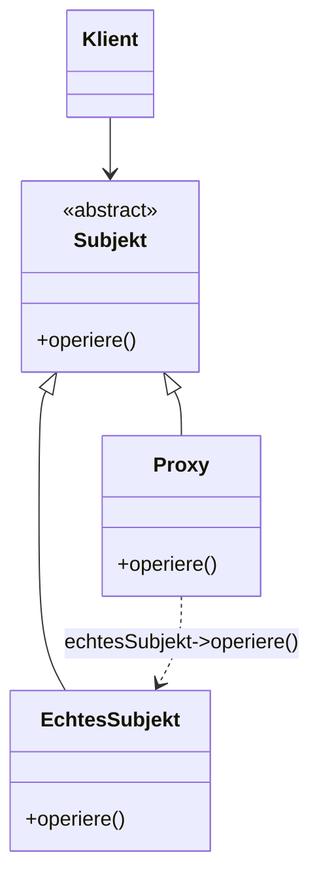
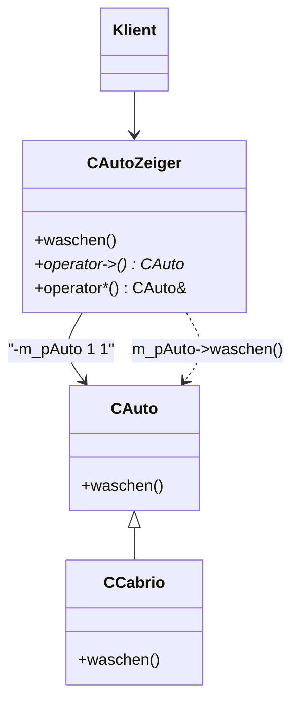

## Intent

The **Proxy** pattern (*Proxy*) is a structural pattern (*Strukturmuster*)
that controls access to an object with the help of a placeholder object
placed in front of it (*kontrolliert Zugriff auf ein Objekt mit Hilfe eines
vorgelagerten Objekts*). It enables creation of "expensive" objects
(computation time, memory) only on demand — **lazy evaluation** — and
enables **smart pointers**: pointer variables whose memory is automatically
freed (see [[concepts/smart-pointers]]).

## Structure



*Abbildung 43: UML-Klassendiagramm: Proxy.* `Subjekt` is an abstract class
(see [[concepts/abstract-class]]).

## Participants

| Role | Responsibility |
|---|---|
| `Klient` (Client) | Calls the operation on `Proxy`, believing it talks to `Subjekt`. |
| `Subjekt` (Subject) | Abstract interface common to `EchtesSubjekt` and `Proxy`, so the client can use either interchangeably. |
| `EchtesSubjekt` (RealSubject) | The real object that does the actual work. |
| `Proxy` | Has the **same interface** as `EchtesSubjekt`; controls the execution of the operation on `EchtesSubjekt` (e.g. delayed in time). |

## Collaboration

1. `Klient` calls the operation on `Proxy` (instead of directly on
   `EchtesSubjekt`), because `Proxy` has the same interface and `Klient` can
   therefore replace `EchtesSubjekt` with `Proxy`.
2. `Proxy` controls the execution of the operation on `EchtesSubjekt`, e.g.
   creating it lazily or delaying the call in time.
3. `Proxy` forwards (delegates) to `echtesSubjekt->operiere()`.

## Example: classic form is not fully worked — a smart-pointer variant

§0.7.4.2 *Beispiel zu Proxy* uses a **variant** of the Proxy pattern in which
**`Proxy` does not inherit from `Subjekt`**. Instead, the operators `->`
(access) and `*` (dereference) are **overloaded**. As a consequence, `Proxy`
can no longer be stored in a variable of type `Subjekt`, but the client can
still use `Proxy` exactly like `Subjekt`.



*Abbildung 44: UML-Klassendiagramm: Proxy-Beispiel.* Note the multiplicities
`1` on both ends of the `m_pAuto` association between `CAutoZeiger` and
`CAuto`. Instead of inheritance, `CAutoZeiger` overloads operators `->` and
`*`; `CAuto*` can thus be replaced by `CAutoZeiger` (smart pointer, see
[[concepts/smart-pointers]]).

```cpp
//cautozeiger.hpp
class CAutoZeiger
{
  public:
    CAutoZeiger(CAuto *pauto);
    ~CAutoZeiger();
    CAuto* operator->();
    CAuto& operator*();
  private:
    CAutoZeiger(const CAutoZeiger&);
      //verboten
    CAutoZeiger operator=(CAutoZeiger);
      //verboten

    CAuto *m_pauto;
};
```

- The actual pointer to `CAuto` is stored in `m_pauto`.
- Overloaded `operator->()`: performs `->` on `EchtesSubjekt` (the real
  object).
- Overloaded `operator*()`: returns the content of `EchtesSubjekt` as a
  reference.
- **Forbid copies of Proxy!** (*Kopien von Proxy verbieten!*) — hence the
  private, undefined copy constructor and assignment operator.

```cpp
//cautozeiger.cpp
CAutoZeiger::CAutoZeiger(CAuto *pauto):
  m_pauto(pauto)
{}
CAutoZeiger::~CAutoZeiger()
{
  delete m_pauto;
}
CAuto* CAutoZeiger::operator->()
{
  return m_pauto;
}
CAuto& CAutoZeiger::operator*()
{
  return *m_pauto;
}
```

- Constructor of `CAutoZeiger` is initialized with a pointer to an object of
  type `CAuto`.
- Destructor of `CAutoZeiger` calls `delete` for the object.
- `operator->()` returns the address of the object.
- `operator*()` returns the content of the object.

```cpp
{
  CAutoZeiger cabrio(new CCabrio());  // Aufrufe Konstruktoren
  CAutoZeiger taxi(new CTaxiAdapter()); // CAutoZeiger(CAuto*)
  cabrio->waschen();
        //wird zu (cabrio.operator->())->waschen();
        //zweites -> implizit durch Compiler eingefügt
  taxi->waschen();
}
```

Explicit `delete` is **not required**:

1. Objects of type `CAutoZeiger` are created in automatic storage (stack).
2. The destructor of `CAutoZeiger` is therefore called at the end of scope.
3. In the destructor, `delete` is called for the actual (wrapped) object.

## Consequences

- Controls access to a (possibly expensive) object via a placeholder,
  enabling lazy evaluation.
- Enables smart pointers whose memory is automatically freed, removing the
  need for explicit `delete` at the use site (shown above).
- In the operator-overload variant, `Proxy` (`CAutoZeiger`) can **no longer
  be stored in a variable of type `Subjekt`** — it trades interface
  substitutability (classic form) for transparent pointer-like syntax.
- Copies of the proxy must be forbidden (private, undefined copy
  constructor/assignment operator) to avoid double-deleting the wrapped
  object.

## Misuse & anti-patterns

Not stated by the source.

## Related

- [[concepts/smart-pointers]]
- [[concepts/abstract-class]]
- [[concepts/operator-overloading]]
- [[concepts/destructor]]
- [[patterns/adapter]]
- [[patterns/design-patterns-overview]]

## Sources

[[sources/grigat-uml-patterns]] §0.7.4, §0.7.4.1, §0.7.4.2

## Open questions

- The script presents only the operator-overload smart-pointer variant of
  Proxy in worked code (`CAutoZeiger`); no C++ code example of the classic
  inheritance-based form (`Proxy : public Subjekt`) is given, only the UML
  diagram (Abbildung 43). Do not invent one.
