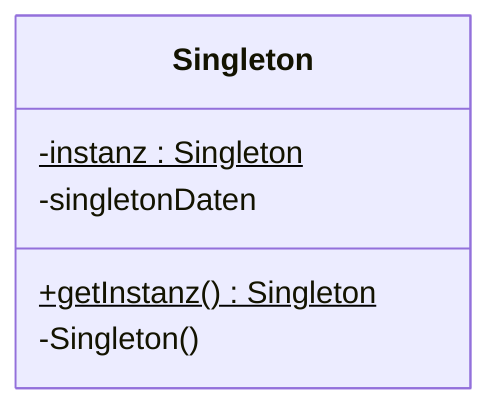
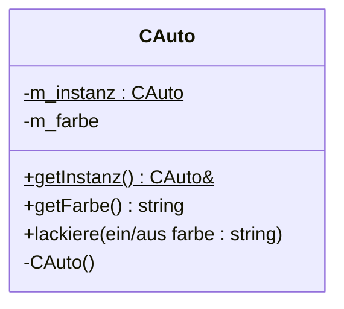

## Intent

The **Singleton** (*Singleton*) pattern is a creational pattern
(*Erzeugungsmuster*) that enables exactly one instance of a class
(*genau eine Instanz*) to exist. The constructor is not public
(*Konstruktor ist nicht öffentlich*); the instance is stored in a private
static variable; and a public static member function delivers a reference to
that instance.

## Structure



*Abbildung 39: UML-Klassendiagramm: Singleton.* `-instanz` and
`+getInstanz()` are underlined in the original figure, denoting
static/class-scope members (see [[concepts/static-members]]).

## Participants

| Role | Responsibility |
|---|---|
| `Singleton` | Declares the static `getInstanz()` operation that lets clients access its unique instance. Holds the sole instance in a private static member `instanz`. Keeps its constructor private so clients cannot create further instances. |

## Collaboration

1. A client requests the single instance via `Singleton::getInstanz()`,
   never via `new Singleton()` (the constructor is inaccessible to clients).
2. `getInstanz()` returns a reference to the one, statically-held instance.
3. The instance is created once, at the start of program execution, by
   initialization of the static member variable — in static memory, before
   any client call occurs.

## Example

§0.7.2.2 *Beispiel: Singleton* — "Nur ein Auto erlauben" (allow only one
car).



*Abbildung 40: UML-Klassendiagramm: Singleton-Beispiel CAuto.* `-m_instanz`
and `+getInstanz()` are underlined — static members.

```cpp
//cauto.hpp
class CAuto
{
  public:
    static CAuto& getInstanz();
    std::string getFarbe();
    void lackiere(std::string farbe);
  private:
    CAuto();
    CAuto(const CAuto& other);
      // Kopierkonstruktor verboten
    CAuto operator=(CAuto& other);
      // Zuweisungsoperator verboten
    static CAuto m_instanz;
    std::string m_farbe;
};
```

To prevent the compiler from generating a default copy constructor and
assignment operator (*Verhindern, dass Default-Kopierkonstruktor und
-Zuweisungsoperator vom Compiler erstellt werden*), the class declares its
own copy constructor and assignment operator — without providing a
definition (*ohne Definition zu erstellen*).

```cpp
//cauto.cpp
CAuto::CAuto():
  m_farbe("rot")
{}
CAuto& CAuto::getInstanz()
{
  return m_instanz;
}
CAuto CAuto::m_instanz;
  // Aufruf des Konstruktors

string CAuto::getFarbe()
{
  return m_farbe;
}
void CAuto::lackiere(string farbe)
{
  m_farbe = farbe;
}
```

Creation of the (one and only!) instance of `CAuto` happens:

- At the start of program execution (*bei Beginn der Programmausführung*).
- Through initialization of the static member variable `m_instanz`.
- In static memory (*im statischen Speicher*).

The static method `getInstanz()` returns a reference to the instance.

```cpp
//main.cpp

CAuto& dasAuto = CAuto::getInstanz();

//CAuto zweitwagen(dasAuto); // Compilerfehler

dasAuto.lackiere("gelb");
cout << dasAuto.getFarbe() << endl;
```

- `dasAuto` is a reference to the single/unique instance.
- A reference to this instance is provided by the static method
  `CAuto::getInstanz()`.
- Member methods `lackiere` or `farbe` can be applied to the instance of the
  object in the normal way.
- Calling the copy constructor or assignment operator would lead to a
  compiler error, since no implementation exists for either.

## Consequences

The source does not enumerate a separate consequences list for Singleton
beyond what the example itself demonstrates:

- Exactly one instance exists, guaranteed by construction (private
  constructor + static instance).
- Attempting to copy the instance (copy constructor) or build a second one
  (`CAuto zweitwagen(dasAuto);`) is a **compiler error**, because the copy
  constructor and assignment operator are declared private and left
  undefined.

## Misuse & anti-patterns

Not stated by the source.

## Related

- [[concepts/static-members]]
- [[concepts/constructor]]
- [[concepts/copy-constructor]]
- [[concepts/assignment-operator]]
- [[patterns/design-patterns-overview]]

## Sources

[[sources/grigat-uml-patterns]] §0.7.2, §0.7.2.1, §0.7.2.2

## Open questions

- The script does not discuss thread-safety of static initialization, lazy
  vs. eager instantiation trade-offs, or subclassing a Singleton — these are
  not stated by the source and are therefore omitted here.
