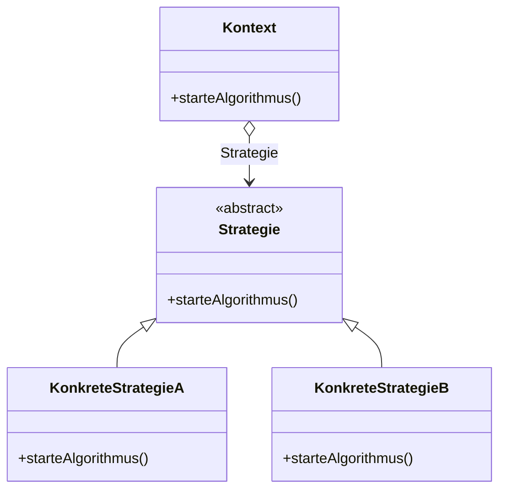
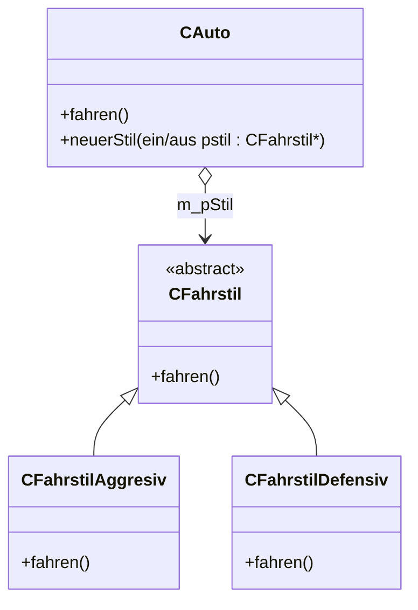

## Intent

The **Strategy** pattern (*Strategie*) is a behavioral pattern
(*Verhaltensmuster*) that encapsulates algorithms and makes them
interchangeable (*Kapselt Algorithmen und macht sie austauschbar*).
`Strategie` declares the interface offered by all algorithms, and each
`KonkreteStrategie` implements one concrete algorithm.

## Structure



*Abbildung 45: UML-Klassendiagramm: Strategie.* `Strategie` is an abstract
class (see [[concepts/abstract-class]]).

## Participants

| Role | Responsibility |
|---|---|
| `Kontext` (Context) | Holds a reference/pointer to a `Strategie` object and calls `starteAlgorithmus()` on it, without knowing the concrete algorithm. |
| `Strategie` (Strategy) | Declares the interface offered by all algorithms. |
| `KonkreteStrategieA`/`B` (ConcreteStrategy) | Implements one concrete algorithm. |

## Collaboration

1. `Kontext` holds a pointer to the currently selected `Strategie`.
2. `Kontext::starteAlgorithmus()` (or `fahren()` in the example) forwards the
   call to the pointed-to strategy object.
3. The strategy can be replaced at runtime, changing `Kontext`'s behavior
   without changing `Kontext`'s own code.

## Example

§0.7.5.2 *Beispiel zu Strategie*: different driving styles
(*verschiedene Fahrstile*).



*Abbildung 46: UML-Klassendiagramm: Strategie-Beispiel.* Abstract class
`CFahrstil` represents the interface for driving algorithms; derived classes
implement the driving algorithms.

```cpp
//cfahrstil.hpp
class CFahrstil
{
  public:
    virtual void fahren() = 0;
};

//Abgeleitete Klasse, implementiert defensiven Fahr-Algorithmus
class CFahrstilDefensiv : public CFahrstil
{
  public:
    void fahren();
};

//Abgeleitete Klasse, implementiert aggressiven Fahr-Algorithmus
class CFahrstilAggressiv : public CFahrstil
{
  public:
    void fahren();
};
```

```cpp
//cfahrstil.cpp

//Abgeleitete Klasse, implementiert defensiven Fahr-Algorithmus
void CFahrstilDefensiv::fahren()
{
  cout << "Laaangsaaam ... " << endl;
}

//Abgeleitete Klasse, implementiert aggressiven Fahr-Algorithmus
void CFahrstilAggressiv::fahren()
{
  cout << "IDIOT!" << endl;
}
```

`CAuto` is the Strategy pattern's "Context":

```cpp
//cauto.hpp
class CAuto
{
  public:
    CAuto();
    virtual ~CAuto();
    virtual void neuerStil(CFahrstil* pStil);
    virtual void fahren();
  private:
    CFahrstil* m_pStil;
};
```

A pointer to the current driving style is kept in `m_pStil`. The driving
style can be changed at runtime via method `neuerStil(CFahrstil* pStil)`.

```cpp
//cauto.cpp
CAuto::CAuto():
  m_pStil(new CFahrstilDefensiv)
{}
CAuto::~CAuto()
{
  delete m_pStil;
}
void CAuto::neuerStil(CFahrstil* pStil)
{
  delete m_pStil;
  m_pStil = pStil;
}
void CAuto::fahren()
{
  m_pStil->fahren();
}
```

- In the constructor, a new driving style is created with `new`.
- This must be deleted with `delete` in the destructor.
- Method `neuerStil` expects a pointer to a style that was created with
  `new` **outside** the method.
- The old style must be deleted with `delete` inside method `neuerStil`.

```cpp
CCabrio cabrio;
CTaxiAdapter taxi;

cabrio.fahren();
      // Ausgabe: Laaangsaaam ...
cabrio.neuerStil(new CFahrstilAggressiv);
cabrio.fahren();
  // Ausgabe: IDIOT!
taxi.fahren();
      // Ausgabe: Laaangsaaam ...
```

- Each object can have its own strategy (*Jedes Objekt kann seine eigene
  Strategie besitzen*).
- Strategy can be changed at runtime (*Strategie kann zu Laufzeit geändert
  werden*).

## Consequences

- Each object can have its own, independently-assigned strategy.
- The strategy can be changed at runtime by swapping the pointer held by the
  context object, without modifying the context's own code.
- The context is responsible for `delete`-ing the old strategy in
  `neuerStil()` and the current one in its destructor, since strategies are
  passed in as raw pointers created with `new`.

## Misuse & anti-patterns

Not stated by the source.

## Related

- [[concepts/abstract-class]]
- [[concepts/polymorphism]]
- [[concepts/function-objects]]
- [[concepts/lambda-expressions]]
- [[patterns/observer]]
- [[patterns/design-patterns-overview]]

## Sources

[[sources/grigat-uml-patterns]] §0.7.5, §0.7.5.1, §0.7.5.2

## Open questions

- The example `CTaxiAdapter` reuses the `Adapter` example's class from
  [[patterns/adapter]] (`taxi.fahren()` implies `CTaxiAdapter` derives from
  `CAuto` and inherits its `fahren()`/strategy mechanism) — the script does
  not restate `CTaxiAdapter`'s declaration here, only its usage.
- The script discusses function objects/lambdas (see
  [[concepts/function-objects]], [[concepts/lambda-expressions]]) in a
  different part of the course; it does not itself connect them to Strategy
  in this section, so that connection here is only a cross-link suggestion,
  not a source claim.
