## One-sentence definition

An **AVL tree** (*AVL-Baum*) is a self-balancing [[structures/binary-search-tree]]
— named after Adelson-Velskii and Landis — that guarantees **O(log n)** for
all three [[structures/dictionary]] operations by restoring balance via
rotation after every insertion or deletion (§0.11.5.2).

## Balanced trees (§0.11.5.1)

**Definition.** A tree is **balanced** (*balanciert*) if, for every node,
the heights of its two subtrees differ by at most 1.

Unbalanced trees (Abbildung 81) can degenerate into a list-like chain, or
fan out wide at the top and then collapse into a long chain:

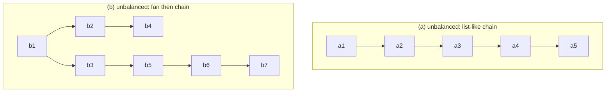

Balanced trees are **not** always complete — height balance only constrains
the *difference* between subtree heights, not their shape (Abbildung 82):

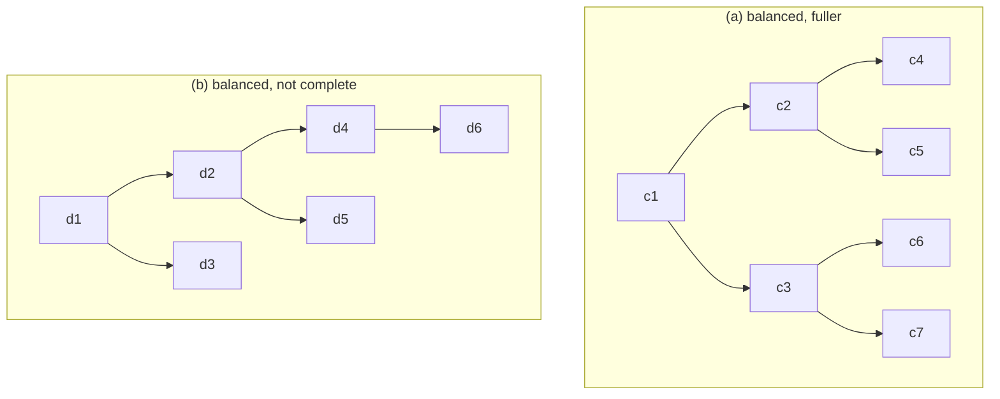

An AVL tree is a balanced BST; because it cannot degenerate into a list, the
cost of `insert`, `delete`, and `member` is **guaranteed O(log n)**
(§0.11.5.2). This lecture considers only AVL trees **without duplicate
keys** — the duplicate-key case is more complex and left to the specialized
literature (*Fachliteratur*) (§0.11.5.3).

## The AVL invariant and balance factor (§0.11.5.8)

Each node stores a **balance value** `b`, defined as:

```
b = height(left subtree) − height(right subtree)
```

| `b` | Meaning |
|---|---|
| `b ∈ {-1, 0, 1}` | node is **balanced** (*balanciert*) |
| `b ∈ {-2, 2}` | node is **unbalanced** (*unbalanciert*) — rebalancing required |

An AVL implementation stores either the height or the balance value in each
node (§0.11.5.8).

## Update operations (§0.11.5.3)

**Update** = inserting or deleting a node `p_e`; either can destroy balance.

- **Insert:** insert `p_e` exactly as in a plain BST. `p_e` now belongs to
  every subtree whose root lies on the path from the AVL tree's root to
  `p_e`; the height of each of these subtrees can grow by 1.
- **Delete:** delete `p_e` exactly as in a plain BST. The affected subtrees
  are those with root on the path from the AVL tree's root to `p_v`, the
  parent of the deleted node; the height of each of these subtrees can
  **decrease** by 1.

## Rebalancing after insertion vs. after deletion (§0.11.5.4)

Rebalancing is necessary whenever an update violates balance. Two cases are
treated separately because they have different consequences for the ancestor
chain:

- **(a) Thrown off balance by insertion:** restoring balance at the
  deepest unbalanced node is always *sufficient* — no further ancestors need
  checking.
- **(b) Thrown off balance by deletion:** restoring balance at one node may
  *change that subtree's height*, which can propagate the imbalance further
  up — ancestors may also need rebalancing (§0.11.5.8).

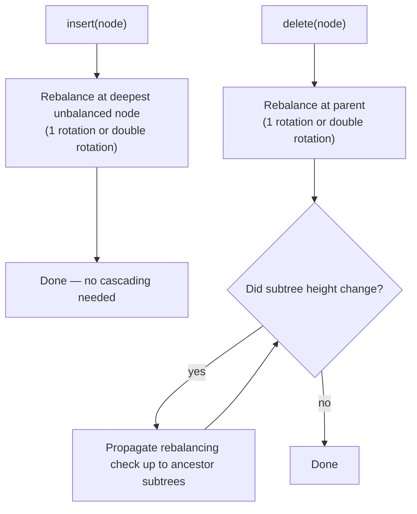

## Single vs. double rotation: how to choose (§0.11.5.5)

Terminology:

- **Pivot** `P` (or `P1`, `P2`): the deepest node without balance.
- **Rotator** `R`: the child of the pivot that is the root of the pivot's
  **larger** subtree.
- If `R` is the **right** child of the pivot, `R`'s right subtree is the
  **outer** subtree `C` and `R`'s left subtree is the **inner** subtree `B`
  (their roots are children of `R` and siblings of each other). If `R` is
  the **left** child instead, inner/outer are mirrored.

**Decision rule:**

| Condition | Rebalancing operation |
|---|---|
| outer subtree `C` is taller than inner subtree `B` | **single rotation**, pivot `P` |
| inner subtree `B` is taller than outer subtree `C` | **double rotation**, pivots `P1` and `P2` |

## The rotation operation (§0.11.5.6)

**Single rotation:** pivot `P` sinks and rotator `R` rises by one height
level each. All subtrees follow their node (pivot or rotator) — **except**
the inner subtree, which keeps its height level but switches parents, from
the rotator to the pivot. If the inner subtree was the left (right) child of
the rotator, it becomes the right (left) child of the pivot.

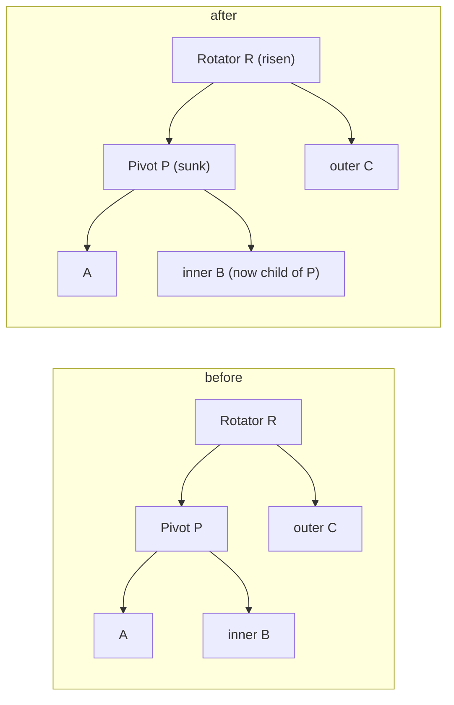

**Double rotation:** two opposite single rotations in sequence. The first
single rotation's only purpose is to establish the precondition for the
second (real) single rotation, by giving the outer subtree the greater
height. Both single rotations share the same rotator node (`R1 = R2`), but
have *different* pivot nodes `P1` and `P2` — both of which end up as
children of the shared rotator afterward (Abbildung 86).

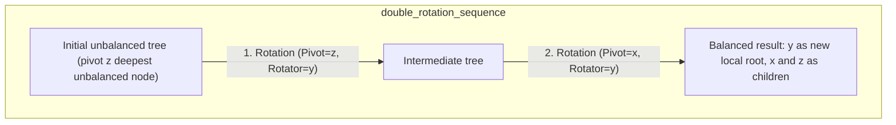

Crucially, rotation preserves the **inorder sequence**: `⟨A, x, B, y, C⟩`
stays the same before and after — only the tree's shape changes, not the
sorted order it represents.

## Rebalancing after insertion, in detail (§0.11.5.7)

### Case 1 — outer subtree `C` higher than inner subtree `B`: single rotation

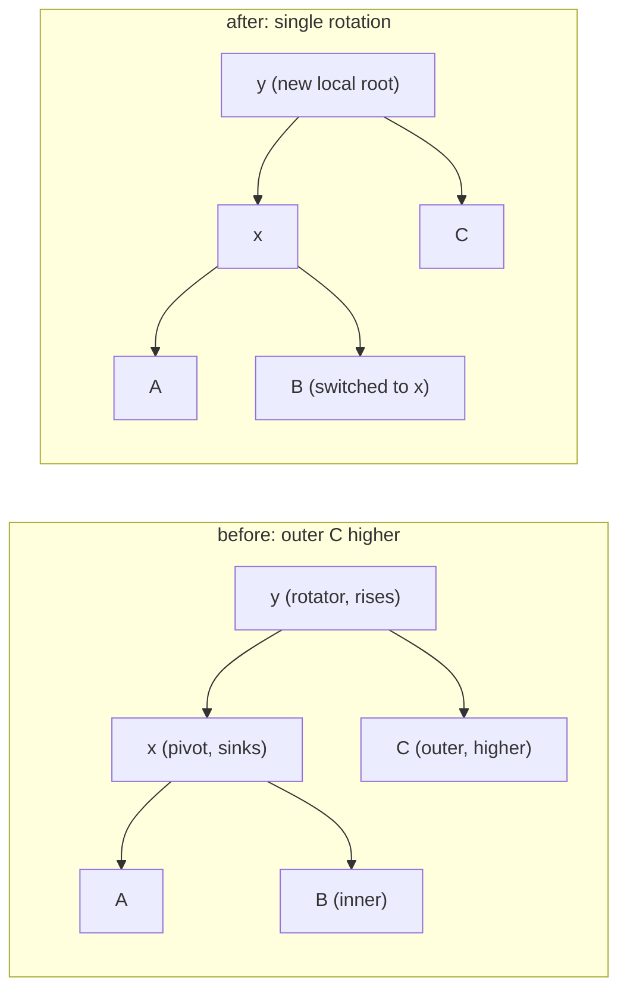

### Case 2 — inner subtree `B` higher than outer subtree `C`: single rotation fails, double rotation required

A single rotation does **not** restore balance in this configuration
(Abbildung 84, "Geht nicht hier!" — "doesn't work here!"):

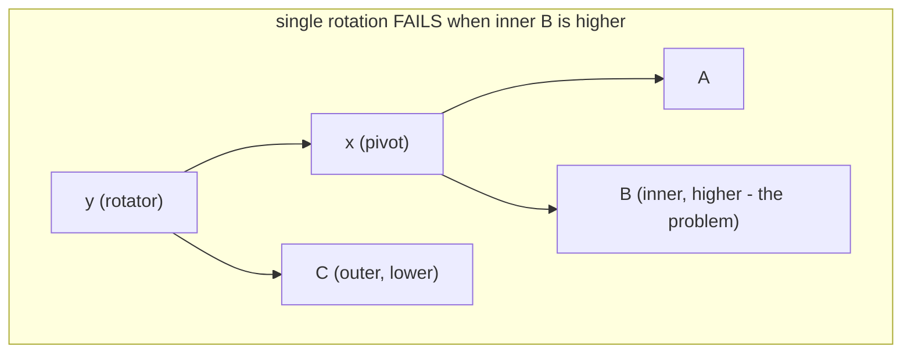

The fix is to split the larger inner subtree `B` into `B1` and `B2`
(Abbildung 85), then apply a **double rotation** with two sub-cases
(Abbildung 87):

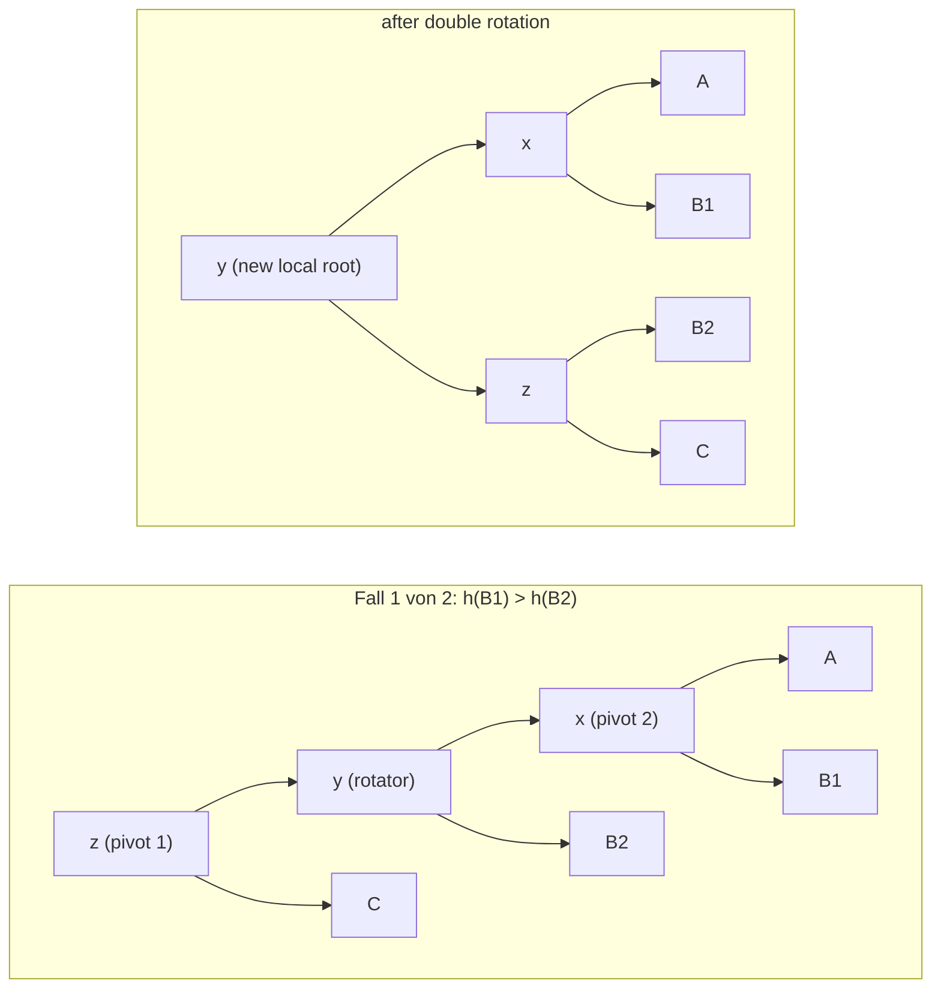

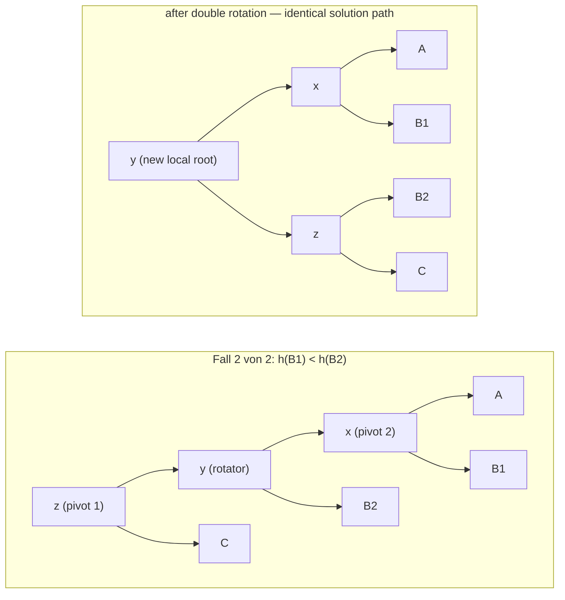

**Result for update-by-insertion:** one rotation or double rotation always
suffices to restore balance after inserting an element — no cascading check
up the tree is needed.

## Rebalancing after deletion, in detail (§0.11.5.8)

Unlike insertion, deletion rebalancing has **three** inner/outer cases
instead of two, because inner and outer subtrees can also tie in height.

### Case 1 — outer subtree `C` higher than inner subtree `B`: single rotation, height reduced by 1

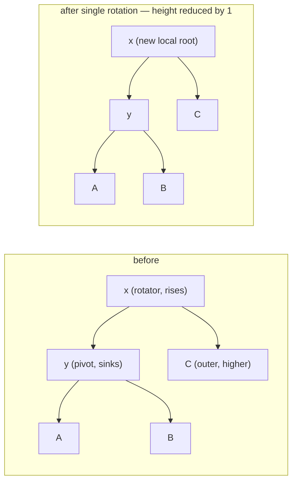

### Case 2 — outer `C` and inner `B` equally high: single rotation, height unchanged

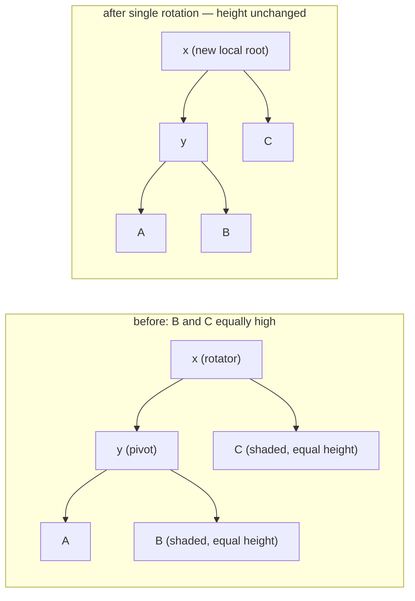

### Case 3 — inner subtree `B` higher than outer `C`: double rotation required, 3 sub-cases, height reduced by 1

As already shown for insertion, a single rotation cannot restore balance
when the inner subtree is higher — a double rotation is required, now with
**three** sub-cases depending on the relative heights of `B1` and `B2`
(Abbildung 90):

| Sub-case | Condition |
|---|---|
| Fall 1 von 3 | `h(B1) > h(B2)` |
| Fall 2 von 3 | `h(B1) < h(B2)` |
| Fall 3 von 3 | `h(B1) = h(B2)` |

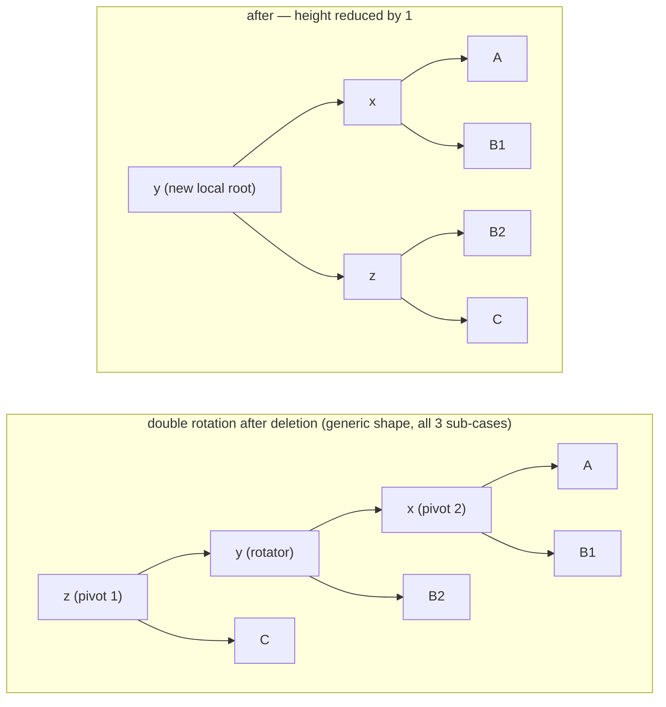

**Result for update-by-deletion:** one rotation or double rotation suffices
to restore balance *at that subtree*, but — unlike insertion — if this
changes the subtree's height, **ancestor subtrees may also need
rebalancing**, cascading the check upward (§0.11.5.8).

## Worked example: inserting weekdays into an AVL tree (§0.11.5.9, Abbildung 91)

Example: inserting German weekday names (alphabetical order), storing the
balance value `b` at every node.

**(a) Double rotation.** Before: root `Mi` (`b=+2`, unbalanced) with left
child `Do` (`b=-1`, whose child is `Fr`). After double rotation: new local
root `Do` (`b=0`), with `Di` and `Mo` as children.

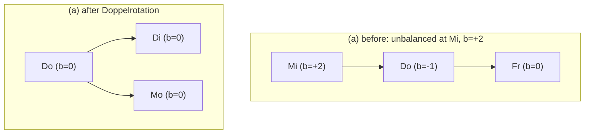

**(b) Single rotation.** Before: root `Mi` (`b=+1`) with left child `Do`
(`b=-2`, unbalanced), whose left child is `Fr`. After single rotation: new
local root `Do` (`b=0`), with left child `Di` (`b=0`) and right child `Mi`
(`b=0`), which in turn has right child `Mo` (`b=0`).

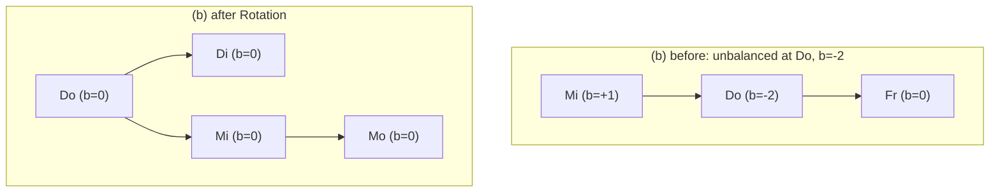

**(c) Single rotation.** Before: root `Mi` (`b=+1`) with children `Do`
(`b=0`, children `Di`, `Fr`) and `Mo` (`b=-2`, unbalanced, right child `Sa`
→ `So`). After rotation: new local root `Mi` (`b=0`), left child `Do`
(`b=0`, children `Di`, `Fr`, `Mo`), right child `Sa` (`b=0`, child `So`).

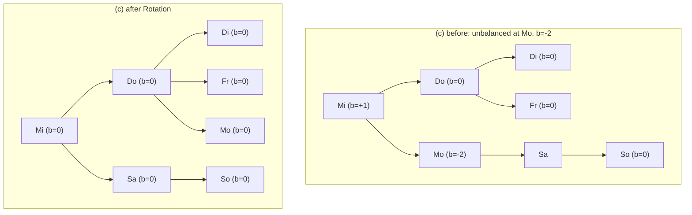

## Complexity table

| Operation | Best | Average | Worst | Assumption |
|---|---|---|---|---|
| `member` | O(log n) | O(log n) | **O(log n)** | guaranteed — AVL cannot degenerate |
| `insert` (incl. rebalancing) | O(log n) | O(log n) | **O(log n)** | at most one rotation/double rotation, no cascade |
| `delete` (incl. rebalancing) | O(log n) | O(log n) | **O(log n)** | rebalancing may cascade up to O(log n) ancestors, each O(1) |

Compare with the plain [[structures/binary-search-tree]], whose worst case
is O(n). See [[concepts/big-o-notation]] and [[concepts/complexity-classes]].

## Trade-offs: when to use, when not to

- Use an AVL tree whenever a *guaranteed* O(log n) bound is required
  regardless of insertion order (e.g. adversarial or sorted input).
- The price is bookkeeping: every node carries a balance value/height, and
  every update may trigger rotations.
- If a hard worst-case bound is not needed and raw expected speed matters
  more, [[structures/hash-table]] may be preferable (at the cost of sorted
  enumeration).

## Common pitfalls & gotchas

- Confusing *inner* and *outer* subtree when the rotator is a left vs.
  right child — the inner/outer assignment mirrors.
- Applying a single rotation when the inner subtree is the taller one: this
  does **not** restore balance (Abbildung 84) and a double rotation is
  required instead.
- After a deletion rebalance, forgetting to check whether the ancestor
  chain also needs rebalancing — unlike insertion, this check does not stop
  at the first fixed node.

## Related
- [[structures/binary-search-tree]] — the unbalanced structure this
  refines.
- [[structures/dictionary]] — the ADT this structure implements.
- [[structures/hash-table]] — the alternative dictionary implementation.
- [[structures/tree-structures-comparison]] — cross-cutting comparison
  table.
- [[concepts/big-o-notation]]
- [[concepts/complexity-classes]]

## Sources
- [[sources/grigat-algorithms-data-structures]] §0.11.5.1, §0.11.5.2,
  §0.11.5.3, §0.11.5.4, §0.11.5.5, §0.11.5.6, §0.11.5.7, §0.11.5.8,
  §0.11.5.9
