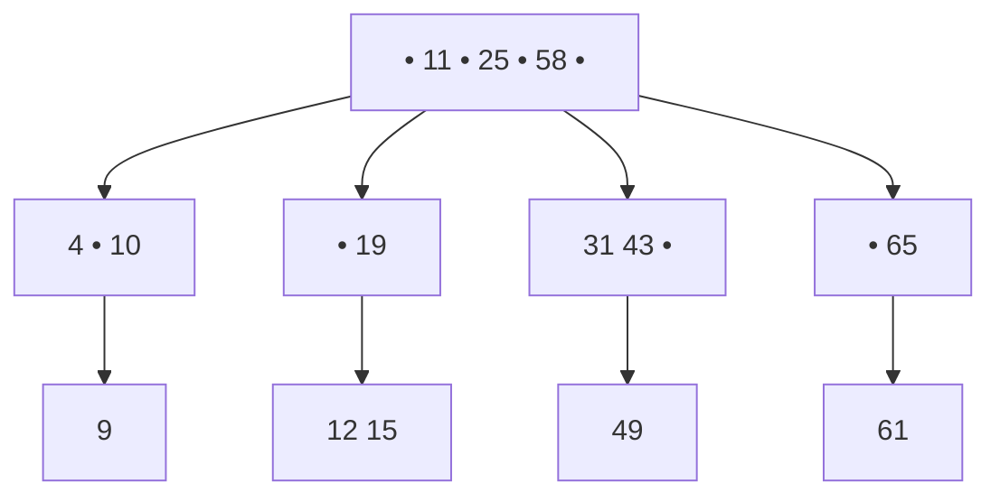
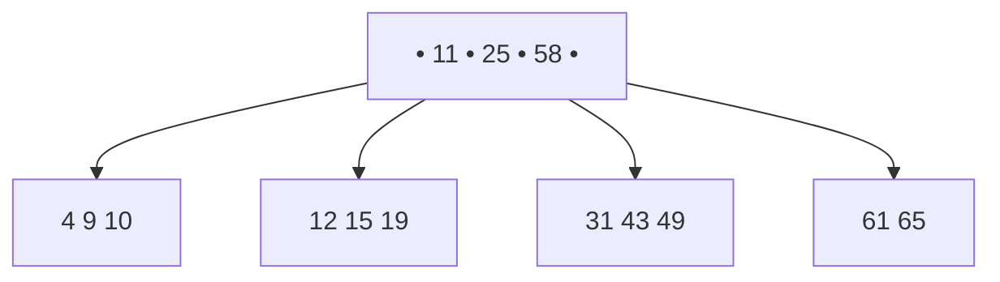
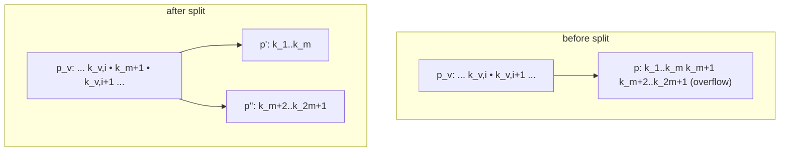
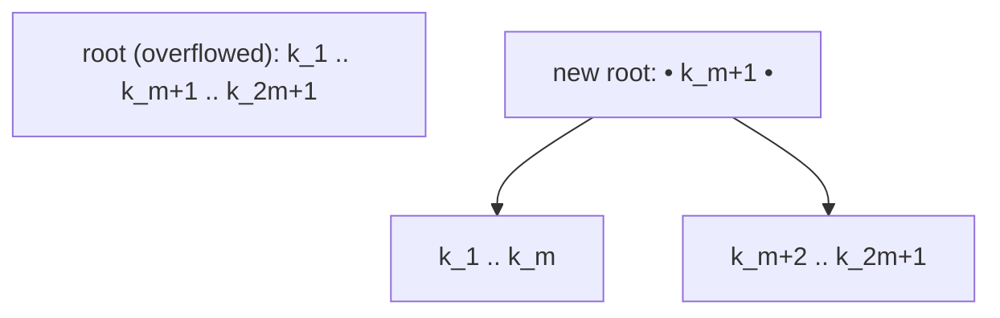
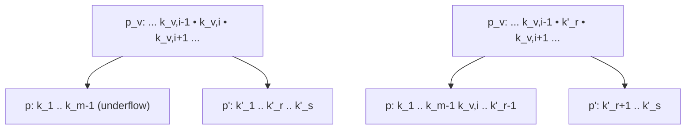
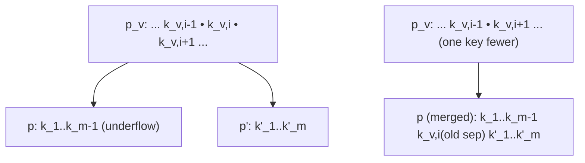

A **B-tree (*B-Baum*) of order *m*** is a balanced *Vielweg-Suchbaum* (multiway search tree) — a generalization of the [[structures/binary-search-tree|binary search tree]] in which an inner node holds several keys and several children instead of exactly one key and two children — designed so a node's size matches one disk/page block, minimizing the number of external storage accesses needed for [[structures/dictionary|dictionary]] operations.

## Core idea / invariant

A B-tree is first a *Vielweg-Suchbaum* (multiway search tree): see **Abbildung 124**, a root with keys `11, 25, 58` and children holding `{4,10}→9`, `{19}→{12,15}`, `{31,43}→49`, `{65}→61`.



A B-tree additionally satisfies:

1. Number of keys *s* in every node: *m* ≤ *s* ≤ 2*m* (root node exception: 1 ≤ *s* ≤ 2*m*).
2. Leaves (*Blätter*) hold only keys — no children.
3. Every **inner** node with *s* keys has *s* + 1 sons (*Söhne*).
4. All path lengths from root to a leaf are equal (inner nodes may not have empty subtrees), except that a root with exactly 1 key may have 0 or 2 subtrees.

A fully valid B-tree example (**Abbildung 125**): root `11, 25, 58`; leaves `{4,9,10}`, `{12,15,19}`, `{31,43,49}`, `{61,65}`.



### Why: external-storage motivation

A B-tree's node size is chosen to match a disk block, unlike a [[structures/binary-tree|binary tree]] node, so that **one node read = one page access**. Choosing *m* so that a node (2*m* keys + 2*m*+1 child pointers) exactly fills a page minimizes the number of *Plattenoperationen* (disk operations) needed per [[structures/dictionary|dictionary]] operation — this is the central reason B-trees exist, as opposed to using an in-memory [[structures/binary-search-tree|BST]] directly on external storage.

## Minimal and maximal key/node counts

For a **minimally filled** B-tree of height *h*, order *m* (root has two subtrees *T_L*, *T_R*):

```
#Knoten_min(T_L) = Σ_{i=0}^{h-1} (m+1)^i = ((m+1)^h − 1) / m
#Schlüssel_min(T_L) = m · ((m+1)^h − 1)/m = (m+1)^h − 1
#Schlüssel_min(T) = 2·(m+1)^h − 1                                    (23)
```

⇒ a tree of height *h* has at least 2·(m+1)^h − 1 keys. Solving for *n* keys:

```
n ≥ 2·(m+1)^h − 1
(m+1)^h ≤ (n+1)/2
h ≤ log_{(m+1)}((n+1)/2)  ∈ O(log n)
```

For a **maximally filled** B-tree of height *h*, order *m*:

```
#Knoten_max(T) = Σ_{i=0}^{h} (2m+1)^i = ((2m+1)^{h+1} − 1)/(2m)
#Schlüssel_max(T) = 2m · ((2m+1)^{h+1} − 1)/(2m) = (2m+1)^{h+1} − 1   (24)
```

⇒ a tree of height *h* has at most (2m+1)^{h+1} − 1 keys.

### Worked example (§0.15.2.7)

- Page size 2 kB; a key + child pointer cost 4 bytes ⇒ (2m + (2m+1))·4 ≤ 2048 ⇔ **m = 127**.
- *n* = 2·10⁶ records to store ⇒ maximal height h_max = ⌊log₁₂₈((2·10⁶+1)/2)⌋ = **2**.
- Check: minimal key count via (23): 2·128² − 1 = 32767. Maximal key count via (24): 255³ − 1 = 16581374.

## Operations table

| Operation | Purpose | Complexity |
|---|---|---|
| `member` | search for a key | O(m·h) = O(m·log_{m+1} n) = O(log n) |
| `insert` | insert a key (may trigger `split`) | O(log n) amortized — O(log n) search + possible chain of `split`s up to the root |
| `delete` | delete a key (may trigger `balance`/`merge`) | O(log n) — O(log n) search + possible chain of `balance`/`merge` up to the root |
| `split` | fix node overflow (s = 2m+1 keys) | O(m) per node, propagates O(h) levels at worst |
| `balance` | fix node underflow by borrowing from a neighbor | O(m) |
| `merge` | fix node underflow by fusing with a neighbor | O(m), propagates O(h) levels at worst |

All bounds assume a node holds O(m) keys and the tree has height h = O(log_{m+1} n); linear search *within* a node costs O(m) (binary search within a node, using the same technique as [[structures/binary-search-tree|BSTs]], is also possible and would reduce the per-node cost, but the source states the per-node search as O(m)). See [[concepts/big-o-notation]] and [[concepts/complexity-classes]].

## Numbered pseudocode

### `member` (§0.15.2.9)

```
1. function member(T, key):
2.     node ← root(T)
3.     while node is not null:
4.         i ← linear_search(node.keys, key)      // O(m) within node
5.         if node.keys[i] == key: return FOUND
6.         if node is leaf: return NOT_FOUND
7.         node ← node.children[i]                // descend one level, O(h) levels
8.     return NOT_FOUND
```

### `insert` (§0.15.2.10)

1. Search *e* in the tree starting at root, by key `s_e = key(e)`.
2. If *e* was not found, let *p* be the leaf where the search ended; insert *e* into leaf *p* at the correct position.
3. If #Schlüssel(p) = 2m + 1 (one key too many): **overflow** — call `split(p)`.

### `split` (§0.15.2.11) — node overflow

**Fall 1: p has a parent p_v** (Abbildung 126). *p* overflowed with keys k_1..k_m, k_{m+1}, k_{m+2}..k_{2m+1} (2m+1 keys); *p* is a child of p_v between k_{v,i} and k_{v,i+1}. Splitting pushes the median key k_{m+1} up into p_v as a new separator between two new children p' (keys k_1..k_m) and p'' (keys k_{m+2}..k_{2m+1}).



**Fall 2: p is the root node** (Abbildung 127) — the tree grows "upward": a new root is created holding only k_{m+1}, with children p' (k_1..k_m) and p'' (k_{m+2}..k_{2m+1}).



```
1. function split(p):                          // p has 2m+1 keys (overflow)
2.     p'  ← new node with keys k_1 .. k_m
3.     p'' ← new node with keys k_{m+2} .. k_{2m+1}
4.     median ← k_{m+1}
5.     if p has parent p_v:
6.         replace child pointer to p in p_v with (p', median, p'')
7.         if #keys(p_v) == 2m+1: split(p_v)    // overflow propagates toward root
8.     else:                                     // p is root (Fall 2)
9.         create new root containing only median, with children p' and p''
```

Overflow can thus propagate from a leaf all the way up to the root, which is the only way a B-tree grows in height.

### `delete` (§0.15.2.12)

```
1. function delete(T, e):
2.     node ← search(T, e)
3.     if node is not a leaf:
4.         e' ← successor(e)        // smallest key larger than e, located on a leaf
5.         swap(e, e') in-place
6.         node ← leaf containing e'
7.     remove e (or e') from node
8.     if #keys(node) == m-1 and node is not root:
9.         fix_underflow(node)      // balance or merge
```

If the found element is not on a leaf, swap it with its in-order successor *e'* (the next-larger value, the *äquivalenter Wert*), which always lies on a leaf, then delete from that leaf. If the leaf then has m − 1 keys and is not the root: **underflow**. Resolution: if a neighbor has surplus keys (s' > m), use `balance`; otherwise a neighbor has exactly the minimum m keys, so use `merge`.

### `balance` (§0.15.2.13) — node underflow, neighbor has surplus

Feasible when a neighbor p' of p has more than m keys (s > m). The combined sequence ⟨k_1,…,k_{m-1}, k_{v,i}, k'_1,…,k'_s⟩ is split down the middle; the *cut* lies in p' at key k'_r, with index:

```
r = ⌈(m+s)/2⌉ − m
```



```
1. function balance(p, p', p_v, separator_index i):
2.     if #keys(p') > m:                         // neighbor has surplus keys
3.         s ← #keys(p')
4.         r ← ceil((m + s) / 2) - m
5.         combined ← keys(p) + [k_v,i] + keys(p')
6.         p.keys  ← combined[0 .. m-1]           // includes old separator
7.         p_v.keys[i] ← combined[m]              // k'_r becomes new separator
8.         p'.keys ← combined[m+1 .. end]
9.     else:
10.        merge(p, p', p_v, i)
```

### `merge` (§0.15.2.14) — node underflow, neighbor has exactly m keys

Feasible when neighbor p' has exactly m keys. p_v's separator key k_{v,i} moves down into the merged node together with all of p''s keys; p_v loses one key and one child pointer. Afterward p_v is checked for underflow, which may again propagate upward; if the underflowing p_v was the root, the merged node *p* becomes the new root (tree height decreases by 1).



```
1. function merge(p, p', p_v, separator_index i):
2.     p.keys ← keys(p) + [k_v,i] + keys(p')     // combine with old separator
3.     remove child pointer to p' and key k_v,i from p_v
4.     delete node p'
5.     if #keys(p_v) == m-1 and p_v is not root:
6.         fix_underflow(p_v)                     // propagate upward
7.     else if #keys(p_v) == 0 and p_v is root:
8.         new root ← p                           // tree height decreases by 1
```

## Complexity

- Space: **O(n)**.
- Storage utilization: guaranteed > 50% (every non-root node holds at least *m* of its 2*m* key slots).
- Only **O(h) = O(log_{m+1} n)** disk operations per `member`/`insert`/`delete` call.
- O(m) steps per node (linear scan within the node).
- Overall: **O(m·log_{m+1} n) = O(log n)**.

See [[concepts/big-o-notation]] and [[concepts/complexity-classes]] for the notation used throughout.

## Reference implementation (sketch)

```cpp
template<typename K>
struct BTreeNode {
    std::vector<K> keys;                  // m..2m keys, 1..2m at root
    std::vector<BTreeNode*> children;     // empty for leaves; keys.size()+1 otherwise
    bool is_leaf() const { return children.empty(); }
};
```

A real implementation would use a fixed-size array sized to the disk page (see [[concepts/arrays-and-dynamic-memory]]) rather than a `std::vector`, since the whole point is that one node equals one page; `std::vector`'s dynamic growth is for in-memory convenience only, see [[structures/vector]].

## Trade-offs: when to use, when not to

- Use a B-tree as the [[structures/dictionary|dictionary]] implementation of choice when data resides on external storage (disk/tape): it minimizes the number of page accesses, unlike a plain [[structures/binary-search-tree|binary search tree]] whose height is O(log₂ n) but whose nodes are not page-sized.
- Not worthwhile purely in-memory, where a balanced binary structure (see [[structures/tree-structures-comparison]]) avoids the bookkeeping overhead of split/balance/merge.

## Common pitfalls & gotchas

- Forgetting the root exception (1 ≤ s ≤ 2m, versus m ≤ s ≤ 2m elsewhere).
- Treating overflow/underflow fixes as local: both `split` and `merge`/`balance` can propagate all the way to the root, changing the tree's height.
- Choosing *m* without accounting for both key size and pointer size against the actual page size (see the worked example).

## Related

- [[structures/binary-search-tree]] — the two-way special case this generalizes.
- [[structures/dictionary]] — the ADT a B-tree implements.
- [[structures/tree-structures-comparison]]
- [[algorithms/external-merge-sort]] — the sorting counterpart for external storage.
- [[concepts/big-o-notation]]
- [[concepts/complexity-classes]]

## Sources

- [[sources/grigat-graphs-dynamic-programming]] §0.15.2.3–§0.15.2.15
