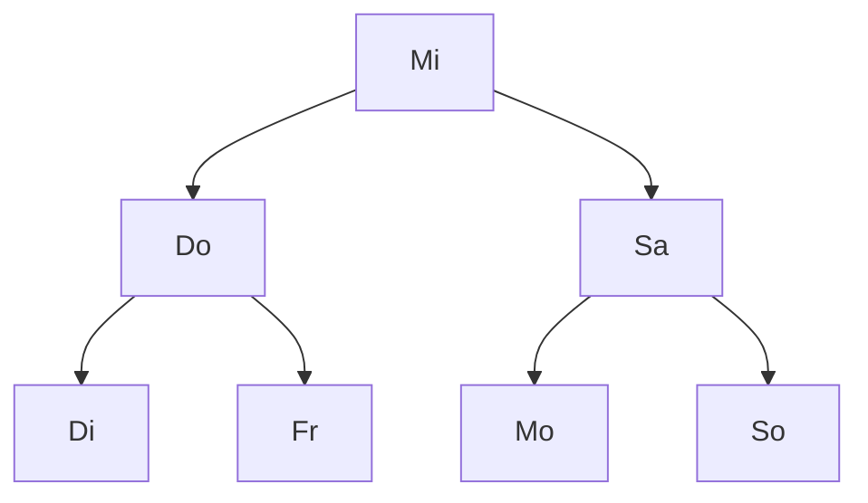
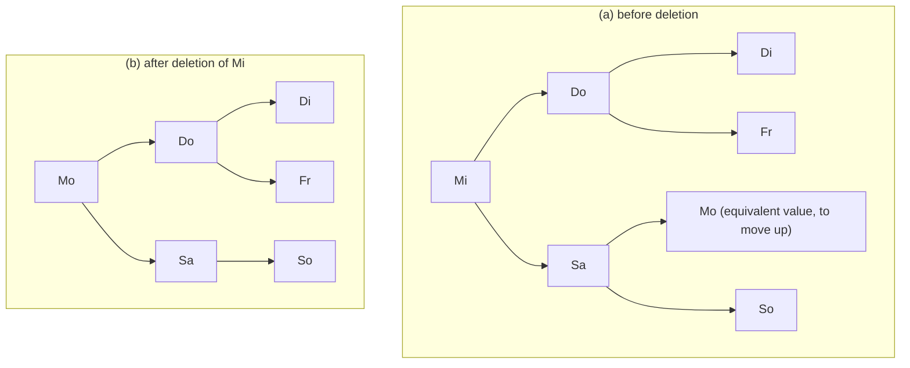

## One-sentence definition

A **binary search tree** (BST, *Binärer Suchbaum*) is a
[[structures/binary-tree]] that keeps all elements sorted in **inorder**
order, implementing the [[structures/dictionary]] ADT's `insert`, `delete`,
and `member` by exploiting that ordering for fast search (§0.11.4.1–§0.11.4.2).

## Core idea / invariant (§0.11.4.2)

For every node `x` in the tree:

- If `p_l` is a node in the left subtree of `x`, then `key(p_l) ≤ key(x)`.
- If `p_r` is a node in the right subtree of `x`, then `key(p_r) > key(x)`.
- Duplicates of `x`'s key may only occur in the left subtree.

Consequence: an **inorder traversal** of a BST visits the elements in sorted
order (traversal algorithms themselves are owned by
[[algorithms/tree-traversal]]).



*Abbildung 79*: a BST over the German weekday abbreviations, alphabetically
ordered (`Mi` = Mittwoch is the root).

## Operations table

| Operation | Best | Average | Worst | Assumption |
|---|---|---|---|---|
| `member` | O(log n) | O(log n) | O(n) | worst case: tree degenerated into a list |
| `insert` | O(log n) | O(log n) | O(n) | same |
| `delete` | O(log n) | O(log n) | O(n) | same |

See [[concepts/big-o-notation]] and [[concepts/complexity-classes]] for the
distinction between these bounds, and the full derivation below (§0.11.4.7).

## Pseudocode: search — `member` (§0.11.4.3)

Search for node `p_e` with key `k_e = key(p_e)`, starting at root `x`:

```
Pseudocode: member(x, k_e)
1. if key(x) == k_e: return FOUND(x)
2. else if k_e < key(x):
3.     if x.left exists: return member(x.left, k_e)
4.     else: return NOT_FOUND
5. else (k_e > key(x)):
6.     if x.right exists: return member(x.right, k_e)
7.     else: return NOT_FOUND
```

## Pseudocode: insert (§0.11.4.4)

Search for `p_e` as in `member`; if it is already contained *and* duplicates
are allowed, insert the new node as the **left child** of the found node
(consistent with the "duplicates only in the left subtree" invariant);
otherwise create a new leaf at the position where the search ended
unsuccessfully.

```
Pseudocode: insert(x, p_e)
1. search for p_e in tree starting at x (as in member)
2. if p_e already contained and duplicates allowed:
3.     insert new node as left child of the found node p_e
4. else if p_e not contained:
5.     create new leaf p_e at the position where search ended unsuccessfully
```

Note (§0.11.4.4): the tree's structure therefore depends on the **order of
insertion**. If elements are inserted already sorted, the tree degenerates
into a list — this is exactly the motivation for rebalancing structures such
as [[structures/avl-tree]].

## Pseudocode: delete, with the inorder-successor replacement case (§0.11.4.5)

Delete node `p_e` with key `k_e`. Define the **equivalent value**
(*äquivalenter Wert*) `k_ē`: the smallest key in the right subtree of `p_e`
— equivalently the inorder successor — or (per the alternative convention
the script also names) the largest key in the left subtree. **This lecture's
convention: use the smallest key in the right subtree.**

Search `p_e` by `k_e` starting at root `x`; abort if not found. When found,
distinguish three cases:

1. `p_e` is a leaf → delete `p_e` directly.
2. `p_e` has exactly one child → replace `p_e` by that child.
3. `p_e` has two children → replace `p_e`'s content with the equivalent
   node `p_ē`'s content, re-link any duplicate-key nodes of `k_ē` beneath
   the new node if applicable, then remove the original `p_ē` from its old
   position in the right subtree.

```
Pseudocode: delete(x, k_e)
1. search node p_e with key k_e starting at x; abort if not found
2. if p_e is a leaf:
3.     remove p_e
4. else if p_e has exactly one child:
5.     replace p_e by that child
6. else (p_e has two children):
7.     find equivalent node p_ē = smallest-key node in right subtree of p_e
8.     replace p_e's content with p_ē's content
9.     if duplicates of k_ē exist, re-link them under the new node
10.    remove the original p_ē node from its old position
```

### Worked deletion example (Abbildung 80, §0.11.4.6)

Task: delete `Mi` from the alphabetically sorted weekday tree.



Solution: the smallest element in `Mi`'s right subtree is `Mo`; delete `Mo`
from its old position, then replace `Mi`'s content with `Mo`.

## Complexity analysis (§0.11.4.7)

Search effort in a tree is bounded by the maximum path length:

| Case | Path length | Condition |
|---|---|---|
| Best (balanced) | **O(log n)** | the tree happens to be balanced |
| Worst (degenerate) | **O(n)** | e.g. elements inserted already sorted |
| Average (random insertion order) | **O(log n)**, specifically `2·ln(2)·log(n) + const` (without proof) | elements inserted in random order |

The dependence of shape on insertion order is exactly what motivates
rebalancing via [[structures/avl-tree]], which guarantees O(log n) in every
case.

## Trade-offs: when to use, when not to

- Use a plain BST when insertion order is expected to be close to random (or
  is explicitly randomized), and sorted enumeration via inorder traversal is
  needed.
- Avoid a plain BST when insertion order may be adversarial or sorted —
  prefer [[structures/avl-tree]] for a guaranteed bound, or
  [[structures/hash-table]] if sorted order is not required.

## Common pitfalls & gotchas

- Using the *left*-subtree-largest convention for the equivalent value when
  the surrounding code assumes the *right*-subtree-smallest convention (or
  vice versa) silently breaks duplicate re-linking.
- Forgetting that inserting already-sorted data produces a degenerate,
  list-like tree with O(n) operations.

## Related
- [[structures/binary-tree]] — the underlying unordered structure.
- [[structures/dictionary]] — the ADT this structure implements.
- [[structures/avl-tree]] — the self-balancing refinement.
- [[structures/hash-table]] — the alternative dictionary implementation.
- [[algorithms/tree-traversal]] — inorder/preorder/postorder traversal
  algorithms.
- [[algorithms/optimal-binary-search-tree]] — choosing node placement by
  search *probability* rather than by insertion order.
- [[concepts/big-o-notation]]
- [[concepts/complexity-classes]]

## Sources
- [[sources/grigat-algorithms-data-structures]] §0.11.4.1, §0.11.4.2,
  §0.11.4.3, §0.11.4.4, §0.11.4.5, §0.11.4.6, §0.11.4.7
