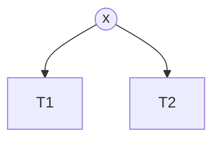
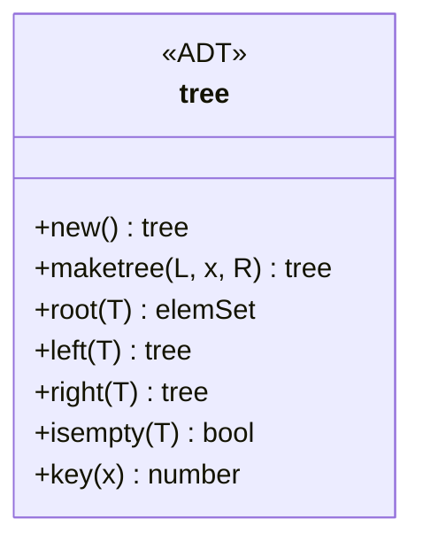
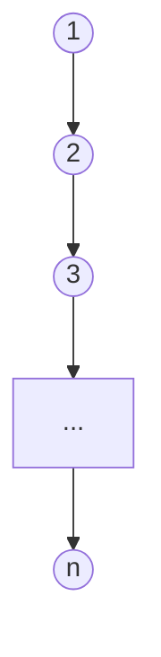
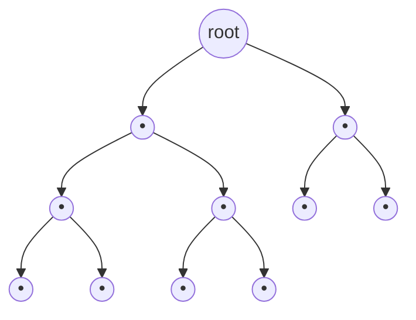
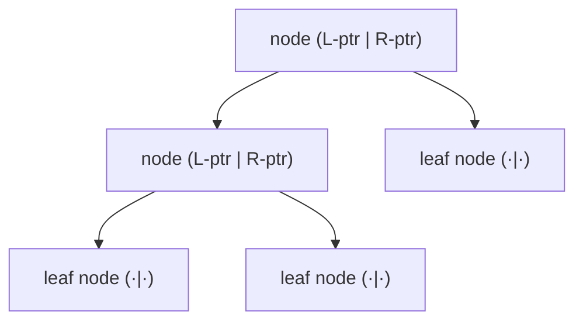
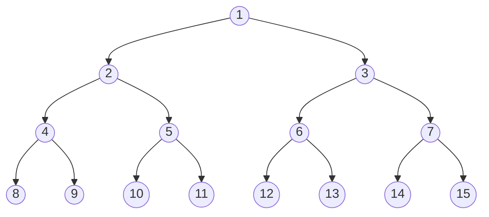

## One-sentence definition

A binary tree (*binärer Baum*) is either the empty tree `◇`, or a triple
`(T1, x, T2)` of a node `x` with a left subtree `T1` and a right subtree
`T2`, each themselves binary trees (§0.10.4.1).

## Nomenclature (§0.10.4.1)



| German | English |
|---|---|
| *Knoten* | node |
| *Kante* | edge |
| *Wurzel* | root — node `x` in `(T1, x, T2)` |
| *linker Teilbaum* | left subtree, `T1` |
| *rechter Teilbaum* | right subtree, `T2` |
| *Söhne* | children — roots of `T1`, `T2` |
| *Vater* | parent — `x` is the father of the roots of `T1`, `T2` |
| *Blatt* | leaf — a node with no children |
| *innerer Knoten* | internal node — any non-leaf node |
| *Schlüsselwert* | key value — one of the values stored in a node, used e.g. for sorting/searching |

## Recursive definition

- The empty tree `◇` ("leerer Baum") is a binary tree.
- `x` is a node and `T1, T2` are binary trees $\iff$ the triple `(T1, x, T2)`
  is a binary tree.

## The ADT functions (§0.10.4.2)

**Description:**

| Function | Meaning |
|---|---|
| `new` | creates an empty tree |
| `maketree` | combines a left subtree, an element, and a right subtree into a new tree |
| `root` | returns the root |
| `left` | returns the left subtree |
| `right` | returns the right subtree |
| `isempty` | checks whether the tree is empty |
| `key` | returns the key value of a node/element |

**Carrier sets:**

```
bool
elemSet
tree = {◇} ∪ {(L,x,R) | x ∈ elemSet, L,R ∈ tree}
```



**Formal definitions** (let `T = (L, x, R)`):

```
new:        → tree
new         = ◇

maketree:   tree × elemSet × tree → tree
maketree(L,x,R) = (L,x,R)

root:       tree → elemSet
root(T)     = x             if T = (L,x,R)
            = undefiniert   otherwise

left:       tree → tree
left(T)     = L             if T = (L,x,R)
            = undefiniert   otherwise

right:      tree → tree
right(T)    = R             if T = (L,x,R)
            = undefiniert   otherwise

isempty:    tree → bool
isempty(T)  = true   if T = ◇
            = false  otherwise

key:        elemSet → number
key(x)      = x             if x is itself a key value
            = k             if x is a tuple (...,k,...) and k is the key value
            = undef.        otherwise
```

## Paths, depth, and height (§0.10.4.3)

- **Pfad (path):** a sequence of nodes `⟨p0,...,pn⟩` such that `pi` is the
  father of `p(i+1)` for each `i ∈ {0,...,n-1}`.
- **Länge (length)** of a path: `laenge(⟨p0,...,pn⟩) = n` — the number of
  edges.
- **Höhe h (height)** of a tree `T`: the length of the longest root-to-leaf
  path, `laenge_max`.
- **Tiefe (depth)** of a node `p` in `T`: `tiefe_T(p) = laenge(⟨p_root,...,p⟩)`
  — the length of the path from the root to `p`.

## Maximum height (§0.10.4.4)

For a binary tree with `n` nodes:

$$h_{max}(n) = n - 1 \in O(n)$$

This corresponds to a tree degenerated into a list.



## Minimum height (§0.10.4.5)

**Vollständiger Baum (complete tree):** a tree where all levels except
possibly the lowest non-empty one are fully occupied. It is **links-vollständig**
(left-complete) if the lowest non-empty level is filled from the left,
without gaps, up to some leaf, and empty to the right of that point.



A complete tree has **minimal** height for its node count. Maximum node
count `N_h` of a binary tree of height `h`:

$$N_h = \sum_{i=0}^{h} 2^i = 2^{h+1} - 1$$

Deriving the minimum height `h_min(n)` from `N_{h-1} + 1 ≤ n < N_h + 1`:

$$(2^h - 1) + 1 \le n < (2^{h+1}-1) + 1 \implies h \le \log_2 n < h + 1$$
$$h_{min}(n) := \lfloor \log_2 n \rfloor$$

where $\lfloor x \rfloor$ is the next-smaller integer `z` with `z ≤ x < z+1`.
This is an **exact** bound, not merely an O-notation statement.

## Mapping a tree onto a list (traversal orders) (§0.10.4.6)

Formal definitions (`∘` is list concatenation):

```
inorder:    tree → list
inorder(◇)       = ◇
inorder((L,x,R)) = inorder(L) ∘ ⟨x⟩ ∘ inorder(R)

preorder:   tree → list
preorder(◇)       = ◇
preorder((L,x,R)) = ⟨x⟩ ∘ preorder(L) ∘ preorder(R)

postorder:  tree → list
postorder(◇)       = ◇
postorder((L,x,R)) = postorder(L) ∘ postorder(R) ∘ ⟨x⟩
```

Full treatment, numbered pseudocode, and a worked example are on
[[algorithms/tree-traversal]] (this page only states the formal definitions
that motivate it). See also [[structures/expression-tree]] for the
operator-tree application of these three traversals.

## Pointer implementation (§0.10.4.8)



The notes show node boxes with two pointer slots (left/right child); a leaf
has both slots null (dotted). The canonical C++ node implied by this layout
(reconstructed, standard for this kind of script):

```cpp
template <class T>
struct TreeNode {
    T data;
    TreeNode<T>* left;
    TreeNode<T>* right;
};
```

## Array implementation (§0.10.4.9)

A **complete** binary tree of height `h` can be embedded in an array of
length `2^(h+1) - 1`, numbering nodes 1 (root), 2, 3 (level 1), 4–7 (level
2), 8–15 (level 3), etc. — node number is directly the array index.



For every node `p` at index `i`:

$$Index(linker\ Sohn(p)) = 2i,\qquad Index(rechter\ Sohn(p)) = 2i+1$$

(The classic implicit/heap array layout; see [[structures/heap]], owned
elsewhere in this wiki, for a structure built directly on this indexing.)

## Complexity

| Operation | Complexity | Note |
|---|---|---|
| `new`, `maketree`, `root`, `left`, `right`, `isempty`, `key` | O(1) | direct field access / construction — the ADT gives no traversal-based operations itself |
| height computation (recursive `height(T)`) | O(n) | visits every node once |
| traversal (inorder/preorder/postorder) | O(n) | see [[algorithms/tree-traversal]] |
| height of a tree with n nodes | between $\lfloor \log_2 n \rfloor$ and $n-1$ | minimum when complete (§0.10.4.5), maximum when degenerated into a list (§0.10.4.4) |

See [[concepts/big-o-notation]] and [[concepts/complexity-classes]].

Pseudocode for computing height (standard recursive algorithm implied
directly by the §0.10.4.3 definitions, not given verbatim in the notes):

```
1. function height(T):
2.     if isempty(T): return -1        // convention: empty tree has height -1
3.     else: return 1 + max(height(left(T)), height(right(T)))
```

## Trade-offs: when to use, when not to

- Use the **array implementation** when the tree is (close to) complete —
  memory-dense, no pointer overhead, and the `2i`/`2i+1` indexing gives O(1)
  child access without storing pointers at all.
- Use the **pointer implementation** when the tree is sparse or highly
  unbalanced, since embedding a very unbalanced tree in an array wastes
  O(2^h) space for only O(n) real nodes.
- A binary tree degenerated into a list (§0.10.4.4) loses the O(log n) height
  advantage entirely; see [[structures/binary-search-tree]] and
  [[structures/avl-tree]] (owned elsewhere in this wiki) for structures that
  actively maintain balance.

## Common pitfalls & gotchas

- Confusing "complete" (*vollständig*) with "left-complete"
  (*links-vollständig*) — only the latter requires the last level to be
  filled strictly from the left.
- Off-by-one errors in the height convention: this page's pseudocode uses
  `height(◇) = -1` so that a single-node tree has height 0, consistent with
  "height = length of the longest path" (a single node has only a
  zero-length path to itself).
- Embedding a non-complete tree in the array scheme still requires reserving
  slots for the "missing" nodes implied by the `2i`/`2i+1` indexing, which
  can waste large amounts of memory for unbalanced trees.

## Related
- [[structures/general-tree]]
- [[algorithms/tree-traversal]]
- [[structures/expression-tree]]
- [[structures/linked-list]]
- [[concepts/abstract-data-type]]
- [[concepts/pointers-and-references]]
- [[concepts/arrays-and-dynamic-memory]]
- [[concepts/templates]]
- [[concepts/big-o-notation]]
- [[concepts/complexity-classes]]
- [[structures/binary-search-tree]] (owned elsewhere — link only)
- [[structures/heap]] (owned elsewhere — link only)

## Sources
- [[sources/grigat-algorithms-data-structures]] §0.10.4.1–§0.10.4.9
