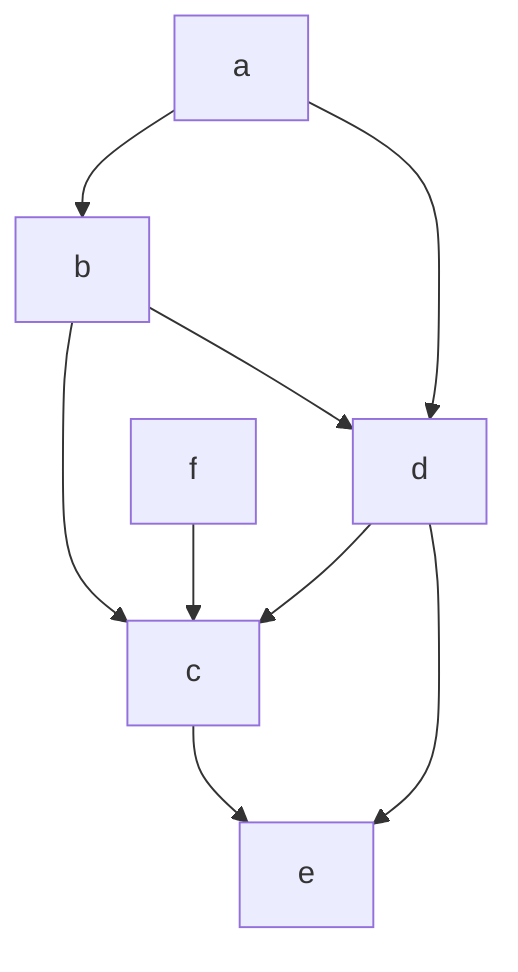

## One-sentence definition

A digraph is **acyclic** (*zyklenfrei*), i.e. a Dag (directed acyclic graph),
exactly when it contains no *Rückwärtskanten* (back edges)
[[sources/grigat-graphs-dynamic-programming]] §0.14.3.14.

## Core idea / invariant

- This is a [[algorithms/depth-first-search|DFS]]-relative definition: run a
  DFS and classify edges as tree / forward / back / cross; the graph is a DAG
  iff no edge is classified as a back edge (*Rückwärtskante*) during that
  traversal (see [[algorithms/depth-first-search]] §0.14.3.8 for the exact
  classification rule).
- **Worked example** (§0.14.3.14): removing edges (d,a) and (e,e) from the
  Digraph G used throughout §0.14.3 — whose DFS back edges were exactly
  (d,a) and (e,e), see [[algorithms/depth-first-search]] — yields an acyclic
  digraph.

## Trade-offs / why it matters

- DAGs are exactly the digraphs that admit a **topological order** — see
  [[algorithms/topological-sort]], whose underlying algorithm "fails on
  cycles" and therefore requires back edges to be removed first (i.e.
  requires a DAG as input).
- A DAG's spanning structure is still produced via
  [[algorithms/depth-first-search]] / [[algorithms/breadth-first-search]];
  what changes is only that no back edges occur, so every
  [[structures/spanning-tree|spanning tree]]/forest found is automatically
  consistent with a global order.

## Related
- [[structures/graph]]
- [[algorithms/depth-first-search]]
- [[algorithms/breadth-first-search]]
- [[algorithms/topological-sort]]
- [[structures/spanning-tree]]

## Sources
- [[sources/grigat-graphs-dynamic-programming]] §0.14.3.14
