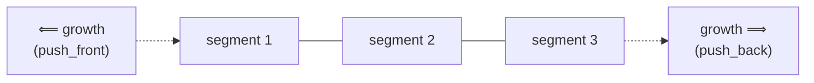

## One-sentence definition

`std::deque` is the STL's sequential container (*sequentieller Container*)
implementing a double-ended dynamisches Feld (dynamic array): elements can be
inserted or removed efficiently at *either* end, with direct `[]` access
(§0.5.6.4).

## Core idea / invariant

Unlike [[structures/vector]], which grows only at one end, a deque is backed
by a segmented storage structure that can grow at both the front and the back
without having to shift or fully reallocate existing elements. Direct access
via `[]` remains O(1) because the segmented layout still supports an
index-to-element mapping in constant time, even though elements are not all
in one single contiguous block.

## Operations table (§0.5.6.4)

| Operation | Complexity | Assumption |
|---|---|---|
| direct access `[]` | O(1) | — |
| insert/remove at the beginning | O(1) | — |
| insert/remove at the end | O(1) | — |
| insert/remove in the middle | O(n) | elements between the insertion point and the nearer end must shift |

## Memory layout: segmented storage



Abbildung 19 in the source (§0.5.6.4) depicts this as a row of boxes with
dotted arrows pointing *both* left and right, indicating growth is possible
on both ends — in contrast to Abbildung 18 for [[structures/vector]], which
only grows on the right.

## Pseudocode: push_front / push_back

The source gives no internal algorithm for deque's segmented growth; the
following states the operation-level behavior implied by the O(1) bound at
both ends (§0.5.6.4), not an internal reallocation algorithm.

```
1. procedure push_front(dq, value):
2.     if no free slot before the first segment's first element:
3.         allocate a new front segment               // O(1), does not touch existing elements
4.     place value at the new front position
5.     dq.size ← dq.size + 1

6. procedure push_back(dq, value):
7.     if no free slot after the last segment's last element:
8.         allocate a new back segment                // O(1), does not touch existing elements
9.     place value at the new back position
10.    dq.size ← dq.size + 1
```

## Reference implementation / usage example (§0.5.6.4)

```cpp
#include <deque>

int main()
{
  std::deque<float> deq;
  for(int i = 1; i <= 5; ++i)
  {
    deq.push_front(i*1.1);
    deq.push_back(i*2.1);
  }
  std::cout << deq[0];//Ausgabe: 5.5
}
```

The notes explain the output: because `push_front` is called repeatedly, each
new value becomes the new front element, so after the loop `deq[0]` holds the
*last* value pushed to the front — the one from `i=5`, i.e. `5*1.1 = 5.5`.

## Trade-offs vs. vector

- Use `deque` instead of `vector` whenever insertion at the *front* is needed
  as well as at the back (§0.5.6.2): `vector`'s front insertion is O(n),
  `deque`'s is O(1).
- `vector` keeps elements in one single contiguous block, which can matter
  for cache locality and for passing a raw pointer to C APIs; `deque`'s
  segmented storage does not guarantee contiguity across the whole container.
- Both support O(1) random access via `[]` and O(n) insertion/removal in the
  middle — the difference is specifically at the two ends.

## Common pitfalls & gotchas

- As with `vector`, `deque::operator[]` does not check bounds; `deque::at()`
  throws `out_of_range` if out of range, matching the general note on direct
  element access (§0.5.6.10).
- Easy to misread `push_front` ordering: repeated `push_front` calls build the
  sequence in *reverse* call order at the front, as the worked example above
  shows.

## Related
- [[structures/vector]]
- [[structures/list]]
- [[concepts/stl-containers]]
- [[concepts/memory-model]]
- [[concepts/complexity-classes]]

## Sources
- [[sources/grigat-cpp-concepts-generic]] §0.5.6.2, §0.5.6.4, §0.5.6.10
