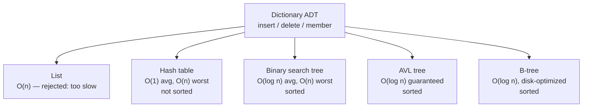

## One-sentence definition

A **dictionary** (*Wörterbuch*) is an [[concepts/abstract-data-type|abstract
data type]] with exactly three operations — `insert`, `delete`, `member` —
that, unlike [[structures/set]], has no set-algebra functions, which lets
implementations specialize for raw lookup speed (§0.11.2).

## Core idea / invariant

A dictionary is the minimal "lookup table" ADT: given a key, answer whether
it is present (`member`), add it (`insert`), or remove it (`delete`). The
**goal** stated in the source is explicit and aggressive (§0.11.2.1):

- Time complexity **O(1)** for `insert`, `delete`, `member`.
- Memory requirement ideally **O(n)**, linear in the cardinality `n` of the
  stored set — **not** proportional to some fixed universe size.

These two requirements together rule out some structures outright:

- A plain list is unsuitable for the time goal (§0.11.2): search is O(n).
- A bit vector is unsuitable for the memory goal: bit vectors are sized for
  the *maximum possible* cardinality, not the actual `n` (§0.11.2).

## Datentyp: Dictionary — functions

```
insert:  dict × element → dict
delete:  dict × element → dict
member:  dict × element → bool
```

## Decision guide: candidate implementations (§0.11.2.1)

The script names three solutions (*Lösungen*) for the dictionary data
structure:

1. **Hashing** → [[structures/hash-table]]
2. **Binäre Suchbäume** (binary search trees) → [[structures/binary-search-tree]]
3. **AVL-Bäume** (AVL trees) → [[structures/avl-tree]]

A fourth structure appears later in the course material for large,
disk-resident dictionaries: [[structures/b-tree]].

| Implementation | `insert`/`delete`/`member` | Memory | Keeps keys sorted? | Notes |
|---|---|---|---|---|
| [[structures/linked-list]] (plain list) | O(n) | O(n) | only if kept sorted, and then still O(n) to insert | ruled out by the O(1) time goal |
| [[structures/hash-table]] | O(1) best case, O(n) worst case (collisions) | O(n + m) | no — cannot easily enumerate in sorted order | easiest to implement; needs a good hash function |
| [[structures/binary-search-tree]] | O(log n) average, O(n) worst case (degenerates to a list) | O(n) | yes (inorder) | depends on insertion order for balance |
| [[structures/avl-tree]] | **O(log n) guaranteed** (best, average, and worst case) | O(n) | yes (inorder) | self-balancing; rebalances via rotation after every update |
| [[structures/b-tree]] | O(log n), tuned for block/disk I/O | O(n) | yes | used by W9's external-storage material |

None of the tree-based or hash-based structures achieves true worst-case
O(1); only the AVL tree guarantees O(log n) in *every* case (best, average,
*and* worst), which is why it is presented as hashing's main competitor when
a sorted enumeration or guaranteed bound is required.



## Related
- [[structures/set]] — the superset ADT that adds union/intersection/
  difference; a dictionary is a set without the set-algebra operations.
- [[structures/set-and-map]] — the STL `std::map`/`std::set` containers,
  which are concrete (typically balanced-tree) realizations of this ADT.
- [[structures/unordered-containers]] — the STL `std::unordered_map`/
  `std::unordered_set`, which realize this ADT via hashing.
- [[concepts/abstract-data-type]]
- [[concepts/big-o-notation]]
- [[concepts/complexity-classes]]

## Sources
- [[sources/grigat-algorithms-data-structures]] §0.11.2, §0.11.2.1
