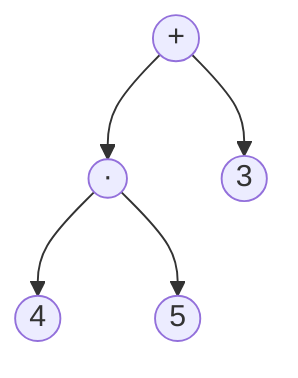

## One-sentence definition

An expression tree, or operator tree (*Operatorbaum*), represents an
arithmetic expression as a [[structures/binary-tree]] whose internal nodes
are operators and whose leaves are operands, such that the tree's three
standard traversals ([[algorithms/tree-traversal]]) read off exactly the
infix, prefix, and postfix forms of the expression (§0.10.4.7).

## Core idea / invariant

**Invariant:** for any subtree `(L, op, R)` of an operator tree, the subtree
represents the expression "`L op R`" (infix), and this nests recursively —
an operand leaf represents itself.

## Worked example (§0.10.4.7, Abbildung 69)

Operator tree `T`: root `+`, left child `·` (multiplication), right child
`3`; node `·` has children `4` (left) and `5` (right).



This represents the expression $(4 \cdot 5) + 3$.

## Correspondence between traversal and notation

Traversal results for the tree above, given verbatim in the notes:

```
inorder(T)   = <4,·,5,+,3>   (Infix-Notation)
preorder(T)  = <+,·,4,5,3>   (Prefix-Notation)
postorder(T) = <4,5,·,3,+>   (Postfix-Notation)
```

| Traversal | Notation | Why |
|---|---|---|
| **inorder** | infix | the operator is visited *between* its left and right subtree's traversals — matching how infix places an operator between its two operands |
| **preorder** | prefix (Polish) | the operator is visited *before* its subtrees — matching how prefix places an operator before its operands |
| **postorder** | postfix (reverse Polish) | the operator is visited *after* its subtrees — matching how postfix places an operator after its operands |

Note that `<4,·,5,+,3>` is not fully parenthesized infix (it omits the
parentheses that would normally be required to disambiguate precedence,
e.g. around `4·5`); the tree structure itself encodes precedence/grouping
unambiguously, which is precisely the point of using a tree representation
instead of a flat token string.

## Pseudocode

The three traversal procedures are exactly those on
[[algorithms/tree-traversal]] (`inorder`, `preorder`, `postorder`); this page
adds no new traversal algorithm, only the operator-tree interpretation of
their output:

```
1. function toInfix(T):    return inorder(T)     // operator between operands
2. function toPrefix(T):   return preorder(T)    // operator before operands
3. function toPostfix(T):  return postorder(T)   // operator after operands
```

## Complexity

| Operation | Complexity | Note |
|---|---|---|
| producing infix/prefix/postfix via the corresponding traversal | O(n) | n = number of nodes in the expression tree; see [[algorithms/tree-traversal]] |
| evaluating a postfix sequence produced this way | O(m) | m = number of tokens; see [[algorithms/postfix-evaluation]] for the stack-based evaluation algorithm and its worked example |

See [[concepts/big-o-notation]] and [[concepts/complexity-classes]].

## Reference implementation

The notes give no C++ listing for expression trees specifically — only the
worked tree example and its three traversal results. The node type is the
same pointer-based `TreeNode<T>` given for [[structures/binary-tree]]
(§0.10.4.8), with `T` instantiated to hold either an operator symbol or an
operand value (e.g. via a tagged union/variant, not specified in the notes).

## Trade-offs: when to use, when not to

- An expression tree is the natural intermediate representation when a
  compiler or calculator needs to reorder/evaluate an expression without
  being tied to one surface notation — any of infix/prefix/postfix can be
  regenerated from the same tree via the appropriate traversal.
- If an expression is only ever consumed in postfix form, and never needs to
  be converted back to infix/prefix or further transformed, it may be
  cheaper to work directly with the postfix token stream and skip
  constructing the tree at all — see [[algorithms/postfix-evaluation]],
  which evaluates postfix directly with a stack, with no tree construction
  step.

## Common pitfalls & gotchas

- Inorder traversal of an operator tree does **not** reproduce a fully
  parenthesized or precedence-correct infix string by itself — the raw
  token sequence `<4,·,5,+,3>` loses the grouping information that the tree
  shape encoded; reconstructing a precedence-correct infix *string* requires
  additionally inserting parentheses based on operator precedence, which is
  not covered in this part of the notes.
- Confusing "prefix" (preorder) with "postfix" (postorder) output order is a
  common source of bugs when building an expression evaluator — see
  [[algorithms/postfix-evaluation]]'s pitfall note on operand pop order for a
  related confusion specific to postfix evaluation.

## Related
- [[structures/binary-tree]]
- [[algorithms/tree-traversal]]
- [[algorithms/postfix-evaluation]]
- [[structures/stack]]
- [[concepts/big-o-notation]]
- [[concepts/complexity-classes]]

## Sources
- [[sources/grigat-algorithms-data-structures]] §0.10.4.7
