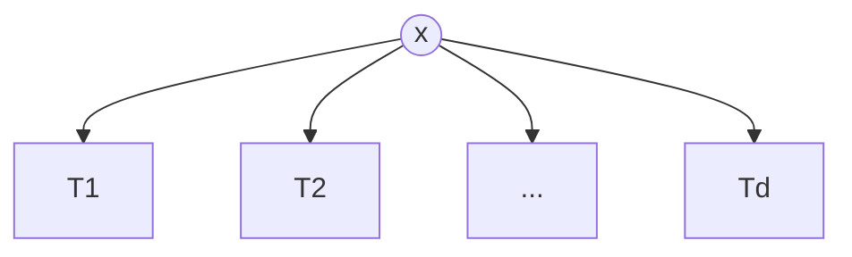
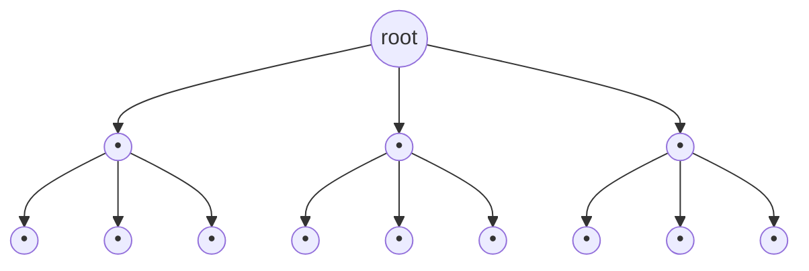
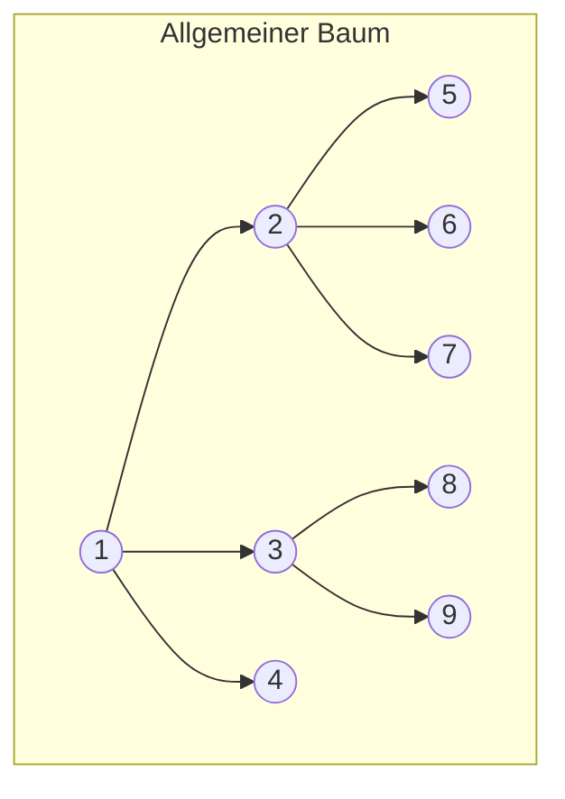
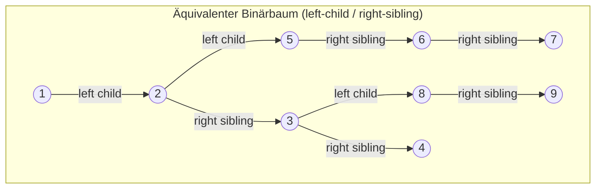

## One-sentence definition

A general tree (*allgemeiner Baum*) generalizes [[structures/binary-tree]]
from exactly two subtrees to any number `d` of them: either a single node, or
a `(d+1)`-tuple `(x, T1, T2, ..., Td)` of a node `x` and `d` subtrees
(§0.10.5.1).

## Definition (§0.10.5.1)

- A single node `x` is a tree.
- If `x` is a node and `T1,...,Td` are trees, then the `(d+1)`-tuple
  `(x, T1,...,Td)` is a tree.

## Terminology

| German | English |
|---|---|
| *Wurzel* | root — `x` |
| *Söhne* | children — roots of `T1,...,Td` |
| *Vater* | parent — `x` is the father of the roots of `T1,...,Td` |
| *Grad eines Knotens* | degree of a node — number of its children |
| *Grad eines Baumes* | degree of a tree — maximum degree over any node in the tree |
| *Wald* | forest — a set of trees with disjoint node sets; obtained by removing the root of a tree |

## Maximum height (§0.10.5.2)

Maximum height of a tree of degree `d` with `n` nodes:

$$h_{max}(n) = n - 1 \in O(n)$$

As with [[structures/binary-tree]], this corresponds to a tree degenerated
into a list.

## Maximum node count and minimum height (§0.10.5.3)

**Theorem — maximum node count $N_h$ for degree `d` and height `h`:**

$$N_h = \sum_{i=0}^{h} d^i = \frac{d^{h+1}-1}{d-1} \quad \forall d \ne 1$$

**Proof** (recurrence on `N_h`):

$$N_{h+1} = d^{h+1} + N_h = 1 + d \cdot N_h$$
$$\iff d^{h+1} - 1 = (d-1) \cdot N_h \iff N_h = \frac{d^{h+1}-1}{d-1}$$

**Minimum required height** of a tree of degree `d` with `n` nodes (a
complete tree with a given node count has minimal height):

$$N_{h-1} < n \le N_h \implies \frac{d^h-1}{d-1} < n \le \frac{d^{h+1}-1}{d-1}$$
$$\implies h < \log_d(n\cdot(d-1)+1) \le h+1$$
$$h = \lceil \log_d(n\cdot(d-1)+1) \rceil - 1$$

**Upper bound**, using $n(d-1)+1 \le nd$:

$$h \le \lceil \log_d nd \rceil - 1 = \lceil \log_d n \rceil + \log_d d - 1 = \lceil \log_d n \rceil$$

**Final result:**

$$h_{min}(n) \in O(\log_d n) = O(\log n)$$

## Left-child, right-sibling representation as a binary tree (§0.10.5.4)

A general tree of arbitrary degree can be represented as a
[[structures/binary-tree]]: each node's **leftmost child** in the general
tree becomes its **left child** in the binary tree; each subsequent
**sibling** becomes the **right child** of the previous sibling.

**Mapping rules (as stated in the notes):**
- General tree: son $p_{l,allg}$ is leftmost w.r.t. father $p_{V,allg}$
  $\implies$ Binary tree: left son $p_{l,bin} \equiv p_{l,allg}$ of father
  $p_{V,bin} = p_{V,allg}$.
- General tree: brother $p_{i+1,allg}$ to the right of son $p_{i,allg}$
  $\implies$ Binary tree: right son $p_{r,bin} \equiv p_{i+1,allg}$ of father
  $p_{V,bin} \equiv p_{i,allg}$.

Both diagrams depict the **same tree** — node 1 with children 2, 3, 4; node 2
with children 5, 6, 7; node 3 with children 8, 9 — viewed first as a general
tree, then as its equivalent binary-tree encoding. This lets a general tree
of arbitrary degree be implemented with exactly the two-pointer node layout
of [[structures/binary-tree]]'s pointer implementation, instead of needing a
variable-length array of child pointers per node.

## Complexity

| Operation | Complexity | Note |
|---|---|---|
| maximum height, degenerate tree | O(n) | same degeneration as [[structures/binary-tree]] |
| minimum height, complete tree of degree d | $O(\log_d n) = O(\log n)$ | derived above (§0.10.5.3) |
| converting between general-tree and left-child/right-sibling binary form | O(n) | each node and its sibling links are visited once |
| access to left-child/right-sibling binary encoding | O(1) | same two-pointer access as [[structures/binary-tree]] |

See [[concepts/big-o-notation]] and [[concepts/complexity-classes]].

## Reference implementation

The notes do not give C++ code for a general tree in this excerpt — only the
mathematical definition, the height/node-count derivation, and the
left-child/right-sibling mapping diagrams above. A general tree implemented
via the left-child/right-sibling trick reuses exactly the
`TreeNode<T>{ data; left; right; }` layout shown on [[structures/binary-tree]]
(§0.10.4.8), relabeling `left` as "first child" and `right` as "next
sibling."

## Trade-offs: when to use, when not to

- Use a general tree when nodes naturally have a variable, data-dependent
  number of children (file-system directory trees, parse trees of
  non-binary grammars, organizational hierarchies).
- Prefer the left-child/right-sibling binary encoding when memory layout
  uniformity matters (fixed two-pointer nodes) over a direct array-of-children
  representation, which would need variable-size nodes or a separate
  dynamic array per node.
- If every node has a fixed degree exactly 2, use [[structures/binary-tree]]
  directly — the general-tree machinery (degree tracking, forests) is
  unnecessary overhead.

## Common pitfalls & gotchas

- The maximum-node-count formula $N_h = \frac{d^{h+1}-1}{d-1}$ is undefined
  for `d = 1` (division by zero) — a degree-1 tree is just a chain/list, for
  which $N_h = h+1$ directly (no geometric-series collapse needed).
  [[structures/linked-list]] is the natural structure for that case.
- When converting to the left-child/right-sibling form, it is easy to
  mistakenly treat "right child" in the binary encoding as "actual right
  subtree" rather than "next sibling" — the two interpretations produce the
  same pointer layout but very different traversal semantics.

## Related
- [[structures/binary-tree]]
- [[algorithms/tree-traversal]]
- [[structures/linked-list]]
- [[concepts/abstract-data-type]]
- [[concepts/pointers-and-references]]
- [[concepts/big-o-notation]]
- [[concepts/complexity-classes]]

## Sources
- [[sources/grigat-algorithms-data-structures]] §0.10.5.1–§0.10.5.4
