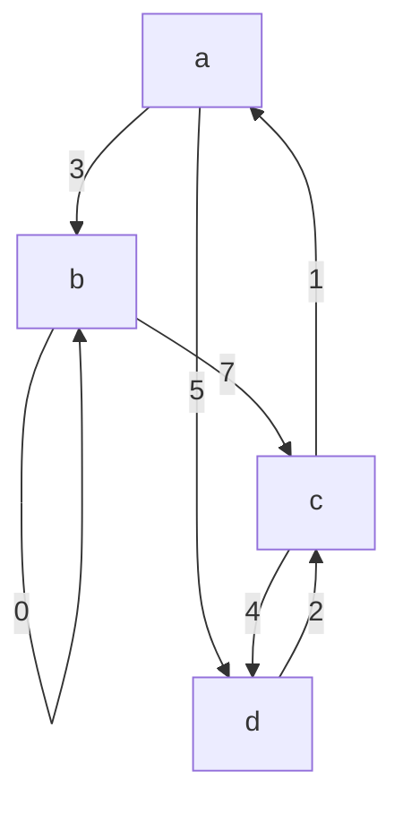

## One-sentence definition

A graph **G = (V, E)** can be stored either as an **Adjazenzmatrix** (adjacency
matrix) or as **Adjazenzlisten** (adjacency lists); the choice trades memory
for the speed of an adjacency test [[sources/grigat-graphs-dynamic-programming]]
§0.14.2.4–§0.14.2.5.

## Core idea / invariant

- **Adjazenzmatrix**: representation of digraph D = (V,E), V = {v₁,…,vₙ}, as a
  boolean n×n matrix **A** with aᵢⱼ = 1 if (vᵢ,vⱼ) ∈ E, else 0. English
  *adjacence* ↔ German *Nachbarschaft* (neighborhood) §0.14.2.4.
- **Adjazenzliste**: for each node, a list of its successor nodes
  (*Nachfolgerknoten*); the order within a list is arbitrary (*beliebig*). All
  per-node lists are managed together in one list structure §0.14.2.5.
- For a **weighted** graph:
  - in the matrix, the weight w(u,v) replaces the boolean 1, and a missing
    edge is marked **∞** (or 0, if only positive weights occur) §0.14.2.4.
  - in the list, the weight w(u,v) is stored together with node v in u's
    adjacency list, i.e. each list cell holds a (target, weight) pair
    §0.14.2.5.

## Operations table / comparison (§0.14.2.4–§0.14.2.5)

| | Adjacency matrix | Adjacency list |
|---|---|---|
| Storage cost (*Speicheraufwand*) | O(n²), n = \|V\| | O(n + e), n = \|V\|, e = \|E\| ≤ n² |
| Time to test adjacency of two nodes (*Rechenzeit*) | O(1) | O(n), i.e. O(\|V\|) |
| Favourable when | e close to n² (dense graph) | e ≪ n² (sparse graph) — stated explicitly in the source as advantageous |

Both costs are stated directly by the source in terms of n = \|V\| and (for
the list) e = \|E\|; see [[concepts/big-o-notation]] and
[[concepts/complexity-classes]] for the notation and the growth-rate
vocabulary used here.

## Worked example — the same weighted graph in both representations

Source weighted digraph (Abbildung 111/113/115), edges and weights:
a→b=3, b→b (self-loop)=0, a→d=5, c→a=1, b→c=7, d→c=2, c→d=4.

### Adjacency matrix (Abbildung 113)

Non-existent edges marked **∞**.

| | a | b | c | d |
|---|---|---|---|---|
| **a** | ∞ | 3 | ∞ | 5 |
| **b** | ∞ | 0 | 7 | ∞ |
| **c** | 1 | ∞ | ∞ | 4 |
| **d** | ∞ | ∞ | 2 | ∞ |

For comparison, the **unweighted** digraph of Abbildung 110 (a→b, a→c, b→c,
c→d, d→a) has the boolean adjacency matrix of Abbildung 112:

| | a | b | c | d |
|---|---|---|---|---|
| **a** | 0 | 1 | 1 | 0 |
| **b** | 0 | 0 | 1 | 0 |
| **c** | 0 | 0 | 0 | 1 |
| **d** | 1 | 0 | 0 | 0 |

### Adjacency list (Abbildung 115)

Each list cell stores a (target-node, weight) pair; lists are terminated by
NULL.

- a's list: (b,3) → (d,5) → NULL
- b's list: (b,0) → (c,7) → NULL
- c's list: (a,1) → (d,4) → NULL
- d's list: (c,2) → NULL

The matrix row `a: [∞, 3, ∞, 5]` and the list `a → (b,3) → (d,5) → NULL`
describe the **same** two outgoing edges of `a`; the matrix spends O(n) cells
per row even for the entries that are ∞, while the list only stores the
entries that actually exist — this is exactly the O(n²) vs. O(n+e) trade-off
in the table above.

## Trade-offs: when to use, when not to

- Use the **adjacency matrix** when adjacency tests dominate (O(1) lookup) and
  the graph is dense, or when weights need O(1) random access.
- Use the **adjacency list** when the graph is sparse (e ≪ n²), since the
  matrix would waste O(n²) space storing mostly-∞/0 entries; this is the
  representation [[algorithms/depth-first-search]] and
  [[algorithms/breadth-first-search]] default to for their O(n+e) complexity.
- Compare with how [[structures/vector]] (contiguous, O(1) access) and
  [[structures/list]] (linked, no random access) trade the same contiguous-vs-
  linked storage decision at the container level — see also
  [[concepts/stl-containers]] and [[concepts/pointers-and-references]] for
  the pointer-chasing cost underlying linked adjacency lists.

## Related
- [[structures/graph]]
- [[algorithms/depth-first-search]]
- [[algorithms/breadth-first-search]]
- [[concepts/big-o-notation]]
- [[concepts/complexity-classes]]
- [[structures/vector]]
- [[structures/list]]

## Sources
- [[sources/grigat-graphs-dynamic-programming]] §0.14.2.4, §0.14.2.5
