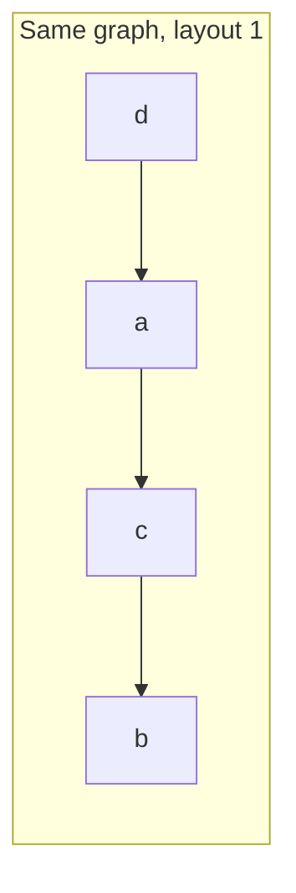
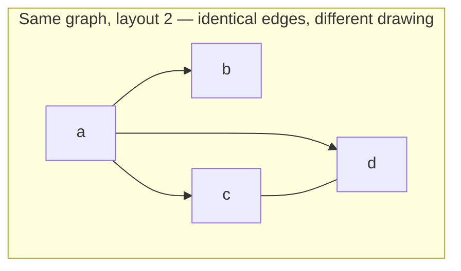
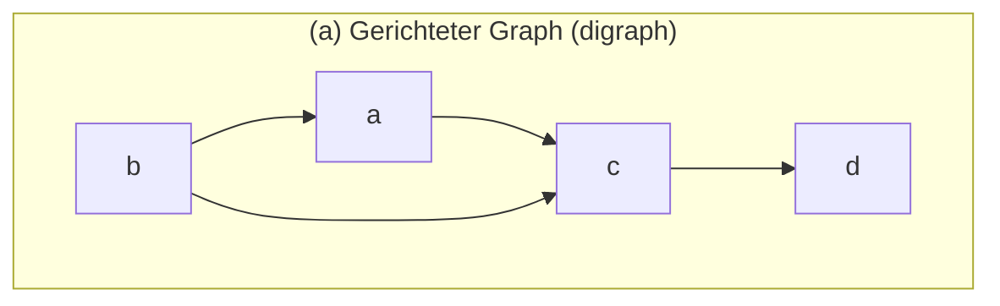
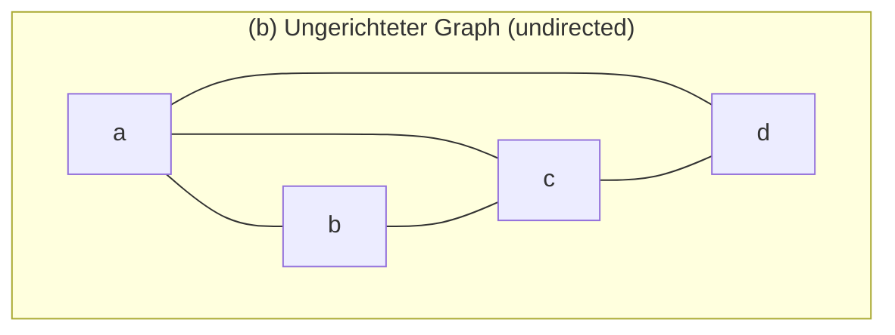
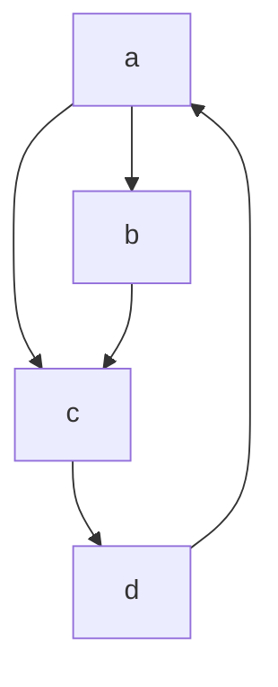
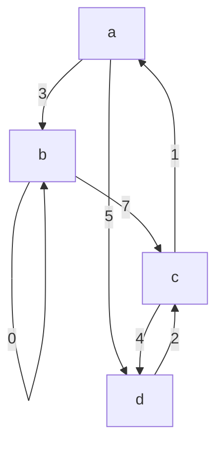

## One-sentence definition

A graph (*Graph*) **G** combines a set **V** of nodes with a relation
**E ⊆ V × V** into a structure **G = (V, E)** [[sources/grigat-graphs-dynamic-programming]] §0.14.1.1.

## Core idea / invariant

- **v ∈ V**: *Knoten* (node, vertex).
- **e = (v, w) ∈ E**: *Kante* (edge, arc) between nodes v and w.
- If the edge (v, w) exists, v and w are *adjazent* (adjacent).
- **|V|**: number of nodes; **|E|**: number of edges — these are the two
  parameters used throughout for running-time estimates (*Laufzeitabschätzung*)
  §0.14.1.1.
- **Grad** (degree) of a node: number of incoming and outgoing edges.
  - *Eingangsgrad* (in-degree): number of incoming edges.
  - *Ausgangsgrad* (out-degree): number of outgoing edges.
- **Pfad / Weg** (path): a sequence of nodes v₁,…,vₙ such that (vᵢ, vᵢ₊₁) ∈ E
  for all i. Its *Länge* (length) is the number of edges it contains.
- **Einfacher Pfad** (simple path): all nodes pairwise distinct, except that
  v₁ = vₙ is allowed.
- **Zyklus** (cycle): a simple path with v₁ = vₙ and n > 1 §0.14.2.2.
- **Gewichteter Graph** (weighted graph): a graph whose edges carry values
  (*Gewichte*, weights), e.g. distances/travel times in a transportation
  network, or currents/voltages in an electrical network §0.14.2.3.
- A **key teaching point** of the source: the geometric layout of nodes/edges
  on paper is *ohne Bedeutung* (without meaning) — only which pairs of nodes
  are connected, and in which direction, matters §0.14.1.2.





## Classification of graphs (§0.14.1.3–0.14.2)

| Criterion | Definition |
|---|---|
| *symmetrisch* (symmetric) | ∀v, w ∈ V, v ≠ w: edge (v,w) exists ⇒ edge (w,v) exists |
| *asymmetrisch* (asymmetric) | ∃v, w ∈ V, v ≠ w: edge (v,w) exists ∧ edge (w,v) does **not** exist |
| *reflexiv* (reflexive) | every node is connected to itself |
| *irreflexiv* (irreflexive) | edge (v,v) is excluded for all nodes |
| *transitiv* (transitive) | ∀v,w,z ∈ V: edges (v,w) and (w,z) exist ⇒ edge (v,z) exists |

**Gerichteter Graph** (*Digraph*, directed graph) vs. **ungerichteter Graph**
(undirected graph) §0.14.1.4–0.14.2.1:

- A **digraph**: edges have direction, drawn with arrows; may be symmetric or
  asymmetric; self-loops (v,v) are allowed.
- An **undirected graph**: a special case of a symmetric graph — the pair of
  edges {(v,w),(w,v)} is represented by **one** undirected edge; self-loops
  are **not** allowed. The source notes that algorithms are first discussed
  for digraphs (the more general case), with undirected graphs following
  later.





### Worked example digraph (used throughout this page family)

```
V = {a, b, c, d}
E = {(a,b), (a,c), (b,c), (c,d), (d,a)}
```



in-degree(c) = 2, out-degree(c) = 1; `(a,b,c,d)` is a path; `(a,b,c,d,a)` is a
cycle §0.14.2.2.

### Weighted graph example



## Related
- [[structures/graph-representations]] — adjacency matrix and adjacency list
- [[algorithms/depth-first-search]]
- [[algorithms/breadth-first-search]]
- [[structures/spanning-tree]]
- [[structures/dag]]
- [[algorithms/topological-sort]]
- [[concepts/big-o-notation]]
- [[concepts/complexity-classes]]
- [[structures/tree-structures-comparison]]

## Open questions
- The script foreshadows Dijkstra's shortest-path algorithm and Prim's
  minimum-spanning-tree algorithm as BFS-like generalizations
  (§0.14.3.1, "ähnlich den Algorithmen von Dijkstra, Prim"), but no worked
  content for either algorithm appears anywhere in the pages scanned for this
  ingest (printed pp. 400–422). Is this material covered later in the script
  (beyond p. 422), or in a different source entirely, and should
  `algorithms/dijkstra` / a minimum-spanning-tree page be created once such a
  source is found?

## Sources
- [[sources/grigat-graphs-dynamic-programming]] §0.14.1.1, §0.14.1.2, §0.14.1.3,
  §0.14.1.4, §0.14.2.1, §0.14.2.2, §0.14.2.3
