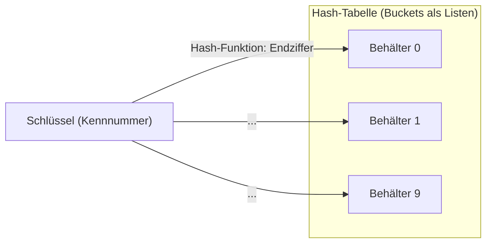
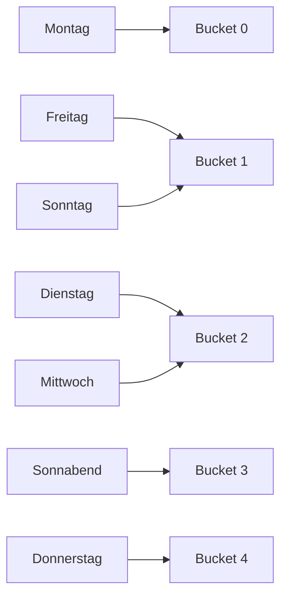
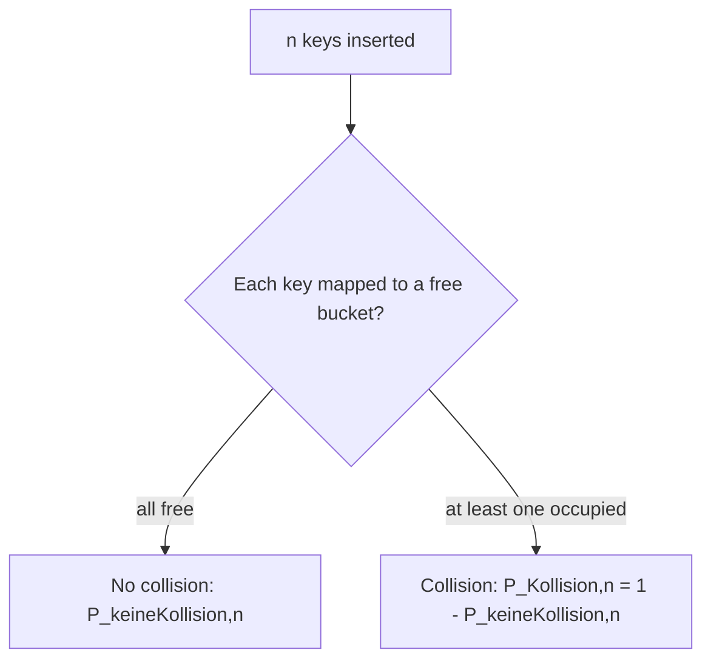
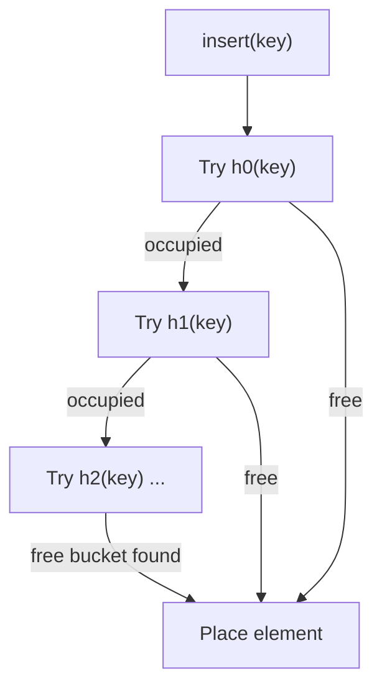
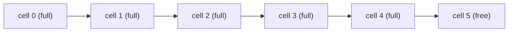
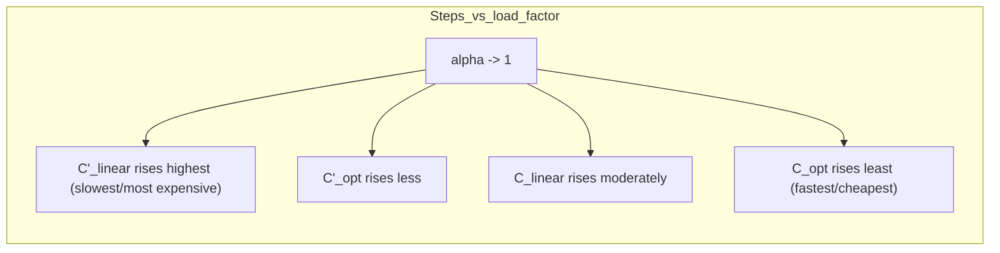

## One-sentence definition

A **hash table** (*Hash-Tabelle*) implements the [[structures/dictionary]]
ADT by computing, from a key, the index of a *bucket* (*Behälter*) in which
the element is stored, trading a small chance of **collision** for expected
O(1) `insert`/`delete`/`member` (§0.11.3.1).

> [!note] Not the STL container
> This page is the **hash-table data structure** itself: hash functions,
> collision handling, load factor. For the C++ standard-library containers
> built on top of it, see [[structures/unordered-containers]]
> (`std::unordered_set`/`std::unordered_map`).

## Core idea / invariant (§0.11.3.1)

Use hashing when the key domain is much larger than the number of available
buckets: `|D| ≫ m`, where `D` is the value range (*Wertebereich*) of keys and
`m` the number of buckets. Group elements into buckets within a table; from
a key, *compute* the bucket; within a bucket, fall back to "less efficient"
methods such as linear search in a list.

**Worked analogy (§0.11.3.1):** picking up photo prints at a drugstore
(*Abholung von Fotoarbeiten in einer Drogerie*) — the element is the photo
envelope (*Fotoversandtasche*), the key is its tracking/order number
(*Kennnummer*), the buckets are the pigeonhole slots (*Fächer*), and the
bucket-computation rule is "take the last digit of the tracking number"
(*Endziffer der Kennnummer*), i.e. `h(k) = k mod 10`.



## Hash function requirements (§0.11.3.2)

A hash function `h : D → {0, …, m−1}` must be:

- **Surjective** (*Surjektivität*): it must cover all buckets.
- **Uniform** (*gleichmäßig*): keys should be distributed uniformly over all
  buckets.
- **Efficient** to compute.

### The division method (§0.11.3.3)

```
h(k) = k mod m                                   (1)
```

Drawback: consecutive key values `k` map to consecutive cells — poor
scattering for sequential keys.

### The mid-square method (§0.11.3.4)

```
h(k) = middle digits of k²                       (2)
```

Example, `m = 100`:

| k   | k mod m | k²    | h(k) |
|-----|---------|-------|------|
| 111 | 11      | 12321 | 32   |
| 112 | 12      | 12544 | 54   |
| 113 | 13      | 12769 | 76   |

*Table 15.* Good scattering (*gute Streuung*), because `h(k)` depends on all
digits of `k`.

## Nomenclature (§0.11.3.5)

| Term | German | Meaning |
|---|---|---|
| Open hashing | *Offenes Hashing* | Every bucket may contain arbitrarily many keys. |
| Closed hashing | *Geschlossenes Hashing* | A maximum of `b_max` keys per bucket is prescribed (this page only treats `b_max = 1`). |
| Open addressing | *Offene Adressierung* | Elements stored directly in the hash table; implies closed hashing with `b_max = 1`. |
| Collision | *Kollision* | Several keys map to the same bucket. |
| Overflow | *Überlauf* | Under closed hashing, at least `b_max` collisions exist for one bucket. |

## Worked example: open hashing with the division method (§0.11.3.6)

Hashing German weekday names, hash function = *number of letters* `mod 6`.
Collisions occur at buckets 1 and 2.

| h(k) | Bucket content (Behälterinhalt) |
|------|----------------------------------|
| 0    | Montag |
| 1    | Freitag, Sonntag |
| 2    | Dienstag, Mittwoch |
| 3    | Sonnabend |
| 4    | Donnerstag |
| 5    | - |

*Table 16.*



### Pseudocode sketch of the open-hashing idea (§0.11.3.1, §0.11.3.6)

```
1. function hash(key): return key mod tableSize        // e.g. "Endziffer" = key mod 10
2. function insert(table, key, elem):
3.     b = hash(key)
4.     append elem to table[b]   // bucket b is a list
5. function member(table, key):
6.     b = hash(key)
7.     return linearSearch(table[b], key)   // "ineffizientere" search within bucket
8. function delete(table, key):
9.     b = hash(key)
10.    remove elem with matching key from table[b]
```

## Collision probability and the birthday paradox (§0.11.3.7–§0.11.3.9)

Assuming an ideal hash function maps uniformly onto all buckets, let `Pᵢ` be
the probability that the i-th key lands in a still-free bucket:

```
P_Kollision,n = 1 - P_keineKollision,n            (3)
P_keineKollision,n = P1 · P2 · ... · Pn           (4)

P1 = 1                                            (5)
P2 = (m-1)/m                                      (6)
Pi = (m-i+1)/m                                    (7)

P_Kollision,n = 1 - [ Π_{i=1}^{n} (m-i+1) ] / m^n (8)
```

**Example, `m = 365`** (the birthday paradox, *Geburtstagsparadoxon*):

| n  | P_Kollision |
|----|-------------|
| 22 | 0.475 |
| 23 | 0.507 |
| 50 | 0.970 |

*Table 17.* At 23 people, there is already a >50% chance two share a
birthday; at 50, it is almost certain. The lesson for hashing: **collisions
are normally unavoidable**, even with a good hash function and a table much
larger than the number of keys.



Abbildung 76 plots, against the number of persons/keys `n` (0–70, table size
365): "Pers. n solo" (probability the n-th person alone has that birthday,
decreasing), "Kollision" (increasing, crossing 0.5 near `n = 23`), and
"Keine Kollis." (the complement, decreasing).

## Open hashing (chaining) vs. closed hashing (§0.11.3.10–§0.11.3.12)

**Open hashing (§0.11.3.10):** buckets are implemented as e.g. an
arbitrarily extendable list of keys (a [[structures/linked-list]] per
bucket, i.e. separate chaining).

| Case | Complexity | Condition |
|---|---|---|
| Best case | O(1) | `n ≈ m` and a uniformly-mapping hash function |
| Worst case | O(n) | poorly mapping hash function — all keys in one bucket |
| Average | **O(1 + n/m)** | `n/m` is the average list (chain) length |

Storage requirement: O(n + m).

**Closed hashing (§0.11.3.11):** at most `b_max · m` elements fit; this page
only treats `b_max = 1`. Efficient overflow handling is necessary.

**Rehashing (§0.11.3.12):** on overflow, besides the original hash function
`h = h0`, use further hash functions `h1, h2, …` to probe further cells.
`insert` applies the sequence of hash functions until a free bucket is
found; `member`/`delete` apply the *same* sequence until the sought element
is found (or a free bucket is hit, meaning absence).



A subtlety (§0.11.3.13): the rehashing probe sequence must not be
interrupted by a prior `delete`, so `delete` leaves a marker (*Markierung* —
a "tombstone") rather than clearing the slot outright.

## Linear probing and clustering (§0.11.3.13–§0.11.3.14)

```
h_i(x) = (h(x) + i) mod m                        (9)
```

On a full bucket, the following bucket is tested cyclically. Drawback:
**chain formation** (*Kettenbildung*) / **clustering** — full buckets form a
contiguous run that must frequently be traversed by `insert`/`delete`/
`member`, degrading complexity from O(1) toward O(chain length).



## Ideal hashing and its comparison with linear probing (§0.11.3.15–§0.11.3.17)

**Ideal hashing** (§0.11.3.15) is a complexity-analysis *model*: a sequence
of hash functions whose resulting bucket order may be assumed *random*
(*zufällig*), without chain formation. It gives a **lower bound** for every
realizable hashing method — linear probing, quadratic probing, and double
hashing are all *worse* than ideal hashing because they can form chains.

Let `α := n/m` be the **load factor** (*Auslastungsfaktor*): `n` of `m`
buckets occupied.

```
C'_α        = 1/(1-α)                                       // ideal, insert / unsuccessful search
C'_α,linSond ≈ (1/2)·(1 + 1/(1-α)^2)                         // linear probing, insert / unsuccessful search  (10)

C_α         = (1/α)·ln(1/(1-α))                              // ideal, delete / successful search
C_α,linSond ≈ (1/2)·(1 + 1/(1-α))                             // linear probing, delete / successful search   (11)
```

### Load-factor comparison table (Table 18, §0.11.3.16–§0.11.3.17)

| Auslastung (load) α | C'_α (ideal, insert) | C'_α,linSond (linear, insert) | C_α (ideal, search) | C_α,linSond (linear, search) |
|---|---|---|---|---|
| 20% | 1.3 | 1.3 | 1.1 | 1.1 |
| 50% | 2.0 | 2.5 | 1.4 | 1.5 |
| 80% | 5.0 | 13.0 | 2.0 | 3.0 |
| 90% | 10.0 | 50.5 | 2.6 | 5.5 |
| 95% | 20.0 | 200.5 | 3.2 | 10.5 |

Linear probing always requires more steps than ideal closed hashing, and
unsuccessful search/insertion is always more expensive than successful
search — with the gap widening sharply as `α → 1`. Abbildung 78 plots this:
four curves (`C'_opt`, `C'_linear`, `C_opt`, `C_linear`) against `α` (0–1),
all rising steeply as `α → 1`; successful ideal search (`C_opt`) is
cheapest, unsuccessful linear-probing insertion (`C'_linear`) is most
expensive.



## Collision strategies (§0.11.3.18–§0.11.3.19)

**Generalized linear probing:**

```
h_i(x) = (h(x) + c·i) mod m
```

`c` is constant and must be relatively prime (*teilerfremd*) to `m` so that
every bucket is reachable; this offers **no improvement** over `c = 1`
regarding chain formation (§0.11.3.18).

**Quadratic probing (§0.11.3.19):**

```
h_i(x) = (h(x) + i²) mod m
```

Reduces the probability of forming longer chains.

**Double hashing (§0.11.3.19):** use two mutually *independent* hash
functions `h(x)` and `h'(x)`. Independence means, for two keys `x` and `y`:

```
P(h(x)=h(y)) = 1/m   and   P(h'(x)=h'(y)) = 1/m        (12)
P(h(x)=h(y) ∧ h'(x)=h'(y)) = 1/m²                       (13)
```

Composed hash function: `h_i(x) = (h(x) + h'(x)·i²) mod m, i = 0,1,…`. Cost
is hardly distinguishable from ideal hashing; the open problem is finding
statistically independent hash functions.

## Summary: dictionaries via hashing (§0.11.3.20)

| | |
|---|---|
| Best-case time | **O(1)** |
| Worst-case time | **O(n)** |
| Table size unknown in advance | use **open hashing** |
| Frequent deletions expected | use **open hashing** |
| Total key count known, few deletions | use **closed hashing**, keep load `< 80%` |
| Ease of implementation | hash functions are relatively easy to implement, but must distribute keys uniformly |
| Drawback | keys cannot easily be listed/enumerated in **sorted** order |

## Complexity table

| Operation | Open hashing (avg.) | Open hashing (worst) | Closed hashing (ideal, load α) |
|---|---|---|---|
| `insert` | O(1 + n/m) | O(n) | C'_α |
| `member` | O(1 + n/m) | O(n) | C_α (successful) / C'_α (unsuccessful) |
| `delete` | O(1 + n/m) | O(n) | C_α |

See [[concepts/big-o-notation]] and [[concepts/complexity-classes]] for how
these amortized/average-case bounds relate to the worst-case classes.

## Trade-offs: when to use, when not to

- Use hashing for raw expected O(1) lookup when sorted enumeration is not
  needed; see [[structures/dictionary]] for the decision guide against
  [[structures/binary-search-tree]], [[structures/avl-tree]], and
  [[structures/b-tree]].
- Avoid hashing when keys must be enumerated in order, or when a hard
  worst-case guarantee is required — an AVL tree guarantees O(log n) in
  every case, a hash table does not.
- See also [[structures/trie]] for an alternative dictionary implementation
  specialized for string keys (compared there, not here).

## Common pitfalls & gotchas

- Forgetting the birthday-paradox intuition: even a near-empty, uniformly
  hashing table will see collisions far sooner than intuition suggests.
- Clearing (rather than tombstoning) a slot on `delete` under open
  addressing breaks the probe sequence for later `member`/`delete` calls.
- Confusing closed hashing's load factor `α` with open hashing's chain
  length `n/m` — they drive different cost formulas.

## Related
- [[structures/dictionary]] — the ADT this structure implements.
- [[structures/unordered-containers]] — the STL `std::unordered_*`
  containers built on hashing.
- [[structures/binary-search-tree]], [[structures/avl-tree]] — the
  tree-based alternatives.
- [[structures/trie]] — specialized string-key dictionary (owned
  elsewhere).
- [[concepts/big-o-notation]]
- [[concepts/complexity-classes]]

## Sources
- [[sources/grigat-algorithms-data-structures]] §0.11.3.1–§0.11.3.20
