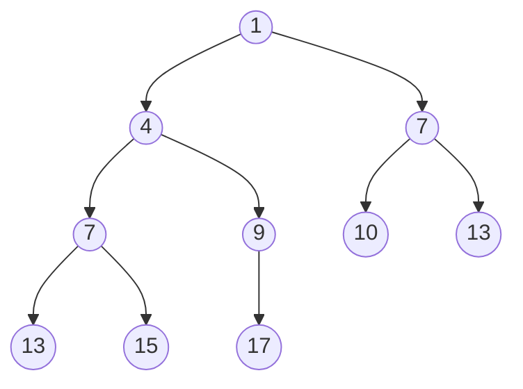
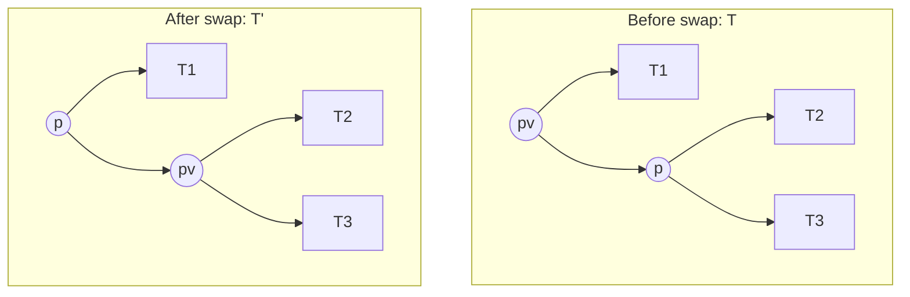
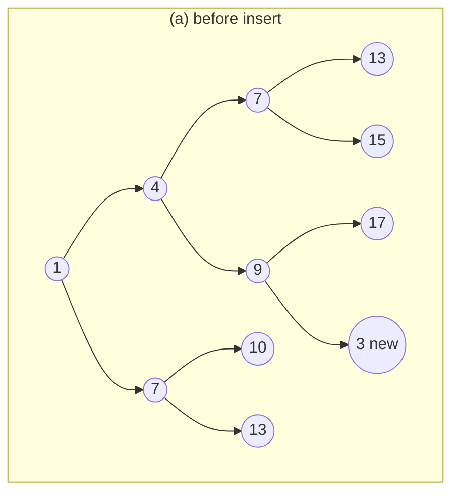
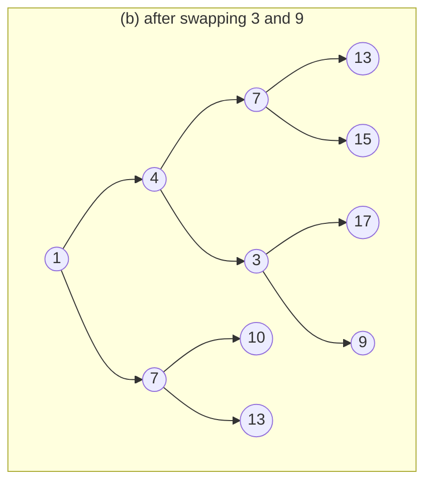
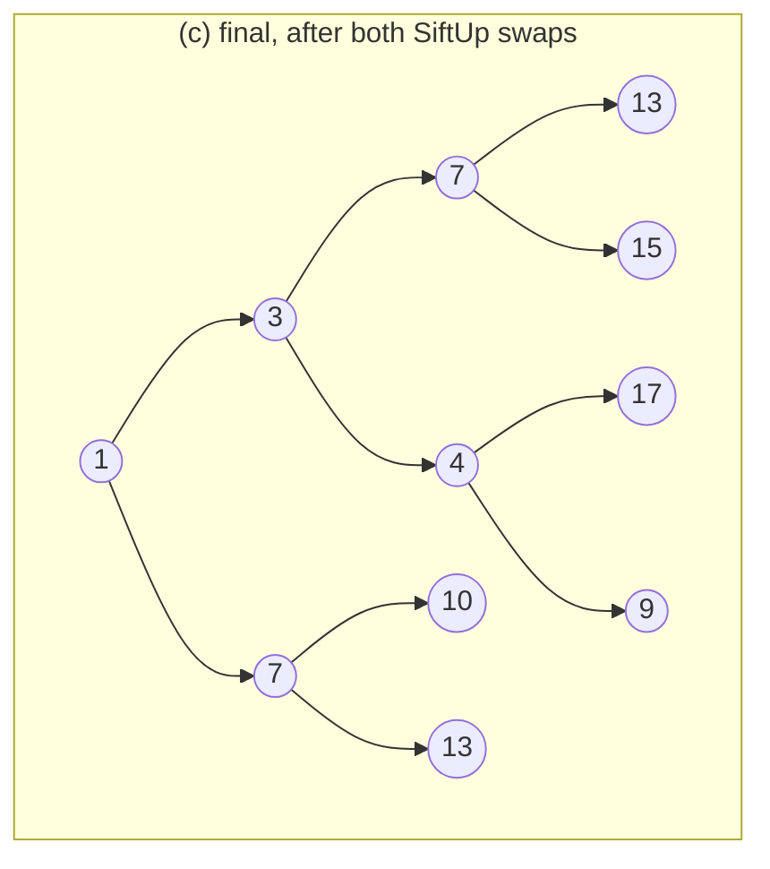
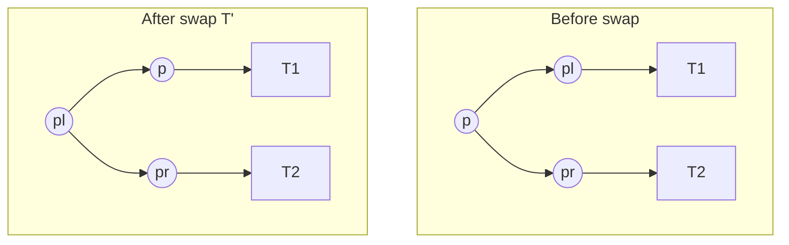
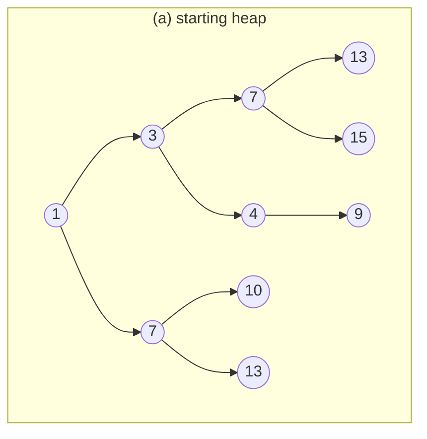
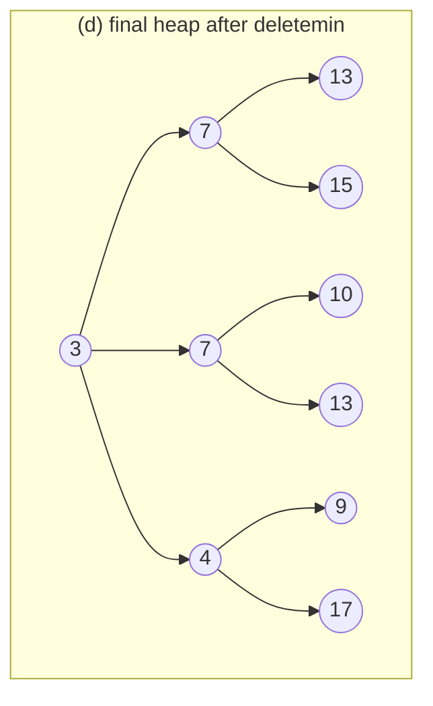

## One-sentence definition

A **heap** (*Haufen*) is a left-complete, partially-ordered
[[structures/binary-tree]] that implements the
[[structures/priority-queue]] ADT in **O(log n)** by always keeping the
minimum-key element at the root (§0.11.8.1).

## Core idea / invariant (§0.11.8.1)

A heap is:

- **Left-complete** (*links-vollständig*): every level is fully filled
  except possibly the last, which is filled from the left.
- **Partially ordered** (*partiell geordnet*): every path (*Pfad*) from the
  root to a leaf is sorted by key. Formally, for every subtree `T'` with
  root `x`:

```
∀p ∈ T':  key(x) ≤ key(p)
```

This is the **min-heap property**: every parent's key is ≤ every
descendant's key. Note that, unlike a [[structures/binary-search-tree]], a
heap imposes **no left/right ordering** between siblings — only the
parent-to-descendant direction is ordered, which is strictly weaker than
full inorder sortedness.

### Example heap (Abbildung 96)

The key multiset `{|1,4,7,7,9,10,13,13,15,17|}` as a heap:



## SiftUp / insert, with correctness argument (§0.11.8.2–§0.11.8.3)

### Pseudocode: `insert(h, p)`

```
1. Erzeugen eines neuen Knotens p mit Schlüssel k = key(p)
   (Create a new node p with key k = key(p))
2. Einfügen von p auf erster freier Position in unterster Ebene (von links)
   (Insert p at the first free position in the lowest level, from the left)
3. Sei p_v jeweils der Vater von p
   (Let p_v be the parent of p)
4. while ( (p_v existiert) and (key(p) < key(p_v)) )
5. {
6.         Vertauschen der Knoten p_v und p (=: SiftUp)
7. }
```

The new node is inserted at the leftmost free slot of the bottom level
(preserving left-completeness), then repeatedly swapped with its parent
(**SiftUp**) as long as it is smaller than that parent — i.e. it "bubbles
up" until the min-heap property is restored.

### Correctness proof (§0.11.8.3)



Let `p` be the node moving up (*aufsteigende Knoten*) and `p_v` its parent
(*Vater*). If `key(p) < key(p_v)`: the heap property is still violated, so
swapping is necessary. Before the swap, `key(p_v)` was minimal with respect
to `T1`, `T2`, and `T3` (since `p_v` was a valid heap root). Because
`key(p) < key(p_v)`, after the swap `key(p)` is minimal with respect to
`T1`, `T2`, *and* `T3` — so `T'` satisfies the heap property. Repeating this
argument up the path from `p`'s original leaf position to wherever it stops
establishes the invariant for the whole tree.

### Worked example: inserting `3` (Abbildung 97, §0.11.8.4)

**(a) Before:** insert `3` at the next free position, as a child of node
`9`.



**(b) SiftUp step 1:** `3 < 9` (its parent) → swap. `3` becomes a child of
`4`; `9` moves down to where `3` was.



**(c) SiftUp step 2:** `3 < 4` (its new parent) → swap again. `3` is now a
child of the root `1`; `4` moves down to `3`'s old position. No further
parent comparison is needed (`1 < 3`), so SiftUp stops.



## Sift / deletemin, with correctness argument (§0.11.8.5–§0.11.8.6)

### Pseudocode: `deletemin(h)`

```
1. Ausgabe der Wurzel von h, d.h. Knoten mit minimalem Schlüssel von h
   (Output the root of h, i.e. the node with minimal key)
2. Kopieren des Eintrags p der letzten besetzten Position in die Wurzel von h
   (Copy the entry p of the last occupied position into the root of h)
3. Löschen des alten Knotens p an der letzten besetzten Position
   (Delete the old node p at the last occupied position)
4.
5. Absinken der Kopie von p beginnend bei Wurzel von h
   (Sink the copy of p starting at the root of h)
6. Seien jeweils p Wurzel und p_l, p_r die Söhne links und rechts,
   (Let p be the root and p_l, p_r its left and right children,)
7. min(p_l,p_r) liefere Knoten mit dem kleineren Schlüssel
   (min(p_l,p_r) returns the node with the smaller key)
8.
9. while (p_l oder p_r existieren)
                  and ( (key(p) > key(p_l)) or (key(p) > key(p_r)) )
11. {
12.        vertausche p mit min(p_l, p_r) (=: Sift)
13. }
```

The minimum is always at the root, so `deletemin` outputs it directly. To
keep the tree left-complete, the entry at the **last occupied position** is
copied into the (now-empty) root and that last position is deleted. This
copy is then "sunk" (**Sift**) by repeatedly swapping it with the smaller
of its two children until it is no longer greater than either child.

### Correctness proof (§0.11.8.6, Abbildung 98)



`p` is the element swapped into the root from the last position after
removing the minimum; `p_l` is minimal w.r.t. `T1`, `p_r` minimal w.r.t.
`T2`. Assume swapping `p` and `p_l` is necessary, i.e. `key(p_l) < key(p)`
and `key(p_l) ≤ key(p_r)`. Then `key(p_l)` is minimal with respect to
`key(p)`, `key(p_r)`, `T1`, *and* `T2` — the swap restores the heap
property locally. If `key(p)` is still not minimal with respect to `T1`
after the swap, `Sift(p)` is applied recursively within `T1`. This repeats
until `key(p) ≤ key(p_l)` and `key(p) ≤ key(p_r)` hold, i.e. until `p`
reaches a position where it is no larger than either child (or has none).

### Worked example: `deletemin` (Abbildung 99, §0.11.8.7)

**(a) Starting heap:** root `1`; left subtree rooted at `3` (children `7`,
`4`; `7`'s children `13`, `15`; `4`'s child `9`); right subtree rooted at
`7` (children `10`, `13`).



**(b)–(c) Sift steps:** `1` is output and removed; the last node's value
(`9`) is copied into the root and its old position deleted. The copy `9` is
then sifted down: at the root it is compared against children `3` and `7`
and swapped with the smaller child `3`; one level down it is compared
against its new children and swapped again with the smaller child
encountered there; this repeats until `9` reaches a position where it is
not larger than its remaining children.

**(d) Final heap**, after the Sift loop terminates, root becomes `3` (the
smallest remaining key):



> [!warning] Open question — partially illegible source
> The intermediate Sift steps (b)/(c) of Abbildung 99 on printed p. 340 were
> **partially illegible** in the scanned source and have been reconstructed
> here from the `Sift` pseudocode's logical trace rather than transcribed
> directly from the figure. The starting heap (a) and the final heap (d)
> are transcribed with confidence (they match the pseudocode's
> precondition/postcondition), but the exact intermediate node arrangement
> during the two Sift swaps is a best-effort reconstruction, not a verified
> transcription. See "Open questions" below.

## Complexity (§0.11.8.8)

The heap is balanced (*balanciert*) by construction (left-complete ⇒
height `O(log n)`):

| Operation | Complexity | Assumption |
|---|---|---|
| `insert` (incl. SiftUp) | **O(log n)** | at most one swap per level, height is O(log n) |
| `min` | O(1) | always the root |
| `deletemin` (incl. Sift) | **O(log n)** | at most one swap per level |

Code example reference in the source: `KP36_12_heap`. See
[[concepts/big-o-notation]] and [[concepts/complexity-classes]].

## Trade-offs: when to use, when not to

- Use a heap whenever you need [[structures/priority-queue]] semantics with
  guaranteed O(log n) `insert`/`deletemin` and O(1) peek-minimum.
- A heap does **not** support efficient arbitrary-key search or sorted
  enumeration — for that, use [[structures/binary-search-tree]] or
  [[structures/avl-tree]] instead.
- `heapsort` builds directly on this structure — see
  [[algorithms/heapsort]] (owned elsewhere; link only).

## Common pitfalls & gotchas

- Confusing a heap's **partial order** (parent ≤ descendants) with a BST's
  **total/sorted order** (inorder sorted) — siblings in a heap have no
  defined relative order.
- Forgetting to maintain left-completeness when inserting: the new node
  must go at the first free position in the lowest level, scanning from the
  left, not at an arbitrary leaf.

## Open questions
- Abbildung 99 (printed p. 340, intermediate Sift steps during `deletemin`)
  was partially illegible in the scanned source; the intermediate trees
  shown above between (a) and (d) are a best-effort logical reconstruction
  from the `Sift` pseudocode, not a direct transcription of the figure.

## Related
- [[structures/priority-queue]] — the ADT this structure implements.
- [[structures/binary-tree]] — the underlying tree shape.
- [[structures/binary-search-tree]], [[structures/avl-tree]] — contrasting
  dictionary-oriented trees with total ordering.
- [[structures/tree-structures-comparison]] — cross-cutting comparison
  table.
- [[algorithms/heapsort]] — sorting algorithm built on this structure
  (owned elsewhere).
- [[concepts/big-o-notation]]
- [[concepts/complexity-classes]]

## Sources
- [[sources/grigat-algorithms-data-structures]] §0.11.8.1, §0.11.8.2,
  §0.11.8.3, §0.11.8.4, §0.11.8.5, §0.11.8.6, §0.11.8.7, §0.11.8.8
