## One-sentence definition

The **list** (*Liste*, *Folge*, *Sequenz*) is the ADT of an ordered sequence
of elements `⟨a1,...,an⟩`, specified either as a *simple list* (new, first,
rest, append, concat, isempty) or as a *list with explicit positions*
(front, last, next, previous, bol, eol, insert, delete, concat, isempty,
find, retrieve) — and this page covers both the ADT and its concrete
implementations (doubly linked, singly linked with a predecessor-pointer
trick, and array-based), not the C++ container (§0.10.1).

> [!note] This page vs. [[structures/list]]
> `[[structures/list]]` documents `std::list`, the STL **container**
> (§0.5.6.5 of the C++ part of the course). **This page** documents the
> underlying **ADT and its implementations** from the algorithms/data-structures
> part of the course (§0.10.1) — the doubly linked list described here *is*,
> conceptually, what `std::list` implements, but the two pages describe
> different abstraction levels (see [[concepts/abstraction-levels]]):
> this page is "Algorithmik" (ADT + Datenstruktur), `structures/list` is
> "Programmierung" (a concrete C++ type). Do not merge them.

## Core idea / invariant

A list of length `n` is a sequence `⟨a1,...,an⟩`; duplicates are allowed; the
empty list is written `◇`. The **concatenation operator** `∘` is defined as:

$$\langle a_1,\ldots,a_n\rangle \circ \langle b_1,\ldots,b_n\rangle := \langle a_1,\ldots,a_n,b_1,\ldots,b_n\rangle$$

(§0.10.1.1; example source file referenced in the notes:
`KP33_3_listReverseSortSpliceMergeUnique`.)

## ADT model 1 — the simple list (§0.10.1.2)

**Carrier sets:**

$$bool,\quad elemSet,\quad list = \{\langle a_1,\ldots,a_n\rangle \mid n\ge 0,\ \forall_{1\le i\le n}\ a_i \in elemSet\}$$

**Functions**, each given with signature then defining equation:

```
new:     → list                new = ◇

first:   list → elemSet        first(⟨a1,...,an⟩) = a1            if n>0
                                                    = undefiniert   otherwise

rest:    list → list           rest(⟨a1,...,an⟩)  = ⟨a2,...,an⟩   if n>0
                                                    = undefiniert   otherwise

append:  list × elemSet → list append(⟨a1,...,an⟩,e) = ⟨e,a1,...,an⟩

concat:  list × list → list    concat(⟨a1,...,an⟩,⟨b1,...,bn⟩) = ⟨a1,...,an,b1,...,bn⟩

isempty: list → bool           isempty(⟨a1,...,an⟩) = (n=0)
```

`append` inserts at the **front**; `first`/`rest` are head/tail access —
there is no operation for middle insertion or deletion in this minimal model.
[[structures/stack]] (as a list without `concat`) and [[structures/queue]]
(as a list with an added `rappend`) are both specializations of this model
(§0.10.2, §0.10.3).

## ADT model 2 — the list with explicit positions (§0.10.1.3)

A richer model where a list is a **pair** of sequences — elements and
distinct position markers:

$$list = \{(\langle a_1,\ldots,a_n\rangle, \langle p_0,\ldots,p_n\rangle) \mid n \in \mathbb{N}\cup\{0\},\ \forall a_i \in elemSet,\ \forall p_i \in pos,\ p_i \ne p_j \text{ for } i\ne j\}$$

`pos` is the set of valid element addresses, excluding `null`. Position
`p0` marks the gap *before* the first element; `p1` the gap after `a1`
(before `a2`); and so on up to `pn` after the last element. Elements are
**inserted after** a given position; `insert(p0, x)` inserts at the first
position.

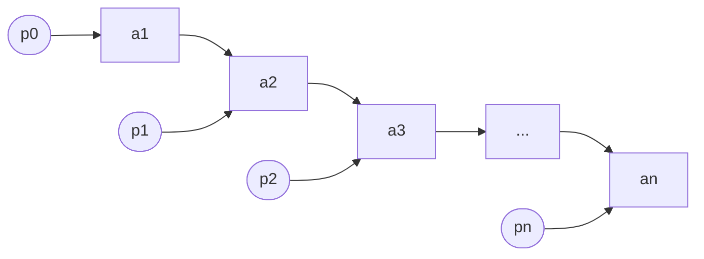

**Functions (description):**

| Function | Meaning |
|---|---|
| `front` | position before the first element |
| `last` | position of the last element |
| `next` | position of the next element |
| `previous` | position of the preceding element |
| `bol` ("begin of list") | tests whether a given position is the first |
| `eol` ("end of list") | tests whether a given position is the last |
| `insert` | inserts an element after a given position |
| `delete` | deletes the element at a given position |
| `concat` | concatenates two lists |
| `isempty` | tests whether the list is empty |
| `find` | returns the position of the first element for which predicate `f` is true |
| `retrieve` | returns the element at a given position |

**Formal definitions** (let `l = (⟨a1,...,an⟩, ⟨p0,...,pn⟩)`):

```
new:      → list                new = (◇, ⟨p0⟩)

front:    list → pos            front(l) = p0

last:     list → pos            last(l)  = pn   if n>0
                                           = undefiniert otherwise

next:     list×pos → pos∪null   next(l,p)     = p(i+1)  if ∃i∈{0,...,n-1}: p=pi
                                                = null     otherwise

previous: list×pos → pos∪null   previous(l,p) = p(i-1)  if ∃i∈{1,...,n}: p=pi
                                                = null     otherwise

bol:      list×pos → bool       bol(l,p) = (p = p0)

eol:      list×pos → bool       eol(l,p) = (p = pn)

insert:   list×pos×elemSet → list
          insert(l,pi,x) = (⟨a1,...,ai,x,a(i+1),...,an⟩, ⟨p0,...,pi,p',p(i+1),...,pn⟩),
                            p' ∈ pos \ {p0,...,pn}

delete:   list×pos → list
          delete(l,p) = (⟨a1,...,a(i-1),a(i+1),...,an⟩, ⟨p0,...,p(i-1),p(i+1),...,pn⟩)

concat:   list×list → list
          concat((⟨a1,...,an⟩,⟨p0,...,pn⟩),(⟨b1,...,bm⟩,⟨q0,...,qm⟩))
            = (⟨a1,...,an,b1,...,bm⟩, ⟨p0,...,pn,q1,...,qm⟩)

isempty:  list → bool           isempty(l) = (n=0)

find:     list×(elemSet→bool) → pos∪null
          find(l,f) = pi  if ∃i: f(ai)=true and ∀j<i: f(aj)=false
                     = null otherwise

retrieve: list×pos → elemSet    retrieve(l,p) = ai  where pi = p
```

(§0.10.1.3, continued over printed pages 266–269.)

## Implementation 1 — doubly linked list (§0.10.1.4–0.10.1.6)

A circular, sentinel-headed structure: `p0` points at a shaded sentinel/head
node; the chain links `a1,...,an` bidirectionally (prev/next pointers) and
wraps back from `an` to the sentinel. The predecessor pointer of the head is
not strictly required but enables efficient `last` and `previous`/`concat`.

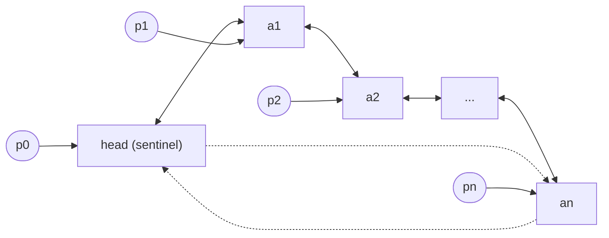

An empty list is just the sentinel, self-referencing.

### Inserting at a position (§0.10.1.5)

```
1. procedure insert(p, x)
2.   create newNode with value x
3.   newNode.prev := p
4.   newNode.next := p.next
5.   p.next.prev := newNode
6.   p.next := newNode
```

**Complexity: O(1)** — relinking a constant number of pointers, independent
of list length.

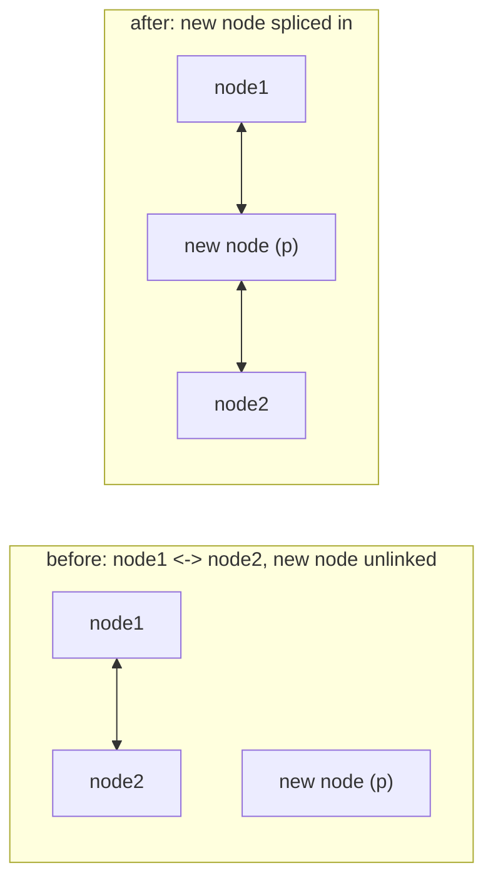

### Concatenating two doubly linked lists (§0.10.1.6)

Two circular doubly linked lists, each headed by its own sentinel (`l1`,
`l2`), are merged into one ring by relinking exactly the four boundary
pointers at the "seam" — no element is touched, and one sentinel is dropped
from the ring.

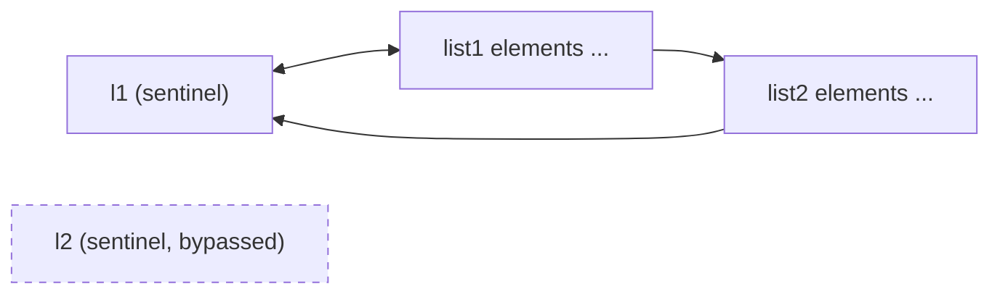

**Complexity: O(1)** — only boundary pointers are rewired, independent of
both lists' lengths.

## Implementation 2 — singly linked list, "first idea" (§0.10.1.7–0.10.1.8)

**First idea:** a sentinel node followed by `a1 → a2 → ... → an`, with each
position pointer `pi` pointing directly at the i-th node (`p0` at the
sentinel).

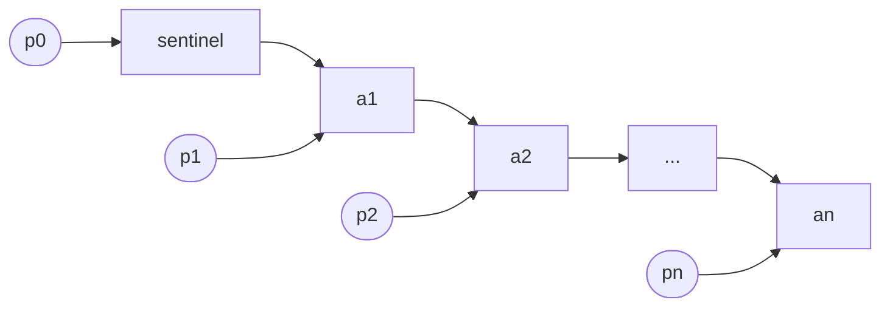

**Advantage:** less memory than the doubly linked list — only one successor
pointer per element.

**Disadvantage:** no efficient (O(1)) `previous`, `last`, or `concat`
(no backward pointer, so these require O(n) traversal); `delete` is not
possible at all with only a forward pointer at hand, because unlinking a node
requires its predecessor.

### Optimized singly linked list (§0.10.1.8)

**Solution:** shift what each pointer `pi` references by one: `pi` now
points at the **predecessor** `a(i-1)` of the node it conceptually denotes,
and `p0` points at the *last* element `an`. This lets `insert`/`delete` at a
given position work in O(1) because the predecessor — the only node that
needs its `next` pointer modified — is directly reachable, and the external
handle `l` (sentinel) directly reaches both the front and, via `p0`, the back.

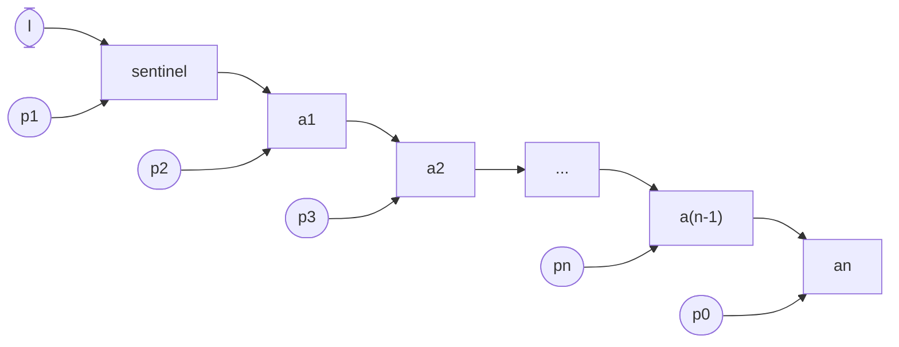

An empty optimized singly linked list is just the sentinel, self-referencing,
labeled `p0`.

## Deletion complexity cases in the singly linked list (§0.10.1.9–0.10.1.11)

### Deleting the (only) element of a single-element list (§0.10.1.9)

Handle `l` points at the sentinel, whose single successor is `a1`; deleting
`a1` makes the sentinel self-referencing again.

**Complexity: O(1)** — the predecessor (the sentinel) is directly reachable
thanks to the optimized pointer scheme.

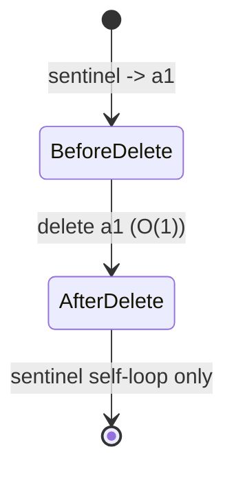

### Deleting the last element (§0.10.1.10)

Deleting the **last** element is more expensive: the predecessor of the last
element is not directly known (the optimized scheme gives O(1) access to a
node's predecessor only when you already hold a pointer denoting that node;
finding "the node before the tail" from the handle alone still requires a
full scan, since there is no backward pointer).

```
1. procedure deleteLast(l)
2.   p := l            // handle references sentinel/last-predecessor info
3.   // must scan from front since no backward pointer exists
4.   while p.next.next != sentinel do
5.     p := p.next
6.   end while
7.   p.next := sentinel   // unlink former last element
8.   // complexity: O(n)
```

**Complexity: O(n)** — "Löschen des letzten (oder vorletzten) Elements hat
Komplexität: O(n)" (the notes state this applies to deleting the last *or*
second-to-last element).

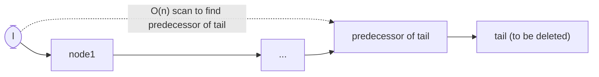

### Deleting a middle element (§0.10.1.11)

Given a pointer `p` to the predecessor of the node to delete (box2 in the
example below), deletion is a single pointer rewrite.

```
1. procedure deleteMiddle(p)   // p points to the predecessor of the node to delete
2.   target := p.next
3.   p.next := target.next
4.   // target is now unlinked
```

**Complexity: O(1)** — once a pointer to the predecessor is already held.
(Example source file referenced: `KP21_4_einfachVerketteteListe`, without
middle insertion.)

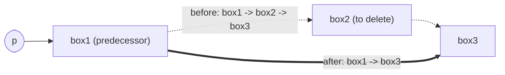

## Array-based implementations (§0.10.1.12–0.10.1.15)

### Single array, contiguous storage (§0.10.1.12)

Elements `a1,...,an` are stored contiguously in an array, with trailing
unused capacity.

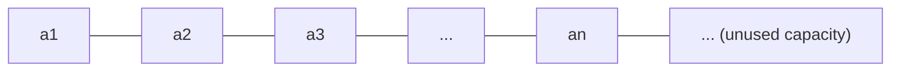

**Disadvantages:**
- Inserting/removing requires shifting all subsequent elements:
  $T_{worst} \in O(n)$.
- Maximum size must be fixed in advance: wastes memory if too large, and the
  entire array must be recopied if an insertion would overflow it.

**Advantages:**
- Very simple implementation.
- No pointers needed.

### Linked list stored as array indices (§0.10.1.13)

Idea: implement the successor relation of a linked list with **array
indices** instead of real pointers. Table 11 from the notes:

| Index | Wert | Nachfolger |
|---|---|---|
| 1 | | |
| 2 | 13 | 5 |
| 3 (L→) | (head cell) | 2 |
| 4 | 35 | 0 |
| 5 | 27 | 4 |

`L` (the list head pointer) references index 3 (the header/dummy cell) whose
successor is index 2 (value 13), whose successor is index 5 (value 27),
whose successor is index 4 (value 35), whose successor is 0 (end of list).
Logical order: 13 → 27 → 35.

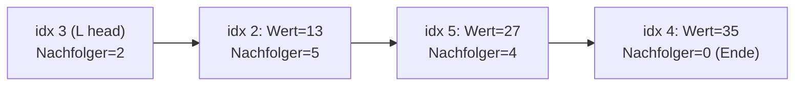

### Two lists in one array (§0.10.1.14)

A single array can hold multiple independent linked lists simultaneously,
plus a `frei` (free) list tracking unused cells, all addressed through the
same successor-index scheme:

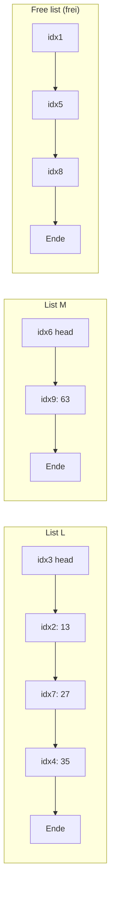

### Implementation trade-offs of array-backed linked lists (§0.10.1.15)

**Advantage:** the operating system is asked for memory only once, at
program start → fast execution; the entire array structure can be stored in
external memory and remains available after a program restart.

**Disadvantage:** total memory requirement must be fixed before execution —
list size is restricted if the array is too small, memory is wasted if it is
too large.

## Operation-time summary (§0.10.1.16)

**Doubly linked list:**

| Operation | Complexity |
|---|---|
| `find` | O(n) |
| all other list operations | O(1) |

**Singly linked, optimized, *without* extra pointer to second-to-last element:**

| Operation | Complexity |
|---|---|
| `find`, `last`, `concat`, `previous` | O(n) |
| `delete` | O(1) |
| all other operations | O(1) |

**Singly linked, optimized, *with* extra pointer to second-to-last element:**

| Operation | Complexity |
|---|---|
| `last`, `concat` | O(1) |
| `find`, `previous`, `delete(pn)` | O(n) |
| `delete` (otherwise) | O(1) |
| all other operations | O(1) |

All bounds assume O(1) arithmetic per pointer/index step; see
[[concepts/big-o-notation]] and [[concepts/complexity-classes]].

## Reference implementation

The notes give no complete C++ class for a hand-rolled linked list in this
excerpt — only pointer-and-index diagrams and the pseudocode above. For a
runnable doubly linked sequence container, see `std::list` at
[[structures/list]]; the pointer-relinking pseudocode there matches the
sentinel/O(1) insert-at-position scheme described here. See
[[concepts/pointers-and-references]] for the pointer semantics used
throughout this page, and [[concepts/memory-model]] /
[[concepts/arrays-and-dynamic-memory]] for the array-based variants above.

## Trade-offs: when to use, when not to

- Use a doubly linked list when `previous`, `last`, and `concat` must all be
  O(1) and the extra pointer-per-node memory cost is acceptable.
- Use the optimized singly linked list when memory is tight and `previous`
  /`last`/`concat` are rarely needed, accepting O(n) for those.
- Use an array-based list when the maximum size is known in advance, pointers
  are undesirable (e.g. embedded/external storage), and insert/remove cost at
  arbitrary positions (O(n)) is acceptable.
- For a generic, templated, STL-integrated choice in C++, prefer
  [[structures/list]] (doubly linked) or [[structures/vector]] (array-based)
  directly, rather than hand-rolling the structures on this page, unless
  there is a specific reason (teaching, embedded constraints, custom memory
  layout).

## Common pitfalls & gotchas

- Confusing the two position-pointer schemes: "first idea" (pointer `pi`
  references node i directly) vs. "optimized" (pointer `pi` references the
  *predecessor* of node i) — they have different complexity profiles for
  `delete`.
- Assuming `delete` is always O(1) in a singly linked list — it is O(1) only
  when a pointer to the *predecessor* is already held; deleting the last
  element specifically costs O(n) even in the optimized scheme (§0.10.1.10).
- Forgetting that array-based successor links (§0.10.1.13) still need their
  own free-list bookkeeping once elements are deleted and reinserted,
  otherwise array slots leak.

## Open questions

> [!warning] Scan gap
> Printed page 271 is **missing** from the scanned source (the provided
> scans jump from printed page 270, §0.10.1.5 "Einfügen in doppelt verkettete
> Liste", directly to printed page 272, §0.10.1.6 "Verketten zweier doppelt
> verketteter Listen"). Any content that belonged on printed page 271 —
> likely the tail end of the insert-diagram discussion (Abbildung 55) and/or
> the opening of §0.10.1.6 — is not represented on this page and should be
> filled in if a complete scan becomes available.

## Related
- [[structures/list]] — the STL container (`std::list`); see the note at the
  top of this page for how the two pages divide the material
- [[structures/vector]] — the array-based STL container analogous to the
  §0.10.1.12 array implementation
- [[structures/stack]] — a list restricted to one end, without `concat`
- [[structures/queue]] — a list with `rappend` added
- [[concepts/abstract-data-type]]
- [[concepts/pointers-and-references]]
- [[concepts/arrays-and-dynamic-memory]]
- [[concepts/memory-model]]
- [[concepts/big-o-notation]]
- [[concepts/complexity-classes]]

## Sources
- [[sources/grigat-algorithms-data-structures]] §0.10.1.1–§0.10.1.16
