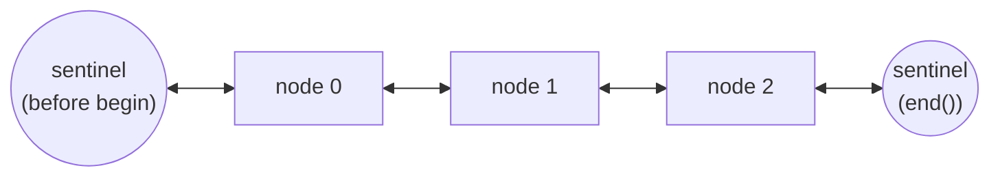

## One-sentence definition

`std::list` is the STL's sequential container (*sequentieller Container*)
implementing a doppelt verkettete Liste (doubly linked list): nodes are
connected bidirectionally, giving O(1) insertion/removal at any already-known
position at the cost of giving up direct `[]` access (§0.5.6.5).

## Core idea / invariant

Each element lives in its own heap-allocated node holding a value plus a
pointer to the previous and next node. The container's invariant is a closed
doubly linked chain: following `next` pointers from the first node eventually
reaches the last node (and the one-past-the-end sentinel position used by
`end()`, see [[concepts/iterators]]), and following `prev` pointers reverses
the traversal. Because elements are not contiguous, there is no arithmetic
way to jump to the k-th element — only traversal from a known position.

## Operations table (§0.5.6.5)

| Operation | Complexity | Assumption |
|---|---|---|
| direct access `[]` | not possible | list provides no `operator[]` |
| insert/remove at the beginning | O(1) | — |
| insert/remove at the end | O(1) | — |
| insert/remove at current position (given an iterator there) | O(1) | pointer relinking only |
| insert/remove at another position | O(n) | must traverse the chain from a known end/position to reach it |

## Memory layout: doubly linked node chain



Abbildung 20 in the source (§0.5.6.5) depicts boxes connected by
double-headed arrows in both directions, with dotted arrows extending past
both ends to indicate linkage to further/sentinel nodes — unlike
[[structures/vector]] and [[structures/deque]], there is no single
contiguous block.

## Pseudocode: insert/erase at a position

The source does not spell out list's internal linking algorithm; the
following states the standard pointer-relinking steps implied by the O(1)
bound at a known position (§0.5.6.5).

```
1. procedure insert(pos, value):          // pos is an existing node/iterator
2.     new_node ← allocate node(value)
3.     new_node.prev ← pos.prev
4.     new_node.next ← pos
5.     pos.prev.next ← new_node
6.     pos.prev ← new_node
7.     list.size ← list.size + 1
       // O(1): no other node is touched or shifted

8. procedure erase(pos):                  // pos is an existing node/iterator
9.     pos.prev.next ← pos.next
10.    pos.next.prev ← pos.prev
11.    deallocate pos
12.    list.size ← list.size - 1
       // O(1): no other node is touched or shifted
```

## Reference implementation / usage example (§0.5.6.5)

```cpp
#include <list>

int main()
{
  std::list<char> lst;
  for(char c = 'a'; c <= 'z'; ++c)
  {
    lst.push_front(c);
  }
  while(!lst.empty())
  {
    lst.pop_front();
  }
}
```

## Trade-offs (no random access)

- Use `list` instead of [[structures/vector]] or [[structures/deque]] when
  insertion/removal also happens in the *middle* of the sequence and you
  already hold an iterator there (§0.5.6.2) — relinking is O(1) regardless of
  position, unlike the O(n) shifting both array-based containers need.
- `list` provides no `operator[]` or `at()` at all: reaching the k-th element
  requires O(n) traversal from `begin()` or `end()`, so algorithms that need
  random access should not use `list`.
- Each element carries the overhead of two extra pointers per node (vs. no
  per-element overhead for packed array storage in `vector`/`deque`).

## Common pitfalls & gotchas

- Forgetting that there is no direct index access: code that assumes `lst[i]`
  works (as with `vector`/`deque`) will not compile — one must use an
  iterator and advance it, see [[concepts/iterators]].
- "Insert/remove at current position" is O(1) only when a valid iterator to
  that position is already held; finding that position from scratch (e.g. via
  `find`) is itself O(n), so the overall cost of "locate-then-modify" is still
  O(n) despite the modification step being O(1).

## Related
- [[structures/vector]]
- [[structures/deque]]
- [[concepts/stl-containers]]
- [[concepts/iterators]]
- [[concepts/memory-model]]

## Sources
- [[sources/grigat-cpp-concepts-generic]] §0.5.6.2, §0.5.6.5
