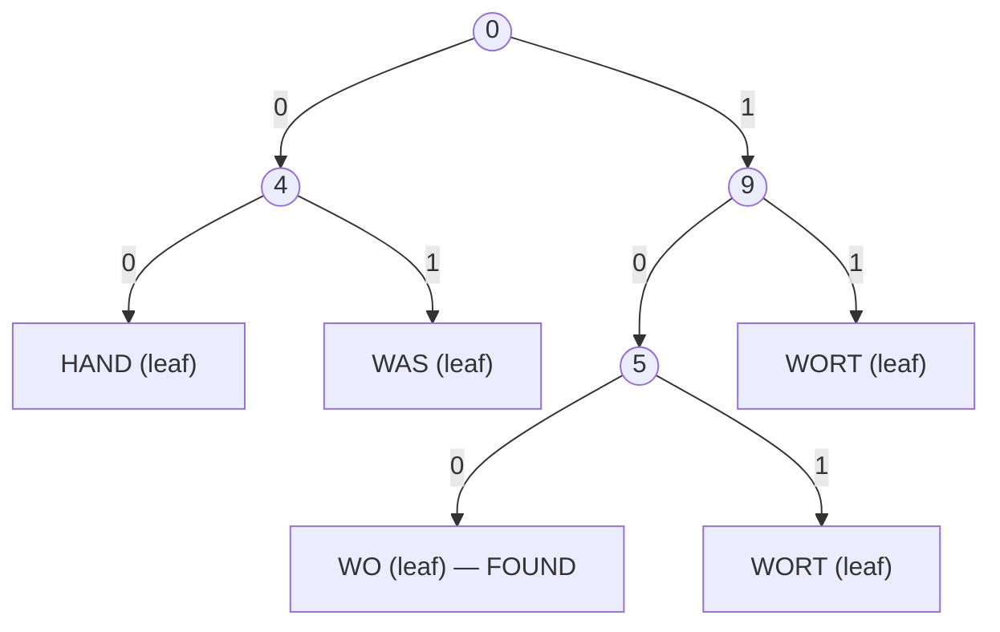
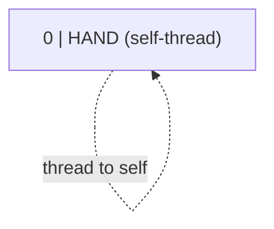
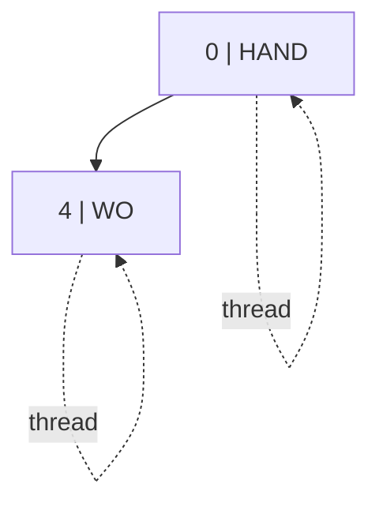
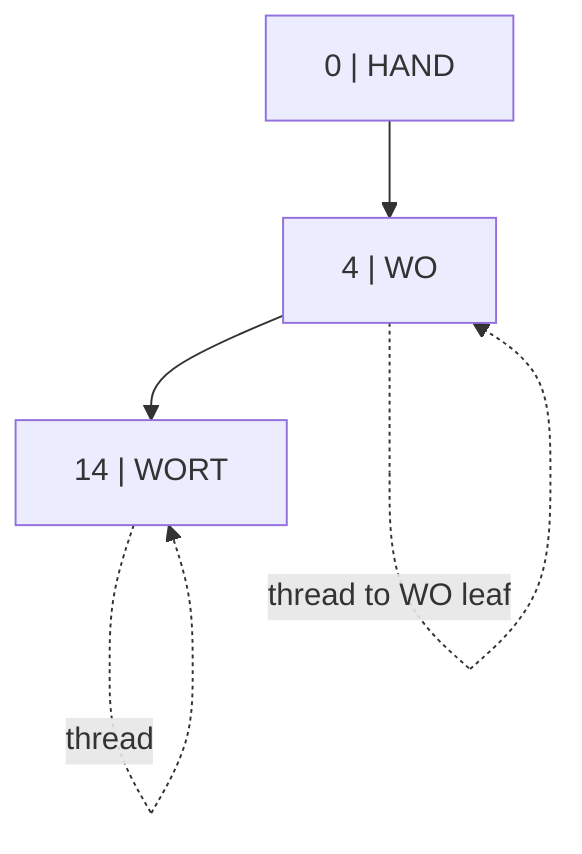
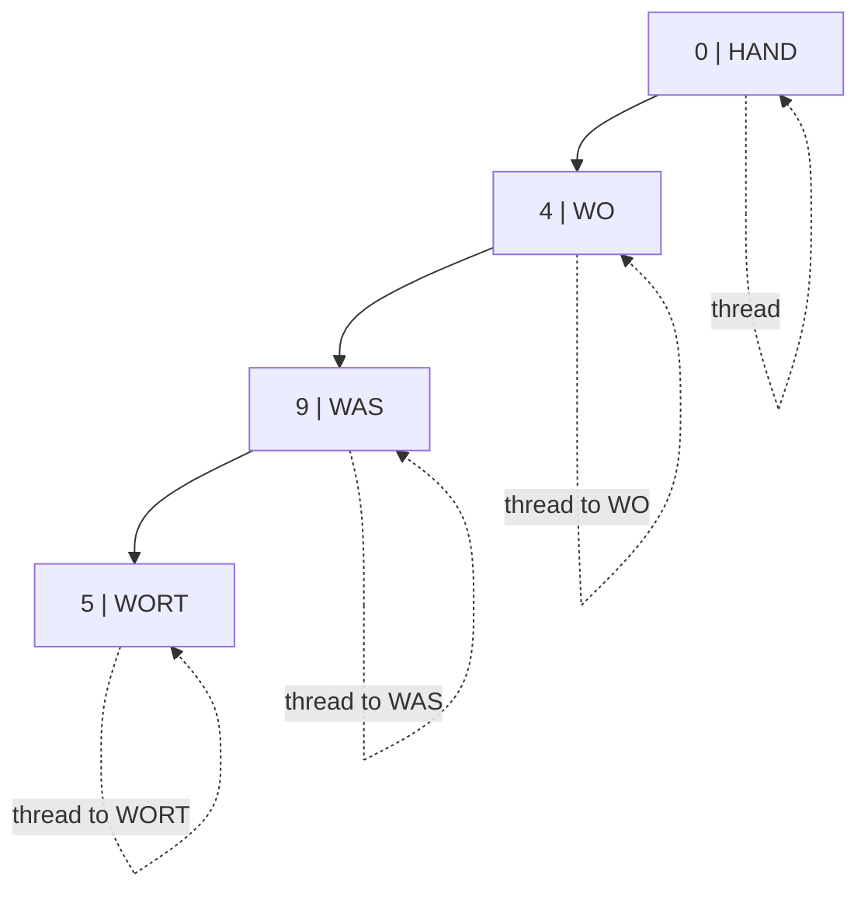
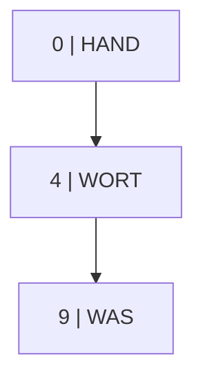
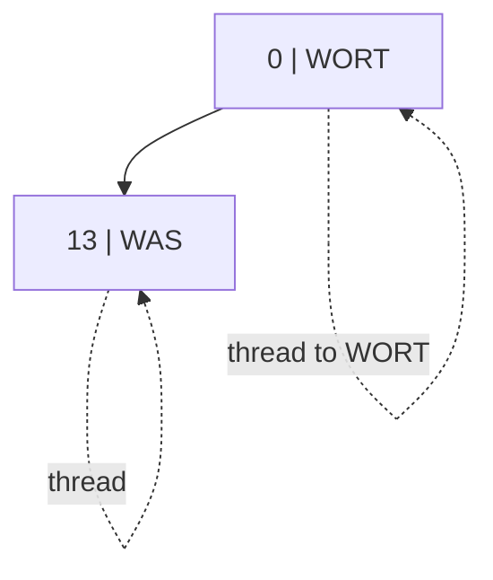

## One-sentence definition

A Patricia tree (**P**ractical **A**lgorithm **T**o **R**etrieve **I**nformation
**C**oded **I**n **A**lphanumeric) is a binary tree for alphanumerically coded
information (e.g. ASCII strings) in which inner nodes hold no data and
represent single-bit comparisons, and leaves hold the stored strings
(§0.12.5).

## Core idea / invariant

Patricia trees are **binary trees** (*Binärbäume*):

- Inner nodes (*innere Knoten*) each represent the comparison of a single bit.
- Leaves (*Blätter*) represent the strings (data).
- This is **not** a search-tree structure in the classic sense, because inner
  nodes contain no data of their own.

During a search, **only** the bits indispensable for distinguishing
(*Unterscheidung*) the stored strings are compared — most bits of a key are
never looked at. Consequently the number of leaves and inner nodes is
identical: exactly one new bit comparison is introduced per new string. A
pair of one inner node and one leaf can be stored together as a space
optimization.

Each inner node stores a **position value** (*Positionswert*): the position of
the bit to compare, given **relative to the bit position compared at the
parent node**. If the queried bit is `0`, search continues in the **left**
child; if it is `1`, search continues in the **right** child. The edges
leading to leaves are called **threads** (*Fäden*): following a thread either
reaches the leaf actually being searched for, or shows that the key is **not**
contained in the tree (the search still terminates — it just lands on the
wrong leaf, which must then be compared in full).

## Searching in a Patricia tree (§0.12.5.1)

**Numbered pseudocode:**
```
1. node := root
2. loop:
3.     bit := read the bit of the search key at the position indicated
4.            by node's position value (counted relative to the parent)
5.     if bit == 0: node := node.left
6.     else:        node := node.right
7.     if the edge just followed is a thread (Faden):
8.         stop; node is the candidate leaf
9. compare the candidate leaf's full string with the search key
10.    if equal: found
11.    else: key is not contained in the tree
```

### Worked example: searching for "WO" (§0.12.5.1, Abbildung 104)

`WO = 01010111 01001111 00000000` (binary ASCII, including the terminating
null byte as word-end marker, *Wortendezeichen* = `00000000`).

| Step | Node / position value | Bit index | Bit value | Branch taken |
|---|---|---|---|---|
| 1 | root | 0 | 0 | left → node "4" |
| 2 | "4" | 0+4 = 4 | 1 | right → node "9" |
| 3 | "9" | 4+9 = 13 | 1 | right → node "5" |
| 4 | "5" | 13+5 = 18 | 0 | left → thread, search ends |

The edge used at step 4 is a thread (*Faden*), so the search terminates there;
if the node's content equals "WO", the string is found, otherwise "WO" is not
contained in the tree.



## Inserting into a Patricia tree (§0.12.5.2)

**Numbered pseudocode (as the source's worked trace demonstrates):**
```
1. Search for the new key in the tree as if looking it up (follow bit
   comparisons down to a leaf via a thread).
2. Compare the new key, bit by bit, against the string found at that leaf.
3. Find the first (lowest-indexed) bit position at which the two strings
   differ; call its absolute index p.
4. Walk back down from the root along the search path taken in step 1 and
   find the first node whose own absolute bit position is >= p
   (i.e. the first node "later" than the new difference).
5. If no such node exists before the leaf, splice the new node in
   immediately above that leaf; otherwise splice it in as a new
   predecessor of that node (Vorgänger), between it and its current parent.
6. Give the new node position value (p − position of its new parent),
   and update the position value stored in its new successor so that it
   remains relative to the new node instead of the old parent.
7. One child of the new node is a thread to the new key's own leaf; the
   other links to the pre-existing subtree, branching left (bit 0) or
   right (bit 1) on bit p according to each string's value there.
```

### Worked example: inserting HAND, WO, WORT, WAS in sequence (§0.12.5.2, Abbildung 105)

1. **Insert HAND into the empty tree**: a single node whose left successor is
   a thread back to itself.



2. **Insert WO**: search reaches HAND via the self-thread, so WO is compared
   against HAND.
   `HAND = 01001000 01000001 01001100 01000100 00000000`,
   `WO = 01010111 01001111 00000000`.
   First difference at bit 0+4 ⇒ position value **4**. HAND has bit 4 = 0
   (left), WO has bit 4 = 1 (right).



3. **Insert WORT**: search follows bit 4 = 1 to the right (thread to WO), so
   WORT is compared against WO. `WO = 01010111 01001111 00000000`,
   `WORT = 01010111 01001111 01010010 01010100 00000000`. Next difference at
   bit 4+14 = 18 ⇒ count forward **14** bits from node "4". WO has bit 18 = 0
   (left), WORT has bit 18 = 1 (right). WORT is appended as node "14" below
   "4", on the right (thread) branch.



4. **Insert WAS**: search follows bit 4 = 1, bit 18 = 1 to the thread for
   WORT, so WAS is compared against WORT.
   `WAS = 01010111 01000001 01010011 00000000`,
   `WORT = 01010111 01001111 01010010 01010100 00000000`. Difference at bit
   4+9 = 13, which is **smaller** than the existing node's absolute position
   18 (4+14) ⇒ WAS must be spliced in as a **predecessor** (*Vorgänger*) of
   node "14", not below it. WAS's node gets position value **9** (13−4); the
   existing node below it is updated from position value 14 to **5**
   (18−13, now relative to the new WAS node instead of to node "4"). WAS has
   bit 13 = 0 (left), WORT has bit 13 = 1 (right).



Final 4-node tree after inserting HAND, WO, WORT, WAS:
`0|HAND → 4|WO → 9|WAS → 5|WORT`, with thread loops on every node pointing
to its own leaf content.

## Deleting from a Patricia tree (§0.12.5.3)

**Numbered pseudocode (as demonstrated by the worked trace, Abbildung 106):**
```
1. Search for the key to delete; let L be the leaf (node) found.
2. Remember the predecessor element P — the node whose thread points to L.
3. Replace L's content with the content of P.
4. Remove P from the tree.
5. Redirect the pointer that used to point to P so that it points to P's
   own former successor instead; update that successor's position value
   if the removal changed the relative bit-count chain (not always needed).
6. Replace the thread that used to point to the removed node with a
   thread pointing to L (which now holds P's former content).
```

### Worked example: removing WO, then HAND (§0.12.5.3, Abbildung 106)

Starting tree: `0|HAND → 4|WO → 9|WAS → 5|WORT`.

**Removing WO:**

1. Search for WO; the predecessor (node whose thread points to WO) is
   `(5, WORT)`.
2. Replace WO's content with WORT: the node at position "4" now reads
   `4|WORT`.
3. Remove the predecessor `(5, WORT)`.
4. The thread that pointed to the removed node is redirected to point to
   WORT; no position-value update needed here (*entfällt hier*).



**Removing HAND:**

5. Search for HAND; the predecessor (node whose thread points to HAND) is
   `(4, WORT)`.
6. Replace HAND's content with WORT: the root now reads `0|WORT`.
7. Remove the predecessor `(4, WORT)`.
8. Update the position value of the successor: WAS's position value changes
   from 9 to **13** (absorbing the removed node's offset).
9. Redirect the pointer that pointed to the removed node to point to WAS;
   redirect the thread that pointed to the removed node to point to WORT.



Final result after both deletions: a 2-node tree containing only WORT and
WAS — HAND and WO have been fully absorbed by content replacement.

## Complexity analysis (§0.12.5.4)

Let *n* be the number of nodes in the tree and *l_k* the length of node
content (string length).

| Operation | Complexity (bit comparisons) | Complexity (content comparison) | Total |
|---|---|---|---|
| Insert, Find (avg and worst) | `O(log n)` | `O(l_k)` | `O(log n) + O(l_k)` |

**Advantage over Tries** (*Vorteil gegenüber Tries*): Patricia trees achieve
logarithmic complexity relative to the number of stored elements **even in the
worst case** — unlike a plain [[structures/trie]], whose worst case is
`O(l_k)` (§0.12.2.4).

## Application: suffix indexing (§0.12.5.5–0.12.5.8)

**Problem statement:** given a (usually very long) source sequence
`Q = ⟨a₀,...,a_{q-1}⟩` of `q` characters and a (usually short) search sequence
`S = ⟨b₀,...,b_{s-1}⟩` of `s ≤ q` characters (typically `s ≪ q`), find all
indices `i` (`0 ≤ i ≤ q-s`) at which `S` occurs in `Q`, i.e.
`⟨a_i,...,a_{i+s-1}⟩ = ⟨b₀,...,b_{s-1}⟩`. Applications: searching for words in
text, searching for patterns in DNA sequences.

**Idea (§0.12.5.7, Suchindex):** use the ASCII bit representations of all `q`
suffixes `⟨a_i,...,a_{q-1}⟩` of `Q`, for `0 ≤ i < q`, as keys of length `q-i`,
and build a [[structures/trie]] or a Patricia tree over all `q` keys. Since
these keys are, with `O(q)`, mostly very long, the Patricia tree variant
stores only the index value `i` in each node instead of the full key, plus
the entire bit representation of `Q` stored **once**, separately.

**Index search algorithm (§0.12.5.8):**
```
1. Search for the search sequence S as a prefix of the keys associated
   with the stored indices, in time O(log q).
2. For the first found key candidate, compare S with the prefix of
   length s, in time O(s).
3. If the prefix matches S, then all threads of the subtree below the
   last bit comparison performed in step 1 point to indices i at which
   S occurs in Q. Otherwise S is not contained in Q.
```

**Result:** time complexity **per hit** is `O(s + log q)`; time complexity for
`O(q)` hits is `O(s + q log q)`. See [[algorithms/string-matching]] for the
comparison against the naive matcher.

## Reference implementation

No C++ source code is transcribed for Patricia trees in these pages — only
the definitions, the bit-position/position-value scheme, and the fully
worked search/insert/delete traces reproduced above.

## Trade-offs: when to use, when not to

- Use a Patricia tree when worst-case logarithmic search is required
  regardless of key similarity — its advantage over a plain Trie is precisely
  this worst-case guarantee (§0.12.5.4).
- Use it for suffix indexing of very long source sequences, where storing
  full keys per node (as a naive Trie would) is prohibitively expensive.
- The lack of data in inner nodes is itself a trade-off: inner nodes exist
  purely to steer bit comparisons, which is unusual compared to a
  [[structures/binary-search-tree]] where every node stores a key.

## Common pitfalls & gotchas

- Position values are **relative to the parent**, not absolute — always add
  the parent's absolute bit position when computing the next comparison
  index (as shown in every worked example above).
- A thread lookup that "succeeds" structurally (reaches *a* leaf) does not
  guarantee the key is present — the leaf's full content must still be
  compared against the search key.

## Related
- [[structures/trie]]
- [[structures/ternary-search-trie]]
- [[structures/binary-search-tree]]
- [[algorithms/string-matching]]
- [[structures/hash-table]]
- [[concepts/big-o-notation]]
- [[concepts/complexity-classes]]
- [[concepts/strings-cpp-vs-c]]
- [[concepts/pointers-and-references]]

## Sources
- [[sources/grigat-trees-sorting]] §0.12.5, §0.12.5.1, §0.12.5.2, §0.12.5.3, §0.12.5.4, §0.12.5.5, §0.12.5.6, §0.12.5.7, §0.12.5.8
