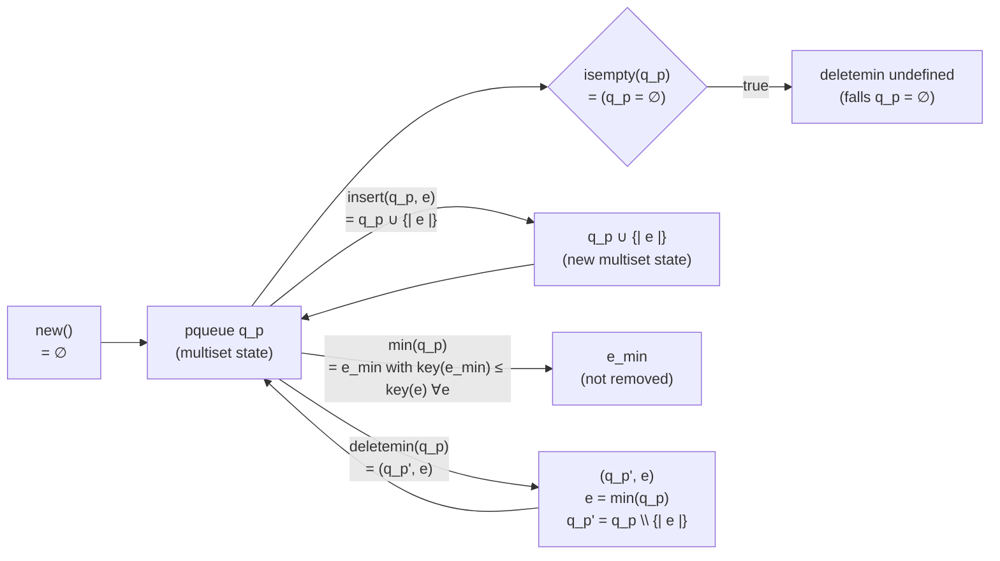
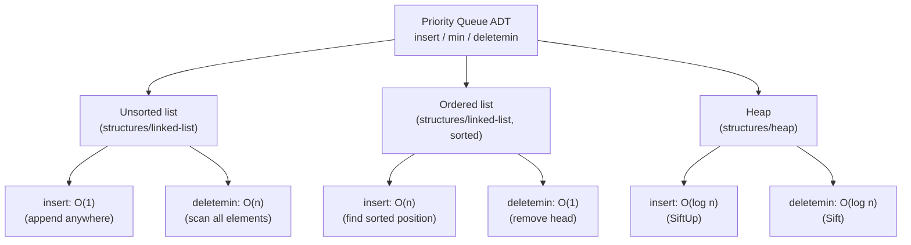

## One-sentence definition

A **priority queue** (*Priority Queue*) is an
[[concepts/abstract-data-type|abstract data type]] over a **multiset**
(*Multimenge*) of elements, where the element with the smallest priority
value (highest priority) is always the one removed next (§0.11.7.1).

## Core idea / invariant (§0.11.7.1)

- Elements carry a key that is a **priority value** (*Prioritätswert*).
- **High priority ⟺ low priority value** — the element with the *smallest*
  key is always removed first.
- Typical algorithmic implementation: a [[structures/heap]].

### Examples (§0.11.7.1)

- *Zeitplanung* (scheduling) of concurrent processes on a computer.
- The waiting room (*Warteraum*) of a hospital emergency department
  (*Krankenhaus-Ambulanz*) — most urgent patient treated next, not
  first-come-first-served.

Code example reference in the source: `KP33_2_priorityQueue`.

## Axiomatic ADT definition (§0.11.7.2)

A priority queue is modeled over a **multiset** `M` (*Multimenge*, bag) —
a set in which elements of `elemSet` may occur multiple times. Notation for
a multiset of `n` elements: `{| p1, …, pn |}`. Example multiset of priority
values: `{| 1,1,2,3,4,4,5 |}`.

```
Datentypen:
  bool
  elemSet
  pqueue = M(elemSet)
```

### Functions: `new`, `isempty`, `insert`, `min`, `deletemin`

```
new:                        → pqueue
new                         = ∅

isempty: pqueue             → bool
isempty(q_p)                = (q_p = ∅)

insert: pqueue × elemSet    → pqueue
insert(q_p, e)               = q_p ∪ {| e |}

min: pqueue                 → elemSet
min(q_p)                     = e_min mit key(e_min) ≤ key(e) ∀e ∈ q_p

deletemin: pqueue           → pqueue × elemSet
deletemin(q_p)                = { (q_p', e)  mit e = min(q_p)
                                            und q_p' = q_p \ {| e |}
                                            falls q_p ≠ ∅
                                   undef.    sonst }
```

This algebraic/axiomatic specification style — a data type defined purely
by its functions' signatures and equations, with no implementation attached
— is the same style used throughout the script for the
[[structures/set]] and [[structures/dictionary]] ADTs: the ADT, its model,
and its implementation are deliberately kept separate (see
[[concepts/abstract-data-type]]).

### Axiom dataflow: multiset state transitions



Reading the diagram against the axioms: `new` produces the empty multiset
state; every `insert` moves the queue to a new state (the multiset plus one
element); `min` observes the current state without transitioning it;
`deletemin` both observes (`e = min(q_p)`) and transitions
(`q_p' = q_p \ {| e |}`) in one step, looping back to a (smaller) queue
state — unless the queue was already empty, in which case `deletemin` is
undefined, matching `isempty`'s guard.

## Complexity table

A priority queue's complexity depends entirely on its chosen
implementation; see [[structures/heap]] for the standard one.

| Implementation | `insert` | `min` | `deletemin` | Assumption |
|---|---|---|---|---|
| Unsorted list | O(1) | O(n) | O(n) | `min`/`deletemin` must scan all elements |
| Sorted list | O(n) | O(1) | O(1) | `insert` must find its sorted position |
| [[structures/heap]] | **O(log n)** | O(1) | **O(log n)** | self-balancing left-complete tree |

See [[concepts/big-o-notation]] and [[concepts/complexity-classes]].

### One ADT, many data structures



Same trade-off the script makes for [[structures/set]] and
[[structures/dictionary]]: an unsorted [[structures/linked-list]] pushes all
the cost onto `deletemin`, a sorted one pushes it onto `insert`, and
[[structures/heap]] is the balanced compromise — O(log n) on both — which is
why it is the implementation named explicitly in §0.11.7.1.

## Trade-offs: when to use, when not to

- Use a priority queue whenever "always process the most urgent item next"
  is the access pattern — not FIFO ([[structures/queue]]) or LIFO
  ([[structures/stack]]).
- A heap-backed priority queue balances `insert` and `deletemin` costs; a
  sorted-list-backed one is only preferable when `min`/`deletemin` vastly
  outnumber `insert`.

## Common pitfalls & gotchas

- Confusing "high priority" with "high key value" — in this ADT, **low**
  key value means **high** priority.
- Treating the underlying collection as a true set: duplicate priority
  values are explicitly allowed (it is a *multiset*), so `insert` never
  needs to check for or reject duplicates.

## Related
- [[structures/heap]] — the standard implementation.
- [[structures/queue]] — the FIFO ADT this contrasts with.
- [[structures/stack]] — the LIFO ADT this contrasts with.
- [[concepts/abstract-data-type]]
- [[concepts/big-o-notation]]
- [[concepts/complexity-classes]]

## Sources
- [[sources/grigat-algorithms-data-structures]] §0.11.7.1, §0.11.7.2
