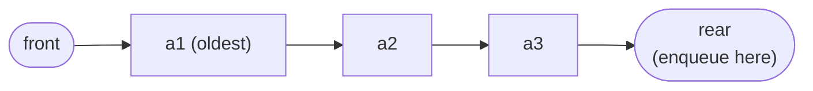
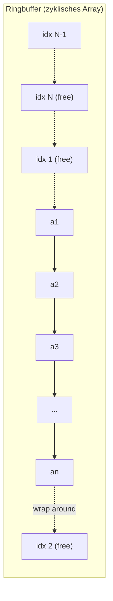
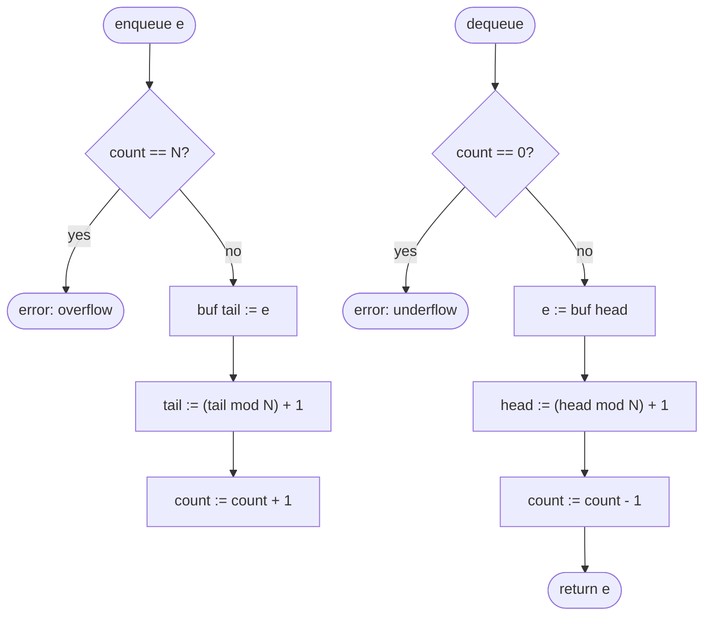

## One-sentence definition

The queue (*Warteschlange*) is a FIFO (first-in-first-out) specialization of
the list ADT: elements are only removed at one end ("front") and only
appended at the other end ("rear") (§0.10.3.1).

## Core idea / invariant

A queue corresponds to the [[structures/linked-list]] ADT's *simple list*
model, but restricted and extended: it drops `concat` and `append`, and adds
a new operation `rappend` (rear-append):

```
rappend: list × elemSet → list
rappend(⟨a1,...,an⟩, e) = ⟨a1,...,an, e⟩
```

Traditional queue operation names map onto the underlying list operations
(§0.10.3.1):

| queue | ≙ | list |
|---|---|---|
| `front` | ≙ | `first` |
| `enqueue` | ≙ | `rappend` |
| `dequeue` | ≙ | `first` und `rest` |

**Invariant:** the sequence of elements currently in the queue is exactly
the sequence of `enqueue` calls not yet matched by a `dequeue`, in the order
enqueued — the oldest unremoved element is always at the front.



## Array implementation: the ring buffer (§0.10.3.2)

A naive array implementation has a problem: as elements are enqueued at the
rear and dequeued at the front, the occupied region "wanders" through the
array (*Queue "wandert" im Array durch Einfügen und Entfernen an
verschiedenen Enden*). The notes' solution: treat the array as a **cycle**
(*Array als Zyklus auffassen*) — a circular buffer / ring buffer, wrapping
index `N` back around to index `1`.



## Numbered pseudocode

The notes do not spell out array-indexed pseudocode for the ring buffer
explicitly on this page; the following reconstructs the standard ring-buffer
algorithm implied directly by the "treat the array as a cycle" solution
above, using a fixed-size array `buf[1..N]`, a `head` index, a `tail` index,
and an element `count`:

```
1. Maintain array buf[1..N], integer head, tail, count

2. procedure enqueue(e):
3.     if count == N: error "overflow"
4.     buf[tail] := e
5.     tail := (tail mod N) + 1
6.     count := count + 1

7. procedure dequeue():
8.     if count == 0: error "underflow"
9.     e := buf[head]
10.    head := (head mod N) + 1
11.    count := count - 1
12.    return e

13. procedure isEmpty():
14.    return count == 0

15. procedure isFull():
16.    return count == N
```



## Complexity

| Operation | Complexity | Note |
|---|---|---|
| `enqueue` | O(1) | index update + write, no shifting, thanks to the ring-buffer wraparound |
| `dequeue` | O(1) | index update + read, no shifting |
| `front` | O(1) | read `buf[head]` without removing |
| `isEmpty` / `isFull` | O(1) | compare `count` to 0 / N |

See [[concepts/big-o-notation]] and [[concepts/complexity-classes]]. These
bounds assume a fixed-capacity array `N`; if the queue must also grow beyond
a pre-allocated capacity, a reallocation step (as in [[structures/vector]]'s
amortized-doubling `push_back`) would be needed and is not covered by the
notes for queues specifically.

## Reference implementation

The notes reference the queue datatype as corresponding to the list
datatype, with no complete C++ class given in this excerpt for the ring
buffer; the pseudocode above is the only algorithmic-level description
provided (reconstructed per the "treat as a cycle" idea stated in the
notes, not invented beyond it). For a runnable double-ended STL container
with O(1) operations at both ends, see [[structures/deque]].

## Trade-offs: when to use, when not to

- Use a queue when access must be strictly FIFO (task scheduling,
  breadth-first traversal, producer/consumer buffering).
- A ring-buffer array implementation needs its maximum capacity `N` fixed in
  advance (or a reallocation strategy bolted on); if capacity is not known
  up front and dynamic growth at both ends is required, prefer
  [[structures/deque]], which already provides this.
- Do not use a queue when LIFO order is required — see [[structures/stack]].

## Common pitfalls & gotchas

- Distinguishing a full buffer from an empty one when both conditions can
  otherwise look like `head == tail`: the pseudocode above resolves this with
  an explicit `count` field rather than comparing `head`/`tail` alone.
- Off-by-one errors in the modular index update `(tail mod N) + 1`, consistent
  with the notes' 1-based array indexing convention used throughout
  [[structures/linked-list]].

## Related
- [[structures/linked-list]] — the list ADT that the queue specializes
- [[structures/deque]] — the STL double-ended container, O(1) at both ends
- [[structures/stack]] — the LIFO counterpart specialization of the same list ADT
- [[concepts/abstract-data-type]]
- [[concepts/arrays-and-dynamic-memory]]
- [[concepts/big-o-notation]]
- [[concepts/complexity-classes]]

## Sources
- [[sources/grigat-algorithms-data-structures]] §0.10.3.1, §0.10.3.2
