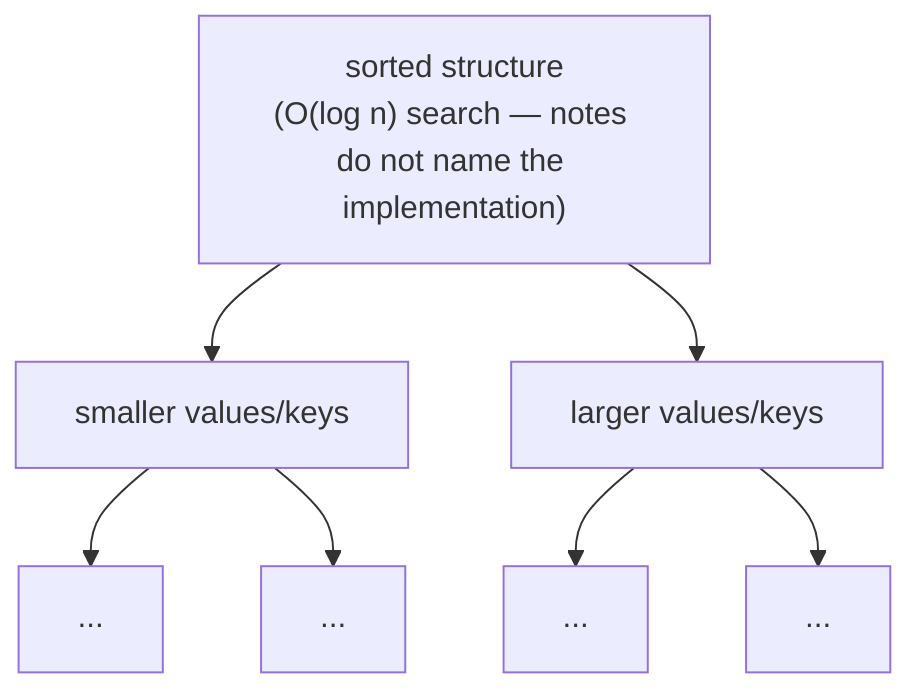
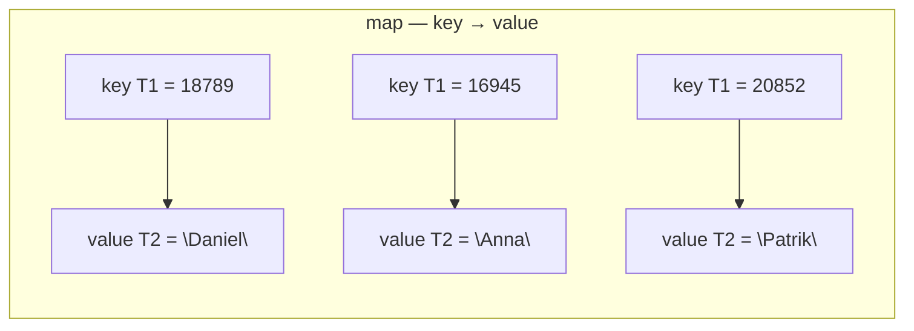

## One-sentence definition

Set/multiset and map/multimap are the STL's associative containers
(*assoziative Container*): sorted sets of elements (or key→value pairs) whose
position depends on their value, optimized for fast search (§0.5.6.7,
§0.5.6.8).

## Core idea / invariant

In both families, elements are kept sorted at all times by their value
(set/multiset) or by their key (map/multimap) — the invariant is:
in-order traversal via [[concepts/iterators]] visits elements in ascending
sorted order. The notes do not name the underlying implementation data
structure; they only state the complexity it achieves (O(log n) search,
§0.5.6.7, §0.5.6.8), which is consistent with — but not asserted by the notes
to be — a balanced binary search tree. The *multi*-prefixed variants
(`multiset`, `multimap`) allow duplicate keys; the non-multi variants
(`set`, `map`) forbid them.

- **Set/Multiset** (§0.5.6.7): elements sorted by their own value (*nach
  ihren Werten sortiert*).
- **Map/Multimap** (§0.5.6.8): elements are of type `pair<T1, T2>`, where
  `T1` is the Sortierschlüssel (sort key) and `T2` is the zugehöriges Element
  (associated element); elements `T2` are stored sorted by key `T1`.

## Ordering invariant and multi- vs. non-multi distinction

| Container | Duplicates | Sorted by |
|---|---|---|
| `set` | verboten (forbidden) | element value |
| `multiset` | erlaubt (allowed) | element value |
| `map` | verboten (forbidden) | key (`T1`) |
| `multimap` | erlaubt (allowed) | key (`T1`) |

## Operations table (§0.5.6.7, §0.5.6.8)

| Operation | Complexity | Assumption |
|---|---|---|
| search / find | O(log n) | sorted-order structure; stated directly by the source as "fast search" |
| insert | O(log n) | search for insertion point is the dominant cost; not stated explicitly by the source beyond "optimized for fast search" |
| direct access `[]`/`at()` | not possible | no positional/indexed access; lookup is by key/value only |

> [!note] Complexity assumption
> The notes state only that set/multiset and map/multimap are "optimized for
> fast search: O(log(n))". They do not give a separate figure for insert or
> erase; the O(log n) entry for insert above is inferred from the fact that
> insertion must locate the correct sorted position, and is flagged as such
> rather than quoted verbatim from the source.

## Mermaid: underlying ordering idea and key→value mapping





Abbildung 21/22 in the source depict both Set/Multiset and Map/Multimap with
the same visual template: an oval containing scattered black squares,
representing stored (sorted) values or key-value pairs respectively
(§0.5.6.7, §0.5.6.8).

## Pseudocode: lookup

The source does not give an internal search algorithm; the following states
the operation-level contract implied by the O(log n) bound.

```
1. procedure find(container, target):
2.     position ← root of the sorted structure
3.     while position is valid and position.key ≠ target:
4.         if target < position.key:
5.             position ← position.smaller_side
6.         else:
7.             position ← position.larger_side
8.     return position   // iterator to element, or end() if not found
```

## Reference implementation / usage examples

Set/Multiset (§0.5.6.7):

```cpp
#include <set>

int main()
{
  std::multiset<int> intSet;
  for(int i = 1; i <=5; i ++)
  {
    intSet.insert(i);
    intSet.insert(i*2);
  }
}
```

Map/Multimap (§0.5.6.8):

```cpp
#include <map>
#include <string>

int main()
{
  std::map<int, std::string> Student;
  Student.insert(std::make_pair(18789, "Daniel"));
  Student.insert(std::make_pair(16945, "Anna"));
  Student.insert(std::make_pair(20852, "Patrik"));
  Student.insert(std::make_pair(21953, "Michael"));
}
```

`make_pair` is a globally defined template function returning an object of
type `pair<T1, T2>` (§0.5.6.8).

## Trade-offs

- Use set/multiset or map/multimap when the dominant operation is *Suche nach
  Inhalten* (search by content, §0.5.6.2) and you need elements to remain
  sorted automatically.
- Neither family supports direct indexed access — there is no `[]` by
  position, only by key (for `map`) or no element access operator at all (for
  `set`, beyond iteration).
- Choose the `multi` variant only when duplicate keys/values are a legitimate
  possibility; otherwise the non-multi variant documents the uniqueness
  invariant directly in the type.

## Related
- [[structures/unordered-containers]]
- [[concepts/stl-containers]]
- [[concepts/iterators]]
- [[concepts/complexity-classes]]
- [[concepts/memory-model]]

## Sources
- [[sources/grigat-cpp-concepts-generic]] §0.5.6.7, §0.5.6.8
