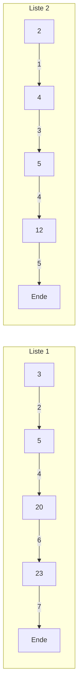

## One-sentence definition

A **set** (*Menge*) is an [[concepts/abstract-data-type|abstract data type]] of
unordered, duplicate-free elements supporting membership test, insertion,
deletion, and the three classical set-algebra operations union, intersection,
and difference (§0.11.1.1).

> [!note] Not the STL container
> This page is about the **set ADT** — its model and candidate
> implementations. For the C++ standard-library container with the same
> name, see [[structures/set-and-map]] (`std::set`/`std::multiset`), which is
> itself one possible (tree-based) implementation of this ADT.

## Core idea / invariant

A set never contains duplicates. Beyond the basic CRUD-style operations, a
set must support the mathematical set functions: union (*Vereinigung*),
intersection (*Durchschnitt*), difference (*Differenz*), and enumeration of
all elements as a list (*Ausgabe der Menge als Liste*) (§0.11.1.1,
§0.11.1.2).

## Datentyp: Menge — formal signature (§0.11.1.2)

```
new:          → set
insert:  set × element → set
delete:  set × element → set
member:  set × element → bool
union:   set × set → set
intersection: set × set → set
difference:  set × set → set
enumerate:   set → list
```

## Three candidate implementations

### 1. Bit vector (§0.11.1.3)

A bit vector (*Bitvektor*) `b` of length `N` represents a set `S` with at
most `N` possible elements: `b[i] == true ⟺ eᵢ ∈ S`. Cost is proportional to
the *maximum possible* cardinality `N`, not to the actual size `n`.

```
1. function new(N): return array of N bits, all false      // O(N)
2. function insert(b, i): b[i] = true                       // O(1)
3. function delete(b, i): b[i] = false                      // O(1)
4. function member(b, i): return b[i]                        // O(1)
5. function enumerate(b):
6.     result = empty list
7.     for i = 1 to N:
8.         if b[i]: append i to result
9.     return result                                          // O(N)
10. function union(b1, b2):
11.    for i = 1 to N: b3[i] = b1[i] OR b2[i]                 // O(N)
12. function intersection(b1, b2):
13.    for i = 1 to N: b3[i] = b1[i] AND b2[i]                // O(N)
14. function difference(b1, b2):
15.    for i = 1 to N: b3[i] = b1[i] AND (NOT b2[i])          // O(N)
```

### 2. Unordered list (§0.11.1.4)

The set's elements are stored unsorted (*unsortiert*) in a list. `insert`
must first linearly search for a duplicate before appending, costing O(n).
`union`/`intersection`/`difference` on two sets of size `m` and `n` require
checking each element of one list against the other: O(m·n).

### 3. Sorted (ordered) list (§0.11.1.5, §0.11.1.6)

The list keeps the set's elements sorted (*sortiert*). `insert`/`delete`/
`member` remain O(n) (binary search is not directly applicable to a linked
list), but the big win is that `union`, `intersection`, and `difference`
drop to **O(m+n)** via a single **parallel traversal** (*paralleler
Durchlauf*) of both lists, comparing the elements at the current position of
each list and advancing whichever list has the smaller head element
(§0.11.1.6).

#### Worked example (Abbildung 75) — order of the parallel traversal



The numbers above the arrows (1..7) are the global step order of the merge:
heads are compared and the smaller one advances; step 4 advances **both**
lists at once because `5` appears in both (an intersection point).

#### Pseudocode: parallel merge traversal (§0.11.1.6)

```
1. function mergeTraverse(L1, L2):
2.     p1 = first(L1); p2 = first(L2)
3.     while p1 != end and p2 != end:
4.         if key(p1) < key(p2):
5.             process(p1)          // e.g. for union: output p1
6.             p1 = next(p1)
7.         else if key(p1) > key(p2):
8.             process(p2)
9.             p2 = next(p2)
10.        else:                     // key(p1) == key(p2)
11.            processBoth(p1, p2)   // e.g. for intersection: output once
12.            p1 = next(p1); p2 = next(p2)
13.    // handle remaining tail elements of whichever list is not yet exhausted
```

`process`/`processBoth` are instantiated differently per operation: `union`
outputs every element reached; `intersection` only outputs matches (step
11); `difference` (A − B) only outputs elements unique to `A` (step 5, not
step 8).

## Complexity table (two sets of sizes `m` and `n`, no duplicates)

| Operation | Bit vector | Unordered list | Sorted list |
|---|---|---|---|
| `new` | O(N) | O(1) | O(1) |
| `insert` | O(1) | O(n) | O(n) |
| `delete`, `member` | O(1) | O(n) | O(n) |
| `enumerate` | O(N) | O(n) | O(n) |
| `union`, `intersection`, `difference` | O(N) | O(m·n) | **O(m+n)** |

`N` is the maximum possible cardinality; `m`, `n` are the actual cardinalities
of the two sets being combined. See [[concepts/big-o-notation]] and
[[concepts/complexity-classes]] for how these bounds are expressed and
compared.

## Trade-offs: when to use, when not to

- Bit vector: best when the universe `N` is small and known, and set-algebra
  operations dominate — but wastes memory when `n ≪ N`.
- Unordered list: cheapest `new`, but every other operation is linear, and
  set-algebra operations are quadratic.
- Sorted list: pays the same O(n) for single-element ops but makes the three
  set-algebra operations near-linear via merge traversal — the best choice
  when union/intersection/difference dominate and a tree-based structure
  (see [[structures/binary-search-tree]], [[structures/avl-tree]]) is
  unavailable or unneeded.

## Common pitfalls & gotchas

- Mixing up "maximum possible size `N`" (bit vector) with "actual size `n`"
  (list implementations) when reading the complexity table — they are not
  interchangeable.
- The merge traversal requires both lists to already be **sorted** by the
  same [[concepts/operator-overloading|`operator<`]] ordering; an unsorted
  list cannot use it.

## Related
- [[structures/set-and-map]] — the STL `std::set`/`std::multiset` container,
  a concrete (balanced-tree) implementation choice for this ADT.
- [[structures/dictionary]] — the related Wörterbuch ADT (insert/delete/member
  only, no set algebra).
- [[structures/binary-search-tree]], [[structures/avl-tree]] — tree-based
  implementations that also keep elements sorted, used by `std::set`.
- [[concepts/abstract-data-type]]
- [[concepts/big-o-notation]]
- [[concepts/complexity-classes]]

## Sources
- [[sources/grigat-algorithms-data-structures]] §0.11.1.1, §0.11.1.2,
  §0.11.1.3, §0.11.1.4, §0.11.1.5, §0.11.1.6
