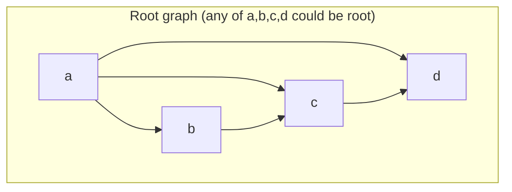

## One-sentence definition

A *Spannbaum* (spanning tree, also *erzeugender Baum*) of a root graph with
root node r ∈ V is a cycle-free sub-digraph that contains all of V but only
as many edges as a tree needs
[[sources/grigat-graphs-dynamic-programming]] §0.14.3.3.

## Core idea / invariant

- **Wurzelgraph** (root graph): if every node of V is reachable from a node
  r ∈ V, the graph is a root graph, and r is its *Wurzelknoten* (root node)
  §0.14.3.2.
- **Teildigraph** (sub-digraph): a digraph D' = (V', E') is a sub-digraph of
  D = (V, E) when V' ⊆ V and E' ⊆ E §0.14.3.2.
- **Spanning tree** of a root graph: a cycle-free sub-digraph D' = (V, E')
  that contains all nodes of V, with only as many edges from E as a tree
  representation requires §0.14.3.3.
- **Invariant**: every node of a spanning tree has in-degree 1, except the
  root, which has in-degree 0 §0.14.3.3.
- Different choices of root/edges on the same root graph can produce
  **different** valid spanning trees (Abbildung 116).

## Spanning forest (§0.14.3.4)

- If digraph D = (V, E) is **not** a root graph (no single node reaches all
  of V), D can be completely decomposed into disjoint root graphs.
- A spanning tree is defined for each of these root graphs.
- The collection of all these spanning trees, taken together, contains every
  node of V and is called the *erzeugender Wald* (spanning forest /
  generating forest).
- Both [[algorithms/depth-first-search]] and
  [[algorithms/breadth-first-search]] use exactly this mechanism: their
  driver loop over all nodes produces one spanning tree per unreached root,
  i.e. a spanning forest, whenever the graph is not a single root graph.

## Trade-offs / when this concept matters

- Spanning trees/forests are the structural output of both standard graph
  traversals; the **edge classification** (tree, forward, back, cross edges)
  used by DFS and BFS is defined *relative to* the spanning tree a traversal
  produces — see [[algorithms/depth-first-search]] and
  [[algorithms/breadth-first-search]] for the exact classification rules.
- A digraph is acyclic exactly when its DFS produces no back edges
  (*Rückwärtskanten*) — see [[structures/dag]].

## Related
- [[structures/graph]]
- [[algorithms/depth-first-search]]
- [[algorithms/breadth-first-search]]
- [[structures/dag]]
- [[algorithms/topological-sort]]
- [[structures/tree-structures-comparison]]
- [[structures/binary-tree]]

## Sources
- [[sources/grigat-graphs-dynamic-programming]] §0.14.3.2, §0.14.3.3, §0.14.3.4
