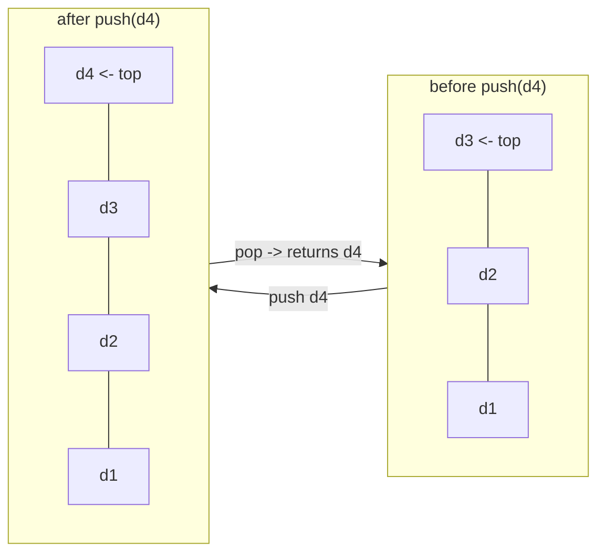
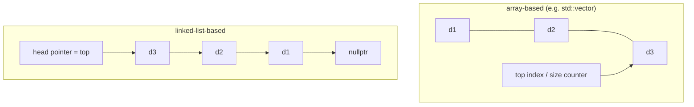
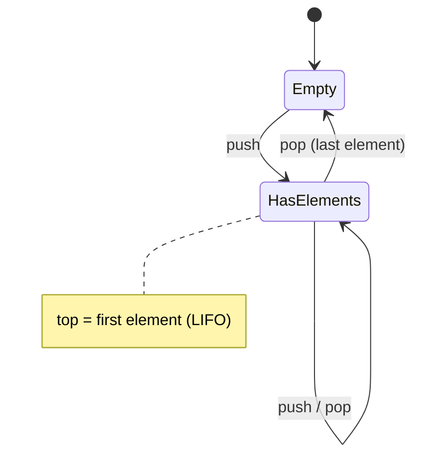
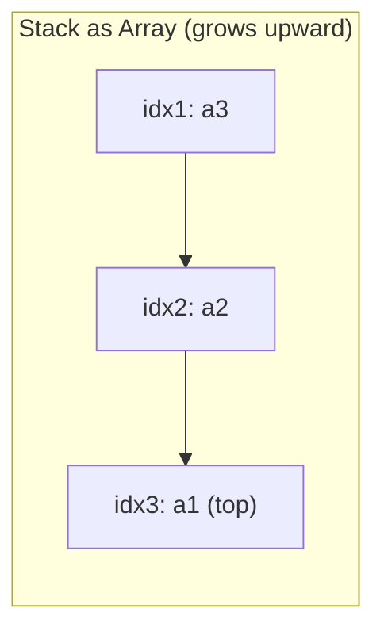

## One-sentence definition

The Stack (*Stapel*) is the lecture's worked example of an
[[concepts/abstract-data-type]]: a last-in-first-out (LIFO) container
specified purely by axioms over `push`, `pop`, and `top` — with no statement
about what a stack "is" or how it is implemented (§0.3.1.2).

## Core idea / invariant

A stack `S` holds a sequence of data elements `D`. Every operation either
grows, shrinks, or inspects the sequence only at one end (the "top"); nothing
in the axioms describes the internal representation.

## Push and pop on the LIFO structure



`push` always adds at the top; `pop` always removes from the top — nothing
else in the sequence is touched, which is the defining LIFO (*last-in,
first-out*) behavior.

## Array-based vs. list-based representation



- **Array-based**: `top` is the last occupied slot; `push`/`pop` move an
  index/size counter and may trigger a resize (reallocation) when capacity is
  exceeded.
- **List-based**: `top` is the head of a singly linked list; `push`/`pop`
  insert/remove at the head, so no resize is ever needed, at the cost of one
  pointer per element.

## The ADT specification (§0.3.1.2)

The notes give the following formal (mathematical/pseudocode) definition:

```
push: S × D → S
      push((d1,...,dn),d) = (d1,...,dn,d)
pop:  S → S × D
      pop(push(s,d)) = (s,d)
top:  S → D
      top(d1,...,dn,d) = d
```

Read informally:

- `push` takes a stack and a datum and returns the stack with that datum
  appended at the end (the "top").
- `pop` is the inverse of `push`: popping a stack that was just produced by
  `push(s, d)` returns the pair `(s, d)` — i.e., the stack before the push, and
  the datum that was pushed.
- `top` returns the last (rightmost) element of the sequence without removing
  it.

The notes stress explicitly: this specification makes **no statement about
what a stack "is"** and gives **no hint about implementation** — only the
[[concepts/abstract-data-type]] axioms matter for correctness.

## Stacks as a restricted list (§0.10.2.1)

The algorithms/data-structures part of the course (distinct from the C++
part cited above) re-introduces the stack (*Stapel*) as a **special case of
[[structures/linked-list|the list ADT]]**, rather than as a standalone
axiomatic type: "Spezialfall von Listen" — a stack is exactly the model of a
[[structures/linked-list|simple list]] *without* `concat`, i.e. the list ADT
with its operation set restricted to one end only. LIFO (last-in-first-out)
behavior falls out of this restriction automatically. Traditional stack
operation names map onto the underlying list operations:

| stack | ≙ | list |
|---|---|---|
| `top` | ≙ | `first` |
| `push` | ≙ | `append` |
| `pop` | ≙ | `first` und `rest` |



This is consistent with, but a different presentation from, the
§0.3.1.2 axioms above: both specify the same LIFO behavior, one as a
free-standing [[concepts/abstract-data-type]] with its own axioms (`push`,
`pop`, `top`), the other by deriving it from the more general
[[structures/linked-list]] ADT with `concat` removed.

## Array-based implementation (§0.10.2.2)

The notes give a dedicated array-based stack implementation distinct from
the generic array-based list of [[structures/linked-list]] §0.10.1.12:
because insertion/removal only ever happens at **one** end of the list, the
inefficient shifting of successor elements that plagues a general array
list is eliminated entirely (*Ineffizientes Verschieben der Folgeelemente
entfällt*).

**Tabelle 13 (Stack-Implementierung als Array)** — the stack grows from low
indices upward; `top` points at the highest occupied index:

| Index | Element |
|---|---|
| 5 | |
| 4 | |
| 3 (→ top) | $a_1$ |
| 2 | $a_2$ |
| 1 | $a_3$ |

Here $a_3$ was pushed first (lowest index), $a_1$ most recently (at `top`).
Example source files referenced in the notes: `KP32_1_stackTemplateT`,
`KP32_1_stackTemplateTn` (C++ template stack classes, not reproduced on this
page of the scan).



**Numbered pseudocode**, with `data[1..capacity]` and `top` as the index of
the highest occupied slot (matching the 1-based indexing of Tabelle 13):

```
1. procedure push(d):
2.     if top == capacity:
3.         grow the underlying array (reallocate to larger capacity)
4.     top := top + 1
5.     data[top] := d

6. procedure pop():
7.     if isEmpty():
8.         error: pop on empty stack
9.     d := data[top]
10.    top := top - 1
11.    return d

12. procedure top():
13.    if isEmpty():
14.        error: top on empty stack
15.    return data[top]

16. procedure isEmpty():
17.    return top == 0
```

**Complexity of the array-based implementation:**

| Operation | Complexity | Note |
|---|---|---|
| `push` | O(1) amortized | occasional O(n) reallocation when capacity is exceeded, same amortized-doubling argument as [[structures/vector]] |
| `pop` | O(1) | index decrement + read, no shifting — because only the single top index changes |
| `top` | O(1) | direct read at index `top` |
| `isEmpty` | O(1) | compare `top` to 0 |

The key point the notes make explicit: restricting operations to one end is
*why* the array implementation avoids the O(n) shifting cost that a general
array-based list (§0.10.1.12) pays for insert/remove — there are never any
"successor elements" to move, since nothing is ever inserted except at the
single growing end.

## Operations table

> [!note] Complexity assumption
> The source notes specify only the axioms, not complexity bounds. The table
> below states the standard complexity for the two typical concrete
> implementations (dynamic-array-based and singly-linked-list-based), not a
> claim from the lecture notes themselves. See [[concepts/big-o-notation]] for
> the notation.

| Operation | Array-backed (e.g. `std::vector`) | Linked-list-backed |
|---|---|---|
| `push` | O(1) amortized (occasional O(n) resize) | O(1) worst case |
| `pop` | O(1) | O(1) |
| `top` | O(1) | O(1) |
| `isEmpty` | O(1) | O(1) |

Space: O(n) for n elements in both implementations, plus O(1) auxiliary state
(a size counter / top pointer).

## Pseudocode for each operation

Array-backed, with `data[0..size-1]` and `size` as the count of stored
elements:

```
push(d):
1. if size == capacity:
2.     grow the underlying array (reallocate to larger capacity)
3. data[size] <- d
4. size <- size + 1
```

```
pop():
1. if isEmpty():
2.     error: pop on empty stack
3. size <- size - 1
4. return data[size]
```

```
top():
1. if isEmpty():
2.     error: top on empty stack
3. return data[size - 1]
```

```
isEmpty():
1. return size == 0
```

## Reference implementation

A minimal C++ realization of the ADT's interface, backed by a
`std::vector<D>` (one valid implementation among many satisfying the axioms
above):

```cpp
#include <vector>
#include <stdexcept>

template <typename D>
class Stack
{
public:
    void push(const D& d) { m_data.push_back(d); }

    D pop()
    {
        if (isEmpty())
            throw std::runtime_error("pop on empty stack");
        D d = m_data.back();
        m_data.pop_back();
        return d;
    }

    D top() const
    {
        if (isEmpty())
            throw std::runtime_error("top on empty stack");
        return m_data.back();
    }

    bool isEmpty() const { return m_data.empty(); }

private:
    std::vector<D> m_data;
};
```

Note the ADT's `pop: S → S × D` returns both the shortened stack and the
removed datum; this reference implementation instead mutates the stack
in-place and returns only the datum, matching how `pop`/`top` are
conventionally split in C++ container APIs (e.g. `std::stack`). This is a
faithful *realization* of the axioms, not a literal transcription of the
mathematical signature.

## Trade-offs: when to use, when not to

- Use a stack when access is strictly LIFO (undo histories, expression
  evaluation, recursive-call simulation, depth-first traversal).
- Do not use a stack when you need access to arbitrary elements, or
  first-in-first-out order (use a queue) — the ADT only exposes the top.

## Common pitfalls & gotchas

- Calling `pop()`/`top()` on an empty stack is undefined by the axioms (they
  are only defined for stacks produced by at least one `push`); a concrete
  implementation must guard this explicitly, as above.
- Confusing the ADT's `pop: S → S × D` (returns new stack *and* datum) with a
  C++ method that mutates `*this` and returns only the datum — both are valid
  designs, but they are not the same signature.

## Related
- [[concepts/abstract-data-type]]
- [[concepts/class-and-object]]
- [[concepts/uml-class-diagram]]
- [[concepts/encapsulation]]
- [[concepts/big-o-notation]] — notation used for the operation
  complexities above
- [[concepts/complexity-classes]]
- [[algorithms/postfix-evaluation]] — a worked algorithm that uses a stack
  as its central data structure
- [[structures/linked-list]] — the list ADT that §0.10.2.1 derives the
  stack from (list without `concat`)
- [[structures/queue]] — the FIFO counterpart specialization of the same
  list ADT
- [[structures/vector]] / [[structures/deque]] — the STL containers
  commonly used to back a `std::stack` (or a hand-rolled array-based stack
  like the one above)

## Sources
- [[sources/grigat-oop-teil1]] §0.3.1.2
- [[sources/grigat-algorithms-data-structures]] §0.10.2.1, §0.10.2.2
