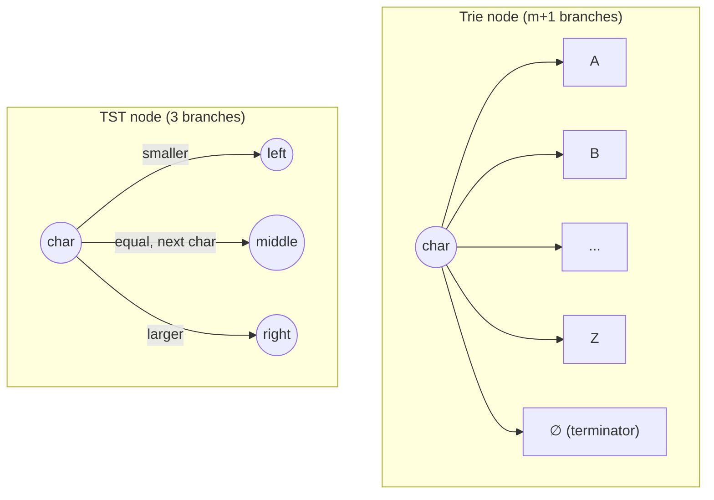
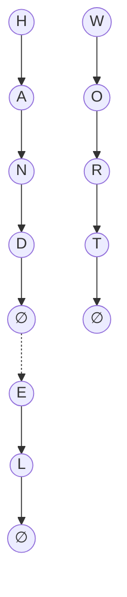
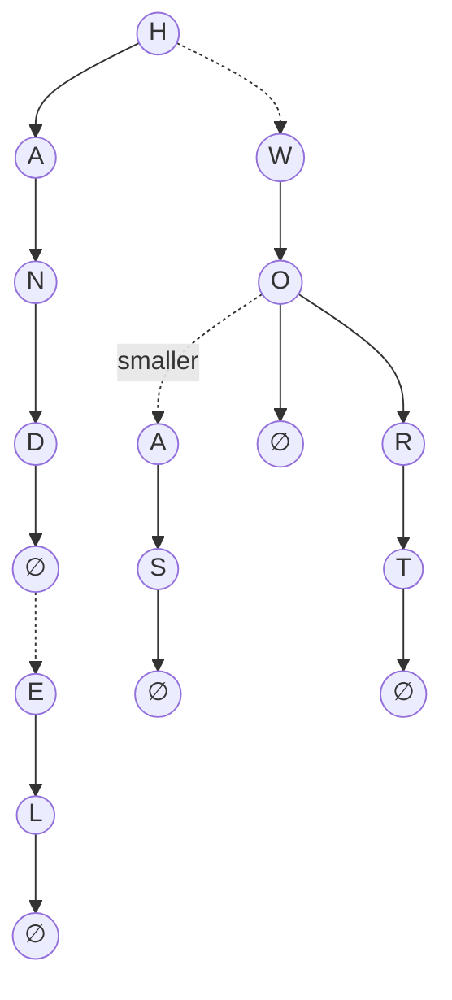

## One-sentence definition

A Ternary Search Trie (TST, *Ternärer Such-Trie*) is the memory-saving remedy
(*Abhilfe*) for the high per-node cost of a [[structures/trie]]: every node
stores exactly one character and has only **3** branches, instead of the
`m + 1` branches of a plain Trie (§0.12.2.5).

## Core idea / invariant

The disadvantage of a Trie is that every node needs `m + 1` branches — `O(m)`
memory per node, with `m = 256` for ASCII or `m = 65536` for Unicode/UTF-16
(§0.12.2.5). A TST fixes this by giving every node:

- one stored character,
- a **left** child, a **middle** child, and a **right** child (exactly 3
  branches, regardless of alphabet size).

During search, the character at the current search-key position is compared
with the character stored in the node:

- go **left** if the search-key character is **smaller**,
- go **right** if the search-key character is **larger**,
- go to the **middle** successor (*mittlerer Nachfolger*) if the characters
  are **equal** — this is the only branch that advances to the next character
  of the key.

## Node layout: Trie vs. TST

The Trie node's branch count scales with the alphabet size `m`; the TST
node's branch count is constant (3), at the cost of needing more nodes per key
since each node holds only one character and comparisons may chain
left/right before advancing via middle.

## Worked example (§0.12.2.6, Abbildung 101)

Inserting the same key set as the Trie example — **HAND, HANDEL, WORT, WO,
WAS** — one step at a time:

- (a) After **HAND**: a single chain of middle-links, `H → A → N → D → ∅`.
- (b) After **HANDEL**: from the `∅` node (end-of-word marker), a side branch
  (non-middle link) hangs off to `E → L → ∅`.
- (c) After **WORT**: a second, independent vertical chain begins:
  `W → O → R → T → ∅`, alongside the unchanged `H`-chain.

- (d) After **WO**: `O` gains a left/smaller child `∅` (end of "WO"), while
  the existing middle chain `R → T → ∅` (end of "WORT") continues unchanged.
- (e) After **WAS**: `O` gains a further branch `A → S → ∅` (lexicographically
  smaller suffix starting with A, end of "WAS"), alongside the `∅` and
  `R → T → ∅` children already present.

This completes the TST holding the same five keys as the earlier
[[structures/trie]] example (Abbildung 100), using only 3-way branching per
node instead of `m+1`-way branching.

## Operations table

The notes do not give the TST its own separate complexity section distinct
from the Trie; TSTs inherit the radix-searching complexity model of
§0.12.2.4 (dependent on key length `l_k`) while trading per-node branching
factor (`O(m)` → `O(1)`) for a larger number of nodes along a path, since
single-character comparisons that go left/right do not advance the search key.

| Operation | Complexity | Assumption |
|---|---|---|
| Per-node memory | `O(1)` | constant: one character + 3 pointers, vs. `O(m)` for a plain Trie |
| Search / Insert | inherits Trie's `O(l_k)` worst-case / `O(log n)` average-case shape (§0.12.2.4) | see [[structures/trie]] for the full derivation; the source does not restate it separately for TSTs |

## Reference implementation

No C++ source code is transcribed for TSTs in these pages — only the
definition, the 3-way branching rule, and the worked figure (Abbildung 101).

## Trade-offs: when to use, when not to

- Use a TST instead of a plain Trie when the alphabet is large (ASCII,
  Unicode) and the `O(m)`-per-node cost of a Trie is unacceptable.
- A TST still realizes radix searching (character-wise key evaluation) but at
  a more modest, constant per-node memory footprint than a Trie.
- For even more compact representations (binary bit-level comparisons instead
  of per-character nodes, and no empty inner-node overhead), see
  [[structures/patricia-tree]].

## Related
- [[structures/trie]]
- [[structures/patricia-tree]]
- [[structures/binary-search-tree]]
- [[structures/hash-table]]
- [[concepts/big-o-notation]]
- [[concepts/complexity-classes]]
- [[concepts/strings-cpp-vs-c]]

## Sources
- [[sources/grigat-trees-sorting]] §0.12.2.5, §0.12.2.6
