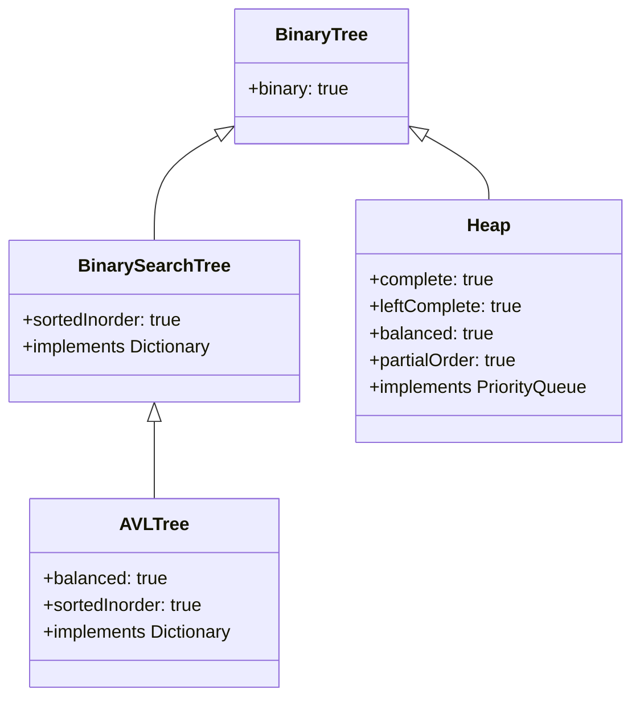

## One-sentence definition

This page is a cross-cutting landing page summarizing and contrasting the
tree structures covered in §0.11 — [[structures/binary-search-tree]],
[[structures/avl-tree]], and [[structures/heap]] — by the structural
properties each one does or does not guarantee (§0.11.9).

## Core idea / invariant

All three structures are [[structures/binary-tree]]s, but they trade off
different properties depending on which [[concepts/abstract-data-type|ADT]]
they implement: [[structures/dictionary]] (ordered, search-oriented) or
[[structures/priority-queue]] (minimum-extraction-oriented). The structural
properties — complete, left-complete, balanced, sorted-inorder,
partial-order — are not all mutually compatible, which is why no single tree
dominates on every axis.

## Tabelle 24 — comparison of tree structures (§0.11.9)

| Property | [[structures/binary-search-tree\|Binärer Suchbaum]] | [[structures/avl-tree\|AVL Baum]] | [[structures/heap\|Heap]] |
|---|---|---|---|
| Binärbaum (binary tree) | ✓ | ✓ | ✓ |
| Vollständig (complete) | – | – | ✓ |
| Links-vollständig (left-complete) | – | – | ✓ |
| balanciert (balanced; no degeneration to list) | – | ✓ | ✓ |
| Sortiert in Inorder-Reihenfolge (sorted in in-order traversal) | ✓ | ✓ | – |
| Partielle Ordnung (partial ordering) | – | – | ✓ |
| Implementiert z.B. den Datentyp (implements e.g. the data type) | Dictionary | Dictionary | Priority Queue |

A fourth structure, [[structures/b-tree]] (owned elsewhere), extends this
comparison for disk/block-resident dictionaries: like the AVL tree it is
balanced and keeps keys sorted, but it relaxes "binary" to allow many
children per node, trading tree height for fewer, larger node reads.

## Complexity table (summary across pages)

| Structure | `member`/search | `insert` | `delete`/`deletemin` | Sorted enumeration |
|---|---|---|---|---|
| [[structures/binary-search-tree]] | O(log n) avg, O(n) worst | O(log n) avg, O(n) worst | O(log n) avg, O(n) worst | yes (inorder) |
| [[structures/avl-tree]] | **O(log n)** guaranteed | **O(log n)** guaranteed | **O(log n)** guaranteed | yes (inorder) |
| [[structures/heap]] | O(n) (no ordered search) | O(log n) | O(log n) (`deletemin` only) | no |

See [[concepts/big-o-notation]] and [[concepts/complexity-classes]] for how
these bounds are classified, and [[structures/hash-table]] for a
non-tree-based dictionary alternative.

## Decision guide

- Need sorted enumeration **and** a hard worst-case bound → **AVL tree**.
- Need sorted enumeration and insertion order is random/benign →
  plain **binary search tree** is simpler and usually sufficient.
- Need "always extract the minimum/maximum next," no ordered search →
  **heap**.
- Need O(1)-ish lookup, no ordered enumeration needed →
  [[structures/hash-table]] instead of any tree.
- Need sorted dictionary semantics over data too large for memory →
  [[structures/b-tree]].
- Node placement should reflect known, static search *probabilities* rather
  than just structural balance → [[algorithms/optimal-binary-search-tree]].

## Related
- [[structures/binary-search-tree]]
- [[structures/avl-tree]]
- [[structures/heap]]
- [[structures/b-tree]]
- [[structures/dictionary]]
- [[structures/priority-queue]]
- [[structures/hash-table]]
- [[algorithms/optimal-binary-search-tree]]
- [[concepts/big-o-notation]]
- [[concepts/complexity-classes]]

## Sources
- [[sources/grigat-algorithms-data-structures]] §0.11.9
