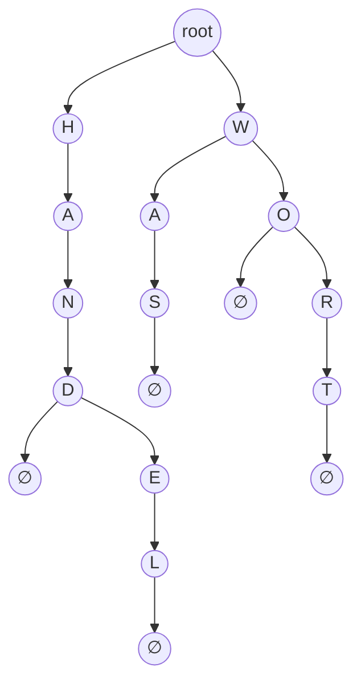

## One-sentence definition

A Trie (*Radix-Baum*, from "re**trie**val") is a tree for **radix searching**
(*digitales Suchen*) in which keys are evaluated character-wise or bit-wise
rather than as a whole, so that the data itself serves as the key (§0.12.2.1).

## Core idea / invariant

Let *m* be the cardinality (*Kardinalität*) of the character set *C* (e.g. the
size of the alphabet). A Trie has degree `d = m + 1`: one branch per possible
character, plus one additional termination symbol (*Terminierungssymbol*, here
written `∅`) marking the end of a string. The path from the root to a leaf
(*Pfad von der Wurzel zum Blatt*) spells out the key of that leaf, one edge per
character (§0.12.2.2). Unlike a [[structures/binary-search-tree]], a Trie does
not compare whole keys against each other — it only ever asks "which branch
does the next character select?".

Radix searching is especially suited to **long texts** and requires
well-distributed search keys (*gut verteilte Suchschlüssel*) to realize its
advantages: efficient handling of variable-length keys and acceptable
worst-case behavior (§0.12.2.1).

## Worked example (§0.12.2.3, Abbildung 100)

Inserting **HAND, HANDEL, WORT, WO, WAS** over the alphabet *C* = {A, …, Z}
with termination symbol `∅`, step by step:

- (a) After **HAND**: a single chain `root → H → A → N → D → ∅`.
- (b) After **HANDEL**: the chain to `D` now branches into `∅` (end of HAND)
  and `E → L → ∅` (end of HANDEL).
- (c) After **WORT**: the root gains a second child `W`; the `H`-subtree is
  unchanged. `W → O → R → T → ∅`.
- (d) After **WO**: `O` branches into `∅` (end of WO) and `R → T → ∅` (end of
  WORT).
- (e) After **WAS**: `W` gains a second child `A → S → ∅`, alongside the
  existing `O` branch.

Final trie after all five insertions:

## Operations table (§0.12.2.4)

Let *n* be the number of stored keys and *l_k* the key length.

| Operation | Best / typical | Worst case | Assumption |
|---|---|---|---|
| Insert, Find (avg) | `O(log n)` | — | dissimilar keys (*unähnliche Schlüssel*) |
| Insert, Find (worst) | — | `O(l_k)` | similar keys (*ähnliche Schlüssel*) |
| Nodes in tree (worst) | — | `O(n · l_k)` | all keys disjoint; every key forces inner nodes of degree 1 |
| Nodes in tree (avg) | `O(l_k · n / log l_k)` | — | marked `[?]` — unproven in the source |

Complexity depends on key length *l_k*, not just on *n* — this is the key
departure from whole-key structures such as hashing, which (per §0.12.2.4)
become inefficient for strongly varying key length.

## Comparison: Trie vs. hash table (§0.12.2.5)

| | Trie | [[structures/hash-table]] |
|---|---|---|
| Search, avg. | `O(log n)` (without proof, cf. `[?]`) | `O(l_k) + O(1)` |
| Search, worst | `O(l_k)` | `O(l_k) + O(n)` |
| Key evaluation | character/bit-wise | computes `h(k)` (and possibly `h'(k)`) over all `l_k` characters, `O(l_k)` |
| Best suited when | *l_k* variable, large relative to `log n` (e.g. long texts), keys well-distributed | *l_k* constant and small |
| Memory per node | `O(m)` — every node has `m + 1` branches | depends on table size / collision strategy |

**Disadvantage of Tries** (§0.12.2.5): every node needs *m* + 1 branches —
`m = 256` for ASCII, `m = 65536` for Unicode (UTF-16) — giving high memory
requirement per node, `O(m)`. This is the motivation for
[[structures/ternary-search-trie]], which replaces the `m+1`-way branch with a
3-way branch while keeping one character per node.

## Reference implementation

The source gives no C++ code for Tries in these pages — only the definition
and the worked figure. The structural idea (one node holding `m+1` child
pointers, one per alphabet character plus the termination symbol) is directly
expressible with [[concepts/templates]] and [[concepts/pointers-and-references]]
for the child array, but no verbatim implementation is transcribed here.

## Trade-offs: when to use, when not to

- Use a Trie when keys are long, variable-length strings over a modest
  alphabet, well distributed, and alphabet-independent worst-case bounds
  matter (text indexing, §0.12.5.5/§0.12.5.7 application).
- Avoid a Trie when the alphabet is large (Unicode) and memory is scarce — a
  [[structures/ternary-search-trie]] or [[structures/patricia-tree]] compress
  the representation; a [[structures/hash-table]] is preferable for short,
  fixed-length keys.

## Common pitfalls & gotchas

- The `[?]` marker on the average node-count bound in §0.12.2.4 and the
  "without proof" (*ohne Beweis*) qualifier on the average search complexity in
  §0.12.2.5 are the source's own caveats, not errors — see Open questions.

## Related
- [[structures/ternary-search-trie]]
- [[structures/patricia-tree]]
- [[structures/hash-table]]
- [[structures/binary-search-tree]]
- [[algorithms/lzw-compression]]
- [[algorithms/string-matching]]
- [[concepts/big-o-notation]]
- [[concepts/complexity-classes]]
- [[concepts/strings-cpp-vs-c]]

## Open questions

- The average-case node-count bound `O(l_k · n / log l_k)` is marked `[?]` in
  the source — left unproven.
- The average-case search complexity `O(log n)` for a Trie is stated "ohne
  Beweis" (without proof) in §0.12.2.5.

## Sources
- [[sources/grigat-trees-sorting]] §0.12.2.1, §0.12.2.2, §0.12.2.3, §0.12.2.4, §0.12.2.5
