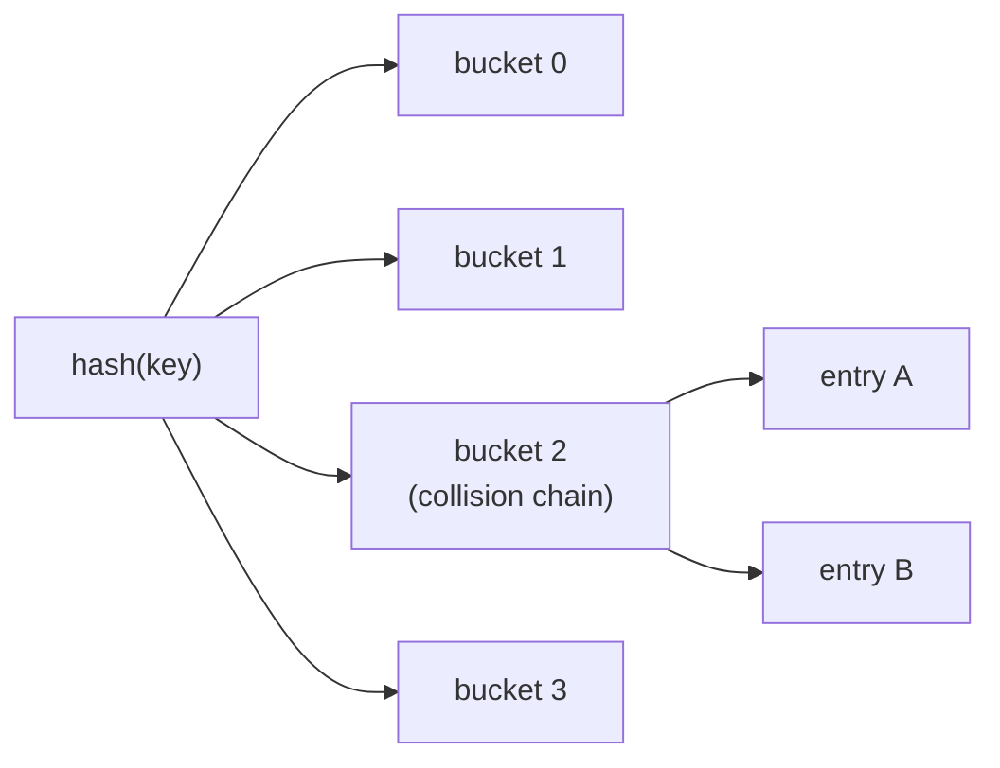

## One-sentence definition

The unordered associative containers (*ungeordnete assoziative Container*) —
`unordered_set`, `unordered_multiset`, `unordered_map`, `unordered_multimap`
— store elements unsorted via a hash function (*Hashfunktion*), trading the
sorted-order invariant of [[structures/set-and-map]] for average O(1) access
(§0.5.6.9).

## Core idea / invariant

Instead of maintaining sorted order, each element's storage slot ("bucket")
is derived from its hash value. There is no ordering invariant — the notes
state explicitly these containers are *unsortiert gespeichert mittels
Hashfunktion* (unsorted, stored via a hash function). Otherwise, interface-
wise, they are identical to the ordered Set/Multiset and Map/Multimap
(§0.5.6.9): same `insert`, same `find`-style lookup, same multi/non-multi
duplicate rule.

## Hashing and the O(1) assumption (§0.5.6.9)

- Access is O(1) "as long as Speicherfüllungsgrad (load factor) is low".
- Individual (custom) classes require their own hash function to be usable as
  keys/elements.
- Otherwise, the interface matches Set/Multiset and Map/Multimap exactly.

## Operations table

| Operation | Complexity | Assumption |
|---|---|---|
| insert / find / erase | O(1) average | load factor (*Speicherfüllungsgrad*) stays low and the hash function distributes keys well — the notes state this condition directly |
| insert / find / erase | O(n) worst case | not stated numerically by the source; follows from the general hash-table property that all keys could collide into one bucket. This worst-case line is this page's own addition, not a figure quoted from the notes. |

## Comparison to the ordered variants

| Aspect | Ordered (set/map, [[structures/set-and-map]]) | Unordered (this page) |
|---|---|---|
| Internal order | sorted by value/key | unsorted, hash-bucket order |
| Typical search | O(log n) | O(1) average, assuming low load factor |
| Iteration order | ascending | unspecified/hash-dependent |
| Custom key types | need an ordering (`<`) | need a hash function |

## Mermaid: hash-bucket layout



## Pseudocode: lookup

The source does not spell out the internal hashing algorithm; the following
states the operation-level contract implied by the O(1)-average claim.

```
1. procedure find(container, key):
2.     bucket_index ← hash(key) mod bucket_count
3.     for each entry in container.bucket[bucket_index]:
4.         if entry.key == key:
5.             return entry           // O(1) average, assuming few collisions
6.     return not_found
```

## Reference implementation / usage example (§0.5.6.9)

```cpp
#include <iostream>
#include <string>
#include <unordered_map>
int main() {
    std::unordered_map<std::string, int> months;
    months["january"] = 31;
    months["february"] = 28;
//...
    months["december"] = 31;
    std::cout << "september -> " << months["september"] << std::endl;
    return 0;
}
```

The notes point out: accessing `months["september"]`, a key that was never
inserted, does not throw — `operator[]` on `unordered_map` default-inserts
the key with a value-initialized value (`0` for `int`) rather than raising an
error. This matches the general note on direct element access via `[]` not
checking existence (§0.5.6.10, see [[concepts/stl-containers]]).

## Trade-offs

- Prefer unordered containers when only fast average-case lookup matters and
  iteration order is irrelevant; prefer the ordered variants
  ([[structures/set-and-map]]) when sorted iteration is required.
- Custom element/key types need a hash function for unordered containers, vs.
  an ordering relation (`<`) for the ordered ones — switching families
  changes what you must supply for user-defined types.

## Common pitfalls & gotchas

- `operator[]` silently creates a default entry for a missing key instead of
  signaling "not found" — using `[]` to merely *check* presence will insert
  an unwanted entry as a side effect.
- The O(1) bound degrades toward O(n) as the load factor grows or with a
  poorly distributing hash function — the notes explicitly tie the O(1)
  claim to "load factor is low" (§0.5.6.9).

## Related
- [[structures/set-and-map]]
- [[concepts/stl-containers]]
- [[concepts/complexity-classes]]
- [[concepts/iterators]]

## Sources
- [[sources/grigat-cpp-concepts-generic]] §0.5.6.9, §0.5.6.10
