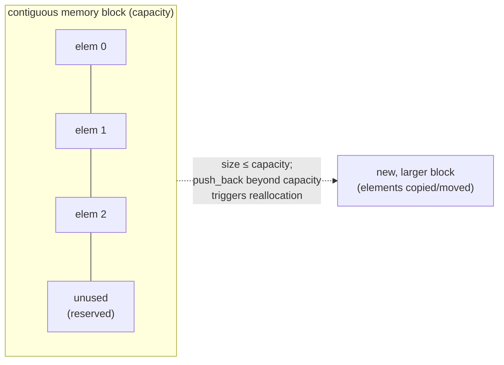

## One-sentence definition

`std::vector` is the STL's sequential container (*sequentieller Container*)
implementing a dynamisches Feld (dynamic array): a contiguous, growable block
of elements with direct `[]` access (§0.5.6.3).

## Core idea / invariant

A vector keeps its elements in one contiguous block of memory. Its *size*
(number of elements currently stored) and *capacity* (number of elements the
current block can hold before a reallocation is needed) are tracked
separately; growth happens only at the end. The invariant is: `size ≤
capacity`, and all elements `[0, size)` are contiguous and accessible in O(1)
via `operator[]`.

## Operations table (§0.5.6.3)

| Operation | Complexity | Assumption |
|---|---|---|
| direct access `[]` / `at()` | O(1) | — |
| insert/remove at the end | O(1) | amortized, due to geometric capacity growth on reallocation |
| insert/remove at the beginning | O(n) | all following elements must shift |
| insert/remove in the middle | O(n) | all following elements must shift |

The notes do not give a complexity for `vector::at()` beyond noting it is
slower than `[]` due to the bounds check (§0.5.6.10); both remain O(1).

## Memory layout



Abbildung 18 in the source (§0.5.6.3) depicts this as a row of boxes with a
dotted arrow pointing right, indicating the growth direction at the end of
the array only (single-ended, unlike [[structures/deque]]).

## Pseudocode: push_back with amortized growth

The source does not spell out vector's internal growth algorithm in
pseudocode; the following is the standard amortized-doubling strategy implied
by the "O(1) amortized at the end" complexity entry above.

```
1. procedure push_back(vec, value):
2.     if vec.size == vec.capacity:
3.         new_capacity ← max(1, 2 * vec.capacity)   // geometric growth
4.         allocate new_block of new_capacity elements
5.         copy/move vec[0 .. size-1] into new_block
6.         deallocate old block
7.         vec.block ← new_block
8.         vec.capacity ← new_capacity
9.     vec.block[vec.size] ← value
10.    vec.size ← vec.size + 1
```

Because reallocation (doubling) happens only every O(log n) insertions and
copies O(n) elements each time, the amortized cost per `push_back` is O(1).

## Reference implementation / usage example (§0.5.6.3)

```cpp
#include <vector>

int main()
{
  std::vector<int> vec;
  for(int i = 1; i <= 5; ++i)
  {
    vec.push_back(i);
  }
  std::cout << vec[0];//Ausgabe: 1
}
```

## Trade-offs: when to use, when not to

- Use `vector` when random access (*wahlfreier Zugriff*) is required and
  insertion happens mainly at the end (§0.5.6.2).
- Avoid `vector` when frequent insertion/removal at the front or middle is
  needed — both are O(n); prefer [[structures/deque]] (front/back O(1)) or
  [[structures/list]] (arbitrary-position O(1) once positioned).

## Common pitfalls & gotchas

- `operator[]` does **not** check bounds — reading/writing past `size` is
  undefined behavior (possibly a random value), whereas `at()` throws
  `out_of_range` but is slower (§0.5.6.10):

```cpp
std::vector<int> vec;
vec.push_back(0);
std::cout << vec[1];    // undefiniert, evtl. Ausgabe eines zufaelligen Wertes
std::cout << vec.at(1); // wirft out_of_range - Ausnahme
```

- The notes do not discuss iterator invalidation on reallocation explicitly;
  this page therefore does not claim a specific invalidation rule beyond what
  is stated above — see [[concepts/iterators]] for the general iterator
  model.
- `vector` is not designed to be used as a polymorphic base class for
  derivation (§0.5.6.2); see [[concepts/stl-containers]].

## Related
- [[concepts/stl-containers]]
- [[structures/deque]]
- [[structures/list]]
- [[concepts/memory-model]]
- [[concepts/complexity-classes]]
- [[structures/stack]]

## Sources
- [[sources/grigat-cpp-concepts-generic]] §0.5.6.1, §0.5.6.2, §0.5.6.3, §0.5.6.10
