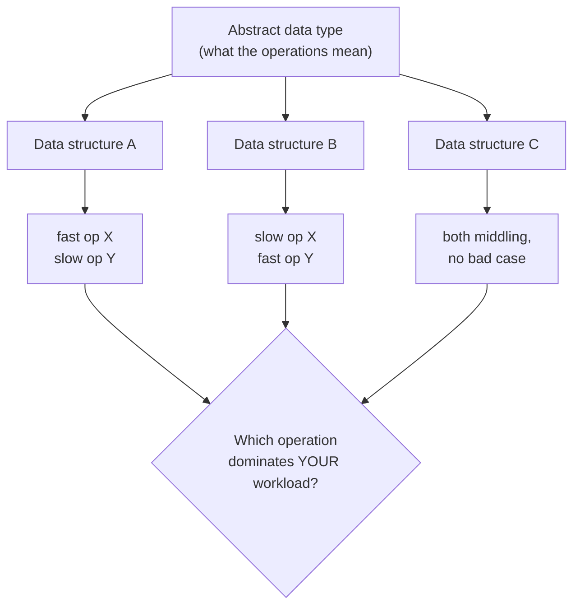
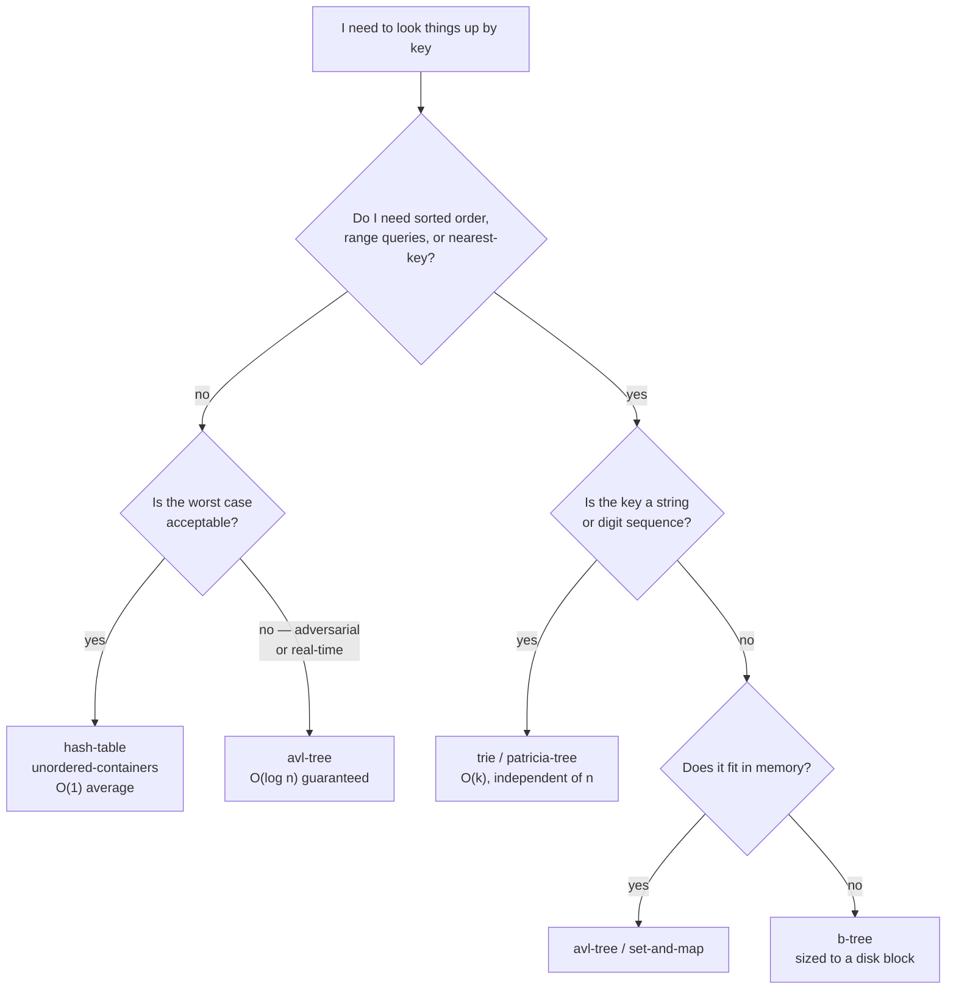

# Choosing a Data Structure

The script never asks this question directly. It presents each structure on its own
terms and ends most sections with a cost table. This page does the thing those
tables are for.

## The one idea underneath everything

Teil II opens with it ([[concepts/abstraction-levels]]) and then demonstrates it
about fifteen times:

> **An abstract data type says what the operations mean. A data structure is one
> of several legal ways to make them fast. Choosing is choosing which operations
> you are willing to make slow.**

There is no fastest structure. Sets get three implementations, dictionaries get
five, priority queues get three — and in every case the script's table has no
winning column, only different shapes of loss.



The third option — "both middling, no bad case" — is worth naming, because it keeps
recurring. The [[structures/avl-tree]] is a [[structures/binary-search-tree]] that
gives up O(1)-ish best-case simplicity to eliminate the O(n) worst case. The
[[structures/heap]] is slower than an ordered list at `deletemin` and slower than an
unordered list at `insert`, and is the right answer because it is bad at nothing.
Guaranteed mediocrity beats conditional excellence whenever you cannot control the
input.

## Decision procedure

```
1. What operations does the workload actually perform, and in what proportion?
       Write them down before looking at any table. This is the step people skip.

2. Do you need the elements in sorted order, or to iterate a range?
       yes -> ordered structure: avl-tree / set-and-map / b-tree / trie
       no   -> hashing is available to you, and is usually faster

3. Is the key a string or a sequence of digits/characters?
       yes -> consider trie / ternary-search-trie / patricia-tree:
              cost is O(k) in key length, INDEPENDENT of how many items you store
       no   -> continue

4. Does the data fit in memory?
       no   -> the cost model changes to block I/O: b-tree, external-merge-sort
       yes  -> continue

5. Can you tolerate a bad worst case, or only a bad average case?
       worst case matters (real-time, adversarial input)
            -> avl-tree, merge-sort, heapsort  (guaranteed bounds)
       average case is enough
            -> hash-table, quicksort           (faster in practice, bad tail)

6. Do you only ever need the minimum (or maximum)?
       yes -> priority-queue via heap. Do NOT sort.

7. Is the access pattern restricted to one or both ends?
       one end  -> stack
       both ends -> queue / deque

8. Only now consult synthesis/complexity-cheatsheet and pick the row.
```

## Sequences: the only question is where you insert

| If you mostly… | use | because |
|---|---|---|
| index randomly, append at the end | [[structures/vector]] | contiguous, O(1) index, amortized O(1) `push_back` |
| insert/remove at **both** ends | [[structures/deque]] | O(1) at both, no full reallocation |
| splice or insert in the **middle**, holding an iterator | [[structures/list]] | O(1) there; the price is O(n) index and no locality |
| push and pop at one end only | [[structures/stack]] | the restricted interface *is* the point |
| enqueue at one end, dequeue at the other | [[structures/queue]] | ring buffer, O(1) both |

The underlying trade-off is [[structures/linked-list]] vs. array: pointer chasing
buys you O(1) structural edits and costs you O(1) indexing and cache locality.

A caution the script implies and practice confirms: `vector` wins more often than
its complexity table suggests, because O(n) over contiguous memory frequently beats
O(1) over scattered nodes at realistic n.

## Lookup: ordered or not



See [[structures/dictionary]] for the script's own version of this table, and
[[structures/tree-structures-comparison]] for the tree side.

## Sorting

Four questions decide it, in this order:

1. **Is the worst case a risk?** If yes, [[algorithms/merge-sort]] or
   [[algorithms/heapsort]]; never plain [[algorithms/quicksort]] with a fixed pivot,
   whose O(n²) case is *sorted input* — the input you are most likely to be handed.
2. **Is extra memory available?** Merge sort needs O(n); heapsort needs O(1).
3. **Is the data nearly sorted already?** Then [[algorithms/insertion-sort]], which
   the script recommends for exactly this despite its O(n²) label.
4. **Are the keys small integers or fixed-width?** Then you can leave the
   comparison model entirely: [[algorithms/bucket-sort]],
   [[algorithms/radix-sort]].

If none of these apply, use the standard library's
[[algorithms/stl-algorithms|`std::sort`]] and stop thinking about it. The reason to
know the above is to recognise the cases where that advice is wrong.

## The C++ layer

Most of the time you are not implementing any of this, you are picking an STL
container. The mapping:

| Structure here | STL counterpart |
|---|---|
| [[structures/linked-list]] | [[structures/list]], [[structures/vector]] |
| [[structures/queue]] | [[structures/deque]] |
| [[structures/set]], [[structures/dictionary]] | [[structures/set-and-map]] |
| [[structures/hash-table]] | [[structures/unordered-containers]] |
| [[structures/priority-queue]], [[structures/heap]] | `std::priority_queue` (see [[concepts/stl-containers]]) |

Knowing the structure underneath is what lets you read the container's complexity
guarantees as consequences rather than promises — and what tells you when to reach
past the standard library for a [[structures/trie]] or a
[[structures/b-tree]], which it does not provide.

## Open questions

- The script gives no guidance on cache locality or constant factors, which in
  practice decide `vector`-vs-`list` far more often than the asymptotics do. The
  empirical table on [[algorithms/sorting-comparison]] is the only measured data
  anywhere in the sources.
- Persistent and concurrent structures are not covered at all, despite
  [[concepts/multithreading]] existing in the wiki.
- No source discusses amortized analysis explicitly, though
  [[structures/vector]] depends on it.

## Related

- [[synthesis/complexity-cheatsheet]] — the numbers behind every choice here
- [[concepts/abstraction-levels]], [[concepts/abstract-data-type]]
- [[structures/dictionary]], [[structures/tree-structures-comparison]]
- [[algorithms/sorting-comparison]], [[algorithms/sorting-overview]]
- [[concepts/stl-containers]], [[concepts/big-o-notation]]
- [[synthesis/oop-core-concepts]]
