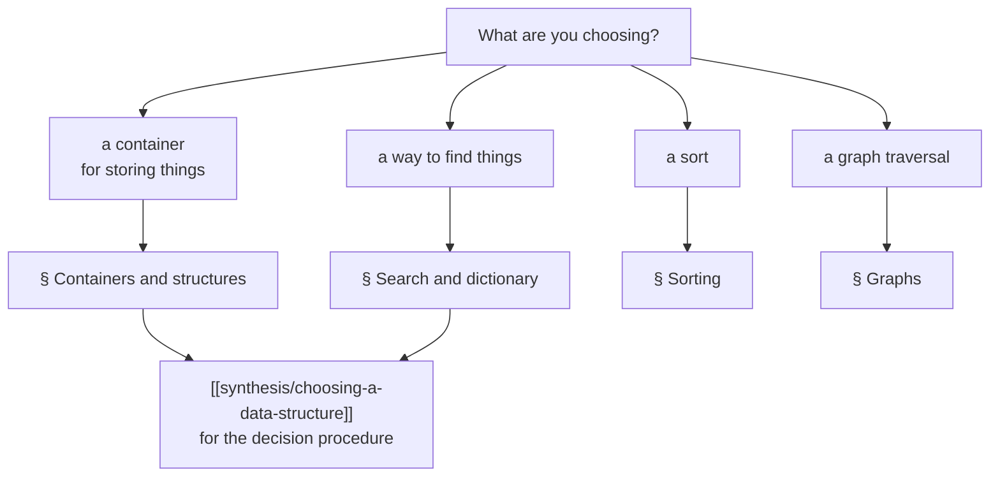

# Complexity Cheatsheet

Every asymptotic bound the wiki records, in one place. All figures are **as stated
by the source**; where the script gives no bound, the cell says so rather than
supplying the textbook value. See [[concepts/big-o-notation]] for what the notation
means and [[concepts/complexity-classes]] for how the classes compare.

> Read this page to orient. Read the linked page for the reasoning — the bounds
> here are conclusions, not arguments.

## How to use this

## Sequence containers and list structures

| Structure | Index access | Insert/erase at front | at back | in middle (iterator known) | Search |
|---|---|---|---|---|---|
| [[structures/vector]] | O(1) | O(n) | amortized O(1) | O(n) | O(n) |
| [[structures/deque]] | O(1) | O(1) | O(1) | O(n) | O(n) |
| [[structures/list]] | O(n) | O(1) | O(1) | O(1) | O(n) |
| [[structures/linked-list]] (singly) | O(n) | O(1) | O(n)¹ | O(1)² | O(n) |
| [[structures/linked-list]] (doubly) | O(n) | O(1) | O(1) | O(1) | O(n) |
| [[structures/stack]] | — | — | O(1) push/pop | — | — |
| [[structures/queue]] | — | O(1) dequeue | O(1) enqueue | — | — |

¹ O(1) with a tail pointer. ² given a pointer to the *predecessor*; this is the
distinction §0.10.1 spends several pages on.

## Associative structures — the dictionary problem

| Structure | Search | Insert | Delete | Ordered traversal |
|---|---|---|---|---|
| unordered list ([[structures/set]]) | O(n) | O(1) | O(n) | no |
| ordered list ([[structures/set]]) | O(n)³ | O(n) | O(n) | yes |
| bit vector ([[structures/set]]) | O(1) | O(1) | O(1) | yes, over the universe |
| [[structures/hash-table]] (ideal) | O(1) | O(1) | O(1) | no |
| [[structures/hash-table]] (linear probing) | O(1) avg, O(n) worst | O(1) avg | O(1) avg | no |
| [[structures/binary-search-tree]] | O(log n) avg, O(n) worst | same | same | yes (inorder) |
| [[structures/avl-tree]] | **O(log n) guaranteed** | O(log n) | O(log n) | yes (inorder) |
| [[structures/b-tree]] | O(log n), few block reads | O(log n) | O(log n) | yes |
| [[structures/trie]] | O(k), k = key length | O(k) | O(k) | yes (lexicographic) |
| [[structures/patricia-tree]] | O(k) | O(k) | O(k) | yes |
| [[structures/set-and-map]] (std) | O(log n) | O(log n) | O(log n) | yes |
| [[structures/unordered-containers]] (std) | O(1) avg, O(n) worst | O(1) avg | O(1) avg | no |

³ O(log n) if the ordered sequence supports random access, i.e. an array rather
than a list — the script is explicit that the *ordering* alone does not buy you
binary search.

The key column is the last one. Hashing beats trees on time and loses on order;
that single trade-off explains the existence of both `std::map` and
`std::unordered_map`. See [[structures/dictionary]] and
[[structures/tree-structures-comparison]].

## Priority queue

| Implementation | `insert` | `min` | `deletemin` |
|---|---|---|---|
| unordered list | O(1) | O(n) | O(n) |
| ordered list | O(n) | O(1) | O(1) |
| [[structures/heap]] | O(log n) | O(1) | O(log n) |

The heap is the compromise, and it is why [[algorithms/huffman-coding]] is
O(n log n) and [[algorithms/heapsort]] exists. See [[structures/priority-queue]].

## Sorting

| Algorithm | Best | Average | Worst | Extra space | In-place |
|---|---|---|---|---|---|
| [[algorithms/selection-sort]] | O(n²) | O(n²) | O(n²) | O(1) | yes |
| [[algorithms/insertion-sort]] | O(n²)⁴ | O(n²) | O(n²) | O(1) | yes |
| [[algorithms/bubble-sort]] | O(n²) | O(n²) | O(n²) | O(1) | yes |
| [[algorithms/merge-sort]] | O(n log n) | O(n log n) | **O(n log n)** | O(n) | no |
| [[algorithms/quicksort]] | O(n log n) | O(n log n) | **O(n²)** | O(log n) | yes |
| [[algorithms/heapsort]] | O(n log n) | O(n log n) | O(n log n) | O(1) | yes |
| [[algorithms/tree-sort]] | — | O(n log n)⁵ | — | O(n) | no |
| [[algorithms/bucket-sort]] | — | — | — | O(n + N) | no |
| [[algorithms/radix-sort]] | O(n) | O(n) | O(n) | O(n + m) | no |

⁴ The script gives insertion sort a single O(n²) bound with no separate best case,
even though it recommends it for nearly-sorted input. ⁵ Inferred; the script states
no formula. Both are flagged on the respective pages.

Radix and bucket sort are linear only because they are **not comparison-based** —
and radix sort only for a constant number of key digits. The full table, including
the script's measured runtimes, is on [[algorithms/sorting-comparison]].

## Graphs

Bounds depend on the representation — see [[structures/graph-representations]].

| Operation | Adjacency matrix | Adjacency list |
|---|---|---|
| Space | O(\|V\|²) | O(\|V\| + \|E\|) |
| Is (u,v) an edge? | O(1) | O(deg u) |
| Enumerate neighbours of u | O(\|V\|) | O(deg u) |
| [[algorithms/depth-first-search]] | O(\|V\|²) | O(\|V\| + \|E\|) |
| [[algorithms/breadth-first-search]] | O(\|V\|²) | O(\|V\| + \|E\|) |
| [[algorithms/topological-sort]] | O(\|V\|²) | O(\|V\| + \|E\|) |

Dense graphs favour the matrix, sparse graphs the list. This is the clearest case
in the wiki of a bound belonging to the *representation* rather than the algorithm.

## Dynamic programming and other algorithms

| Algorithm | Complexity | Note |
|---|---|---|
| [[algorithms/linear-search]] | O(n) | |
| [[algorithms/binary-search]] | O(log n) | requires sorted random-access data |
| [[algorithms/tree-traversal]] | O(n) | each node visited once |
| [[algorithms/string-matching]] (naive) | O(n·m) | |
| [[algorithms/huffman-coding]] | O(n log n) | heap-driven greedy construction |
| [[algorithms/lzw-compression]] | O(n) | with a trie/hash dictionary |
| [[algorithms/optimal-binary-search-tree]] | O(n³) | DP over all subranges |
| [[algorithms/assembly-line-scheduling]] | O(n) | DP over a 2-track DAG |
| [[algorithms/viterbi]] | O(N²·T) | N states, T observations |
| [[algorithms/external-merge-sort]] | counted in block I/O, not comparisons | see below |

## The cost model is a choice

Everything above except the last row counts **comparisons and assignments** in
uniform-access memory. [[algorithms/external-merge-sort]] and
[[structures/b-tree]] discard that model and count **disk block transfers**
instead — which is the entire reason a B-tree node holds hundreds of keys while an
[[structures/avl-tree]] node holds one.

A bound is never a property of an algorithm alone. It is a property of an algorithm
*plus* a machine model. The script makes this explicit only in §0.15, but it is
true of every row on this page.

## Open questions

- No Ω(n log n) lower-bound proof for comparison sorting appears in any source,
  though bucket and radix sort are presented as beating it.
- Several stability properties are "not stated" in the script; they are marked as
  such on [[algorithms/sorting-comparison]] rather than assumed.
- Amortized analysis is used implicitly ([[structures/vector]] `push_back`) but
  never defined.

## Related

- [[concepts/big-o-notation]], [[concepts/complexity-classes]]
- [[synthesis/choosing-a-data-structure]]
- [[structures/tree-structures-comparison]], [[algorithms/sorting-comparison]]
- [[concepts/chrono-time-measurement]] — measuring, as opposed to analysing
- [[concepts/dynamic-programming]], [[concepts/divide-and-conquer]]
