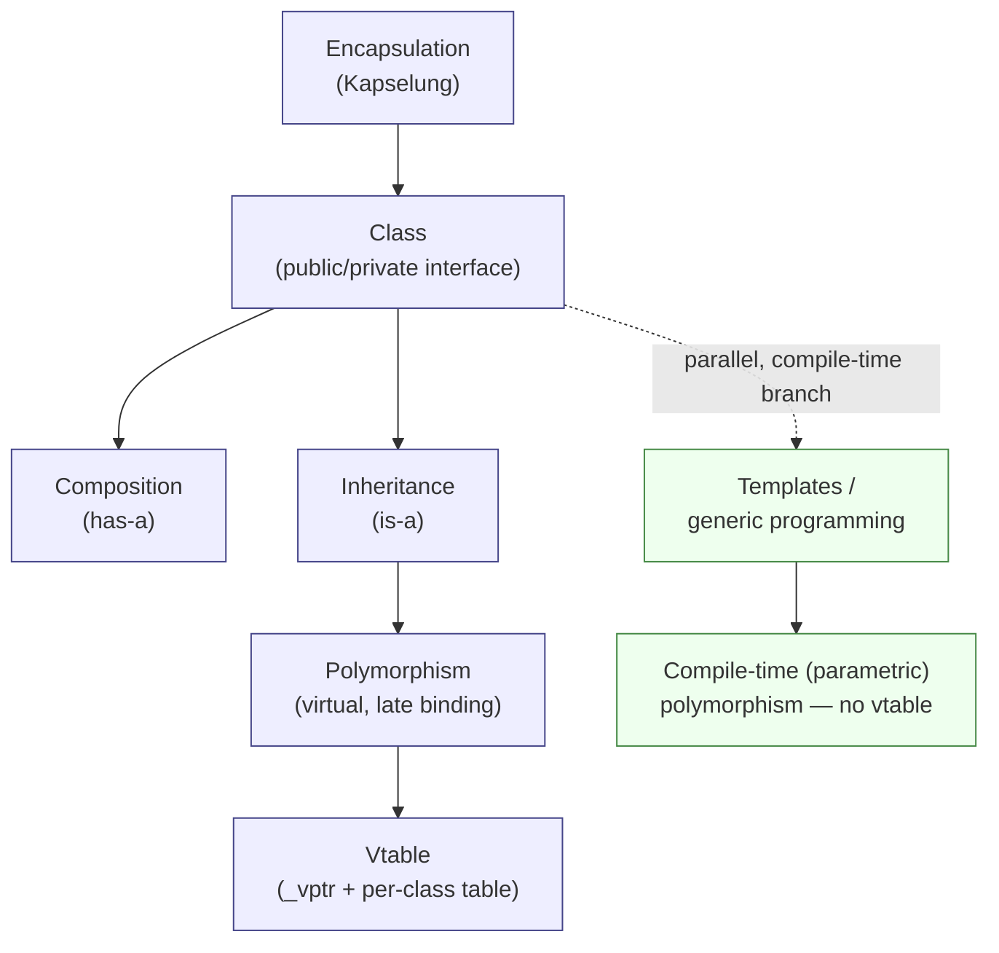

# OOP Core Concepts — Synthesis

The script closes (§0.3.7.12) with a deliberately short summary. Everything in
part 0.3 reduces to two ideas:

> **Grundkonzepte**
> - Trennung von Schnittstelle und Implementation (**Kapselung**)
>   — separation of interface and implementation (encapsulation)
> - Wiederverwendung von Programmcode durch — code reuse through:
>   - **Komposition** ("hat-ein") — composition ("has-a")
>   - **Vererbung** ("ist-ein") — inheritance ("is-a")
>   - **Polymorphie** — polymorphism

## Map of the core concepts

## 1. Separation of interface and implementation

| Idea | Page |
|---|---|
| Specify behaviour without committing to representation | [[concepts/abstract-data-type]] |
| Worked ADT example | [[structures/stack]] |
| Hide data behind public methods | [[concepts/encapsulation]] |
| The mechanism: `public` / `private` / `protected` | [[concepts/access-modifiers]] |
| The deliberate exception | [[concepts/friend]] |
| The notation | [[concepts/uml-class-diagram]] |

The C++ realisation is the class — see [[concepts/class-and-object]],
[[concepts/member-functions]], [[concepts/this-pointer]].
Object lifetime is bracketed by [[concepts/constructor]] and
[[concepts/destructor]], over the three storage kinds in
[[concepts/memory-model]], with class-level state in [[concepts/static-members]].

## 2. Code reuse

| Mechanism | Relation | Page |
|---|---|---|
| Composition | "has-a" | [[concepts/composition]] |
| Inheritance | "is-a" | [[concepts/inheritance]], [[concepts/multiple-inheritance]] |
| Polymorphism | "behaves-as-a" | [[concepts/polymorphism]], [[concepts/vtable]] |

Supporting: [[concepts/overriding-vs-overloading]], [[concepts/abstract-class]].

### Composition vs. inheritance

Both reuse code; they differ in what they commit to. Composition reuses an
object's *behaviour* through its public interface and keeps the two types
independent. Inheritance reuses an *implementation* and additionally asserts
substitutability, which is what makes polymorphism possible — and what makes
inheritance the more expensive commitment. The script's access-modifier
discussion is in effect a long argument about how costly that commitment is.

## The three warnings

The script repeats three pitfalls with unusual emphasis. They interlock.

1. **Never override non-virtual functions.** Without `virtual` there is no
   [[concepts/vtable|vtable]], so binding is static: the *pointer's declared
   type* decides which code runs, not the object's actual type.
2. **Base-class destructors must be virtual.** Otherwise `delete` through a base
   pointer frees only the base part. Constructors are never virtual, and neither
   constructors nor destructors should call virtual functions. See
   [[synthesis/special-member-functions]] for the destructor alongside C++'s
   other special member functions (copy/move constructor, assignment operators).
3. **`protected` member variables are a design flaw.** Make member variables
   `private`.

Why #3 follows from #1: access rights during a call come from the class whose
code is *actually executing*, not from the pointer's static type. So whether a
`protected` member is reachable can depend on whether the base or the overridden
version ran — which in turn depends on `virtual`. The script works this through
in the `CKfz`/`CPkw`/`CMotorrad` exercise (§0.3.7.8–0.3.7.11) and concludes:
*"This whole problem does not arise if you forgo `protected` variables."*

> [!note] The general lesson
> Subtle access-rule questions dissolve when the data is private. Encapsulation
> is not only a design preference here — it is what keeps the inheritance and
> polymorphism rules tractable.

## How part 0.2 feeds part 0.3

The language mechanics are not a separate topic; each is load-bearing for OOP:

- [[concepts/type-declaration-definition]] — "declare many times, define once" is
  what makes header files and class declarations work.
- [[concepts/pointers-and-references]] — function pointers *are* the vtable
  mechanism.
- [[concepts/parameter-passing]] — whether a method sees the caller's object or a
  copy; central to the `CKfz&` reasoning in the exercise above.
- [[concepts/const-and-volatile]] — generalises to `const` member functions.
- [[concepts/scope-and-storage-classes]] — generalises to static members.
- [[concepts/modularization-and-build-pipeline]],
  [[concepts/preprocessor-and-include-guards]], [[concepts/namespaces]] — the
  physical counterpart to logical encapsulation.

## Open questions to pursue

- ~~How do `unique_ptr` / `shared_ptr` change the virtual-destructor rule?~~
  **Answered** by [[sources/grigat-cpp-concepts-generic]] §0.5.4 →
  [[concepts/smart-pointers]]. The virtual-destructor rule still holds for
  polymorphic deletion; `shared_ptr` is the partial exception, since it captures
  the deleter at construction time.
- ~~How do templates and generic programming interact with these rules?~~
  **Answered** by [[sources/grigat-cpp-concepts-generic]] §0.5.1–0.5.2 →
  [[concepts/templates]]. Templates give *compile-time* polymorphism, with no
  vtable and no base class — a genuine alternative to the runtime dispatch
  described above, not merely a complement.
- Composition is often preferred over inheritance in modern practice; the script
  presents them as peers. Worth checking against a design-patterns source
  (`raw/oop_uml_and_design_patterns.pdf`).
- How does Java's single-inheritance-plus-interfaces model compare with the C++
  rules here? `raw/oop_java.pdf` should settle it.

## Two kinds of polymorphism

A distinction the first source could not yet make, now available:

| | Runtime (subtype) | Compile-time (parametric) |
|---|---|---|
| Mechanism | `virtual` + [[concepts/vtable]] | [[concepts/templates]] |
| Binding | late, at call time | at instantiation |
| Cost | `_vptr` per object, indirect call | code bloat per instantiation |
| Requires | a common base class | only that the operations compile |
| Page | [[concepts/polymorphism]] | [[concepts/templates]] |

The STL is built almost entirely on the right-hand column — see
[[concepts/standard-library]].

## Sources

- [[sources/grigat-oop-teil1]] §0.3.7.12 (Objektorientierte Programmierung:
  Zusammenfassung), §0.3.7.8–0.3.7.11 (worked exercise), §0.3.5.8–0.3.5.10
