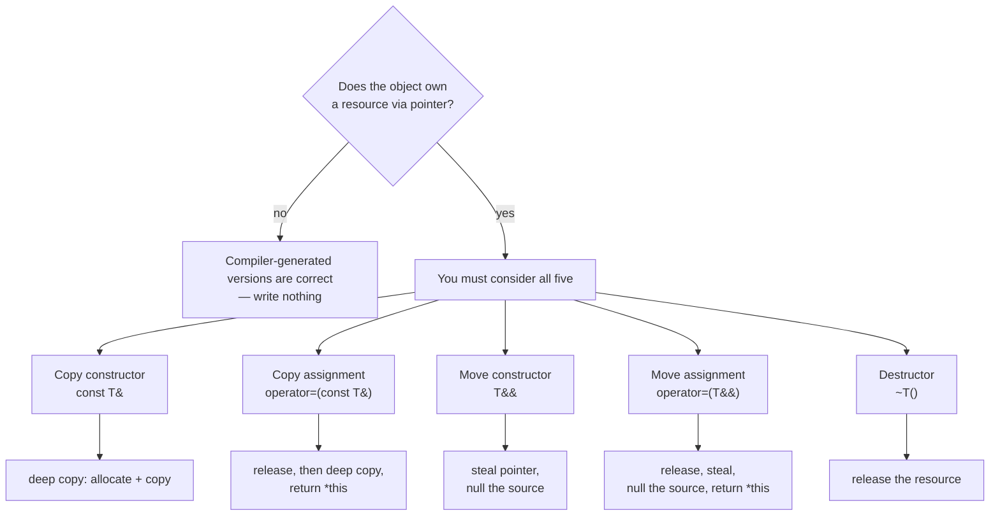
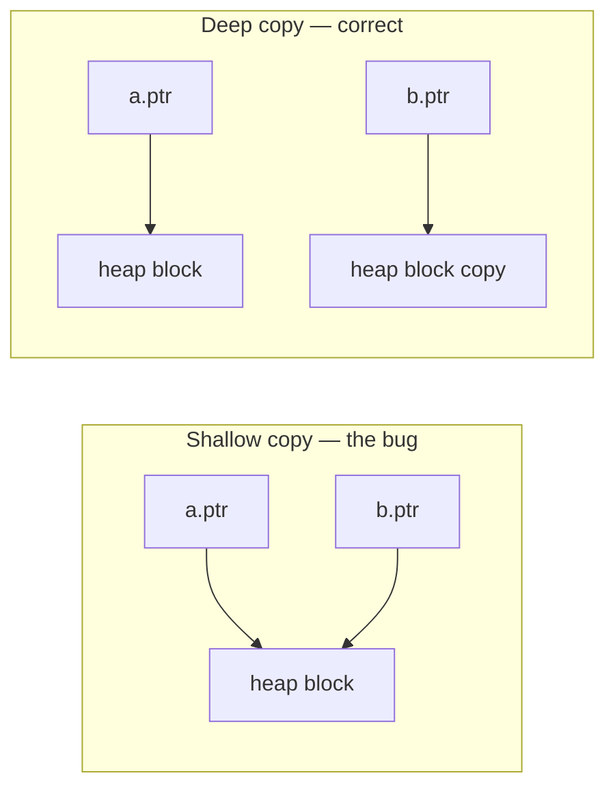

# Special Member Functions and Resource Management

The script introduces the copy constructor, assignment operator, move
constructor, move assignment and destructor in separate sections. They are not
separate topics. They are five answers to **one** question:

> When an object owns something through a pointer, what happens to that something
> when the object is copied, moved, or destroyed?

If a class owns no resources, the compiler-generated versions are correct and you
write none of them. The moment a raw pointer member appears, all five become your
problem at once.

## The five



| Function | Parameter | What it does with the pointee | Cost |
|---|---|---|---|
| [[concepts/copy-constructor]] | `const T&` | allocates new storage, copies content | O(size) |
| [[concepts/assignment-operator]] | `const T&` | copies content into *existing* storage, returns `*this` | O(size) |
| Move constructor | `T&&` (non-const) | takes the source's pointer, nulls the source | O(1) |
| Move assignment | `T&&` (non-const) | releases own, takes source's pointer, nulls source | O(1) |
| [[concepts/destructor]] | — | releases the resource | O(size) |

See [[concepts/move-semantics]] for the move pair and
[[concepts/value-categories]] for why the parameter types differ.

## Why the parameter types are what they are

The copy versions take `const T&` because they must not disturb the source. The
move versions take a **non-const** `T&&` precisely because they *must* disturb
it — stealing a pointer means writing `nullptr` back into the source. A `const`
rvalue reference would make moving impossible.

This is also why `std::move` is named misleadingly: it performs no move, it is
only a `static_cast<T&&>` that makes overload resolution select the move version.
The move itself happens in the constructor or assignment operator that the cast
selects.

## The decision procedure

```
1. Does the class own a resource through a raw pointer or handle?
       no  -> write none of the five; the defaults are correct. STOP.
2. Can the ownership be expressed with a smart pointer instead?
       yes -> use unique_ptr / shared_ptr; go back to step 1.  <-- preferred
3. Otherwise, write the destructor:    release the resource.
4. Write the copy constructor:         allocate, then deep copy.
5. Write the copy assignment:          guard self-assignment, release,
                                       deep copy, return *this.
6. Write the move constructor:         take the pointer, null the source.
7. Write the move assignment:          release own, take pointer,
                                       null the source, return *this.
8. If copying should be forbidden:     = delete the copy pair.
```

Step 2 is the one the script arrives at only later, in §0.5.4: most classes
should not reach steps 3–7 at all. See [[concepts/smart-pointers]].

## The shallow-copy trap

The compiler-generated copy constructor copies the *pointer*, not the pointee.
Two objects then believe they own the same memory, and the second destructor
runs on already-freed storage.



This is the same diagram as a **move**, with one difference: after a move the
source pointer is set to `nullptr`, so exactly one owner remains. Sharing without
nulling is the bug; sharing deliberately with a reference count is
[[concepts/smart-pointers|`shared_ptr`]].

## Connection to inheritance

Everything above combines with the part I rule that a polymorphic base class
needs a **virtual destructor** ([[concepts/polymorphism]]). Resource ownership
plus inheritance is where the two sources meet: without `virtual`, deleting
through a base pointer runs only the base destructor and leaks the derived part's
resources.

## Open questions

- The script never names the "rule of three/five/zero" explicitly, though §0.4.4
  derives it in substance. Worth confirming against another source.
- Exception safety of assignment (the copy-and-swap idiom) is not covered;
  §0.4.6 treats [[concepts/exceptions]] separately from §0.4.4.
- `unique_ptr` as a class member removes the need for all five — the "rule of
  zero". The script implies this but does not state it.

## Related

- [[concepts/copy-constructor]]
- [[concepts/assignment-operator]]
- [[concepts/move-semantics]]
- [[concepts/value-categories]]
- [[concepts/smart-pointers]]
- [[concepts/destructor]]
- [[concepts/memory-model]]
- [[synthesis/oop-core-concepts]]

## Sources

- [[sources/grigat-cpp-concepts-generic]] §0.4.4.1–0.4.4.18 (Kopierkonstruktor,
  Zuweisungsoperator, Move-Semantik), §0.5.4 (Smart Pointers)
- [[sources/grigat-oop-teil1]] §0.3.2.11–0.3.2.15 (Konstruktor, Destruktor),
  §0.3.7 (Polymorphie)
